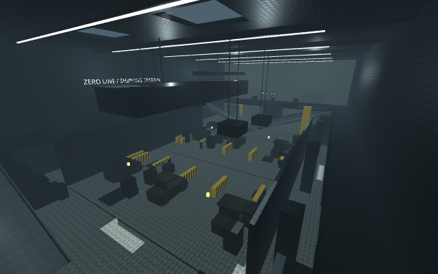

# PROJECT: ZERO-LINE

A playable first-person survival prototype in **Godot 4.6.3**, built from the [technical design](docs/PROJECT_ZERO_LINE_TECHNICAL_DESIGN.md). Sprint, slide, wall-run, dash, slow the world, break enemy sight with Shroud, and run over recovery drops to survive ten waves and an endless continuation.

**Version 0.9 — warehouse revamp:** a 60 × 30 m multi-tier warehouse with office fallback, loading docks, four slide ramps, catwalks, wall-run lanes, mantle chains, forklift cover, and a rideable zipline. Waves change the arena; shootable crane loads and fuel barrels, pulsing electric grates, fixed resupply stations, and telegraphed breaches add tactical choices. Existing human enemies, weapons, dismemberment, and PBR surfaces remain in place.

**Try it:** enter Movement Lab and press **V** to visit nine new route checkpoints. Hold **Space** near the north catwalk zipline anchor to ride down. Start the trial to test the wave-3 obstruction, wave-6 emergency lighting, and wave-9 pit. See the [complete warehouse layout](docs/WAREHOUSE_LAYOUT.md) for the object inventory, spawn table, wave events, assumptions, and map.



Character pipeline work is available separately: [Phase 1 report](docs/CHARACTER_PIPELINE_PHASE_1.md). Run `godot --path . scenes/characters/character_review.tscn` to inspect the CC0 human bodies, five shape presets and explicit LODs. Tactical gear, textures, correctives and wound seams remain open gates; the playable test now uses a shared review soldier fallback; full role variants remain unfinished.

## Playable integration test (2026-10-26)

The real wave game now defaults to the unpolished human review model. See [playtest notes, build commands and known gaps](docs/PLAYABLE_TEST_BUILD.md). All five roles currently share a named soldier fallback; new bodies support corpse head/arm/leg cuts with tissue caps, while F9 enables legacy enemies for comparison. Windows debug/release archives are in `downloads/`.

## Play

**Godot editor:** import `project.godot` with Godot 4.6.3 and press **F6/F5** to run the main scene/project. Or, from this directory:

```sh
godot --path .
```

**Linux standalone:** run `build/linux/zero-line.x86_64`. The exported executable embeds its game data; the editor is not required. It needs a Linux x86-64 desktop with OpenGL 3.3 support.

**Browser build:** serve `build/web` over HTTP; opening the HTML as a `file://` URL will not work:

```sh
python3 -m http.server 8080 --directory build/web
```

Open the server in a desktop browser with WebGL 2, then click **Enter the Trial**. The first click captures the mouse and enables audio. Use **C** for sliding and **X** for dashing in the browser to avoid operating-system/browser Ctrl/Alt shortcuts. Escape pauses and releases the pointer. Keyboard and mouse are required in this version.

Click **Enter the Trial** or press **Enter** to start. Between waves, buy upgrades or press Enter to deploy. Clearing wave 10 unlocks endless continuation. Losing opens a results screen with instant redeployment.

Click **Movement Lab / Free Practice** to explore without waves. Three stationary targets occupy the different levels. Press **T** to place another target in front of you and refill health, armor, ability energy, magazines, ammunition reserves, and dash charges. Press **V** to cycle between nine practice checkpoints. The HUD shows movement speed and height. Practice does not submit a best score. The older route documents describe the previous arena; use the [warehouse layout](docs/WAREHOUSE_LAYOUT.md) for current geometry. See the [route guide](docs/PHASE_1_MOVEMENT.md), [mantle/vault notes](docs/PHASE_2_TRAVERSAL_AND_ART.md), and [slope/elite notes](docs/PHASE_2_SLOPES_AND_ELITE.md). The command-line equivalent is `godot --path . -- --movement-lab`.

## Controls

| Input | Action |
|---|---|
| WASD / mouse | Move / look |
| Left / right mouse | Fire / aim down sights |
| Shift | Sprint |
| C or Ctrl | Slide while sprinting; crouch otherwise |
| Space | Jump; move toward cover to vault/mantle; hold in the air to catch a reachable ledge or wall-run beside a wall |
| X or Alt | Directional dash; two rechargeable charges |
| Q | Toggle Focus; world slow motion with normal player speed |
| E | Toggle Shroud; ordinary AI loses sight and searches last position |
| R / F | Reload / melee |
| 1 / 2 / 3 | Carbine / shotgun / emergency sidearm |
| Escape / Enter | Pause / resume or advance the trial |
| B in Movement Lab | Select the target type for T |
| T in Movement Lab | Place a target and refill resources |
| V in Movement Lab | Cycle through nine movement-route checkpoints |
| M / G / H in menus | Toggle audio / gore and dismemberment / camera motion |
| [ / ] in menus | Adjust mouse sensitivity |

Slide-kicks stagger enemies in front of you. Shooting or dealing melee/kick damage breaks Shroud. Focus and Shroud are mutually exclusive. Run over red bandages, cyan armor, or lime ammunition packs to recover automatically. Supplies behind solid cover cannot be collected through the wall. Full resources leave drops available; partial use retains the remainder.

## Implemented

- A 60 × 30 m warehouse with connected floor and 4.5 m catwalk/office routes, four slide ramps, mantle chains, wall-run lanes, and a zipline.
- Accelerated movement, buffered jumps, bounded air momentum, crouching/sliding, slide-kicks, wall-running, and swept directional dashes.
- Collision-checked mantles up to 1.85 m above your feet and vaults across shallow cover up to 1.4 m high. Focus preserves traversal speed, and weapons remain usable.
- Five authored industrial mesh types with shared PBR atlases, normal maps, roughness/metallic/AO maps, mipmaps, and compressed texture imports. Original creators and modifications are credited in the [third-party notices](THIRD_PARTY_NOTICES.md).
- Hitscan primary weapons, muzzle obstruction checks, ADS, recoil, reload stages, finite primary reserves, and an infinite-reserve emergency sidearm.
- Enforcer, rusher, shield, flusher, and elite prototypes; three-dimensional grid navigation across connected levels, visible projectiles, grenade warnings, and cloak-aware visual perception.
- Ten data-driven rosters, spawn reservations and telegraphs, population caps, pressure/relief intervals, hazard resolution, credits, five purchases, and endless escalation.
- Physical health/armor/ammo drops; swept proximity queries; partial, one-time resource transactions; end-of-wave recovery.
- Title screen, combat HUD, pause controls, upgrade shop, defeat/completion results, persistent local settings and best score.
- Bounded impact particles, tracers, six-part articulated ragdolls, and original synthesized placeholder audio. At most six corpses simulate at once; ten are retained, and bodies freeze after six world seconds.

## Current limits

This prototype does not yet contain hand-keyed skeletal weapon animation, a separate chamber-round simulation, chamber checks, executions, destructible cover, localized persistent wound decals, elite scanners, controller support, or an in-game rebinding UI. The three weapons now use separate authored meshes and a four-bone glove/sleeve rig; detailed finger animation and full hand-keyed clips remain unfinished. Enemy armor is represented by aggregate health except for directional shield blocking. Enemies use ramps between floors; the jump ledges, upper gap landing, and low slide tunnel remain player-only shortcuts. Ragdolls use box proxies and pin joints without anatomical angular limits; they collide with the world but do not obstruct the player or other corpses.

The director uses bounded population, attack windups, and timed relief rather than the full adaptive pressure estimator in the design. Purchase tuning is intentionally simpler than the production attachment system. Effects are capped but not yet pooled. Damage/pickup resolution follows Godot node tick order, rather than the proposed substep timestamp event queue. A full difficulty/playability study is still needed. No 144 FPS claim has been validated.

## Development and validation

```sh
# Execute component + physics integration checks; nonzero exit on failure.
bash tools/test.sh

# Import/check the project.
godot --headless --editor --path . --import --quit

# Install the matching official Godot export templates, then build.
bash tools/build.sh
```

`GODOT_BIN` can select a different Godot executable for helper scripts. Tests cover wave rosters, armor overflow, pickup eligibility/partial use/sweeps/occlusion, Focus timing and movement compensation, Shroud perception, interrupted reload conservation, actual firing traces, death/reward deduplication, shop transactions, pause, navigation, and restart cleanup.

In a restricted cloud shell, direct Godot's writable user directories into a permitted location:

```sh
mkdir -p /tmp/zero-line/{cache,data,config}
XDG_CACHE_HOME=/tmp/zero-line/cache \
XDG_DATA_HOME=/tmp/zero-line/data \
XDG_CONFIG_HOME=/tmp/zero-line/config \
godot --headless --path . --script tests/smoke.gd
```

See [prototype status](docs/PROTOTYPE_STATUS.md) for the validation record and next development priorities. Generated builds, editor caches, and test captures are ignored by Git. Source assets and balance data are retained.

## Project map

| Path | Responsibility |
|---|---|
| `scripts/game.gd` | Run state, director, rewards, upgrades, effects, persistence |
| `scripts/player.gd` | Movement, weapon transactions, reloads, abilities, player attributes |
| `scripts/weapon_view.gd` | Multipart weapon models, skeletal arm poses, sight/muzzle sockets and casings |
| `scripts/traversal.gd` | Ledge probes, vault/mantle routes, swept movement, and cancellation |
| `scripts/industrial_art.gd` | Shared PBR materials and fitted authored model instances |
| `scripts/operator_visual.gd` | Four armored enemy skins, procedural skeletal poses, and corpse bindings |
| `scripts/enemy.gd` | Enemy navigation, perception, attacks, damage |
| `scripts/projectile.gd` | Swept enemy projectiles, grenades, explosions |
| `scripts/pickup.gd` | Physical drop presentation and resource transactions |
| `scripts/arena.gd` | Arena construction and obstacle-aware AI grid |
| `scripts/ragdoll.gd` | Articulated corpse physics and settling |
| `scripts/hud.gd` | Scalable interface and mouse hit targets |
| `scripts/sound.gd` | Procedural placeholder audio and voice limits |
| `data/trial_balance.json` | Weapon, enemy, and wave tuning |
| `tests/smoke.gd` | Automated gameplay/physics regression checks |
| `tests/phase1.gd` | Three-tier navigation, real traversal, and ragdoll checks |
| `tests/traversal.gd` | Mantle/vault collision, input, timing, pause, and lifecycle checks |
| `tests/industrial_art.gd` | Imported model/material integration and collision alignment |

The engine, its dependencies, and the industrial art have their own licenses. See [third-party notices](THIRD_PARTY_NOTICES.md). No assets from Trepang2 or Call of Duty are included.
