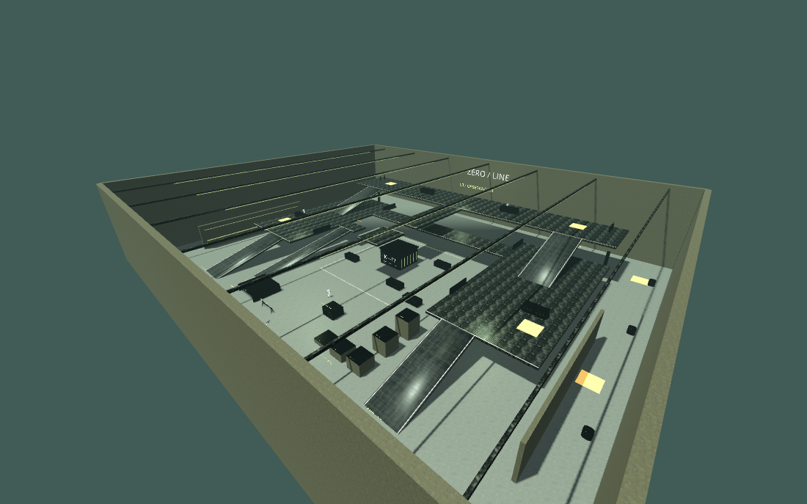

# ambientCG materials installed

Current preference: ambientCG is retained on arena/environment props only. Character and first-person materials use their original source textures and colors; weapon, sleeve, glove and clothing overrides described in the earlier table below have been removed.

The nine user-supplied archives are imported at native resolution: eight 1K sets and Concrete034 at 2K. Original channel files and archive hashes are recorded in assets/ambientcg/*/provenance.json. OpenGL normals, mipmaps and packed linear ORM are used. No source image is upscaled.

| Set | Runtime application |
|---|---|
| Concrete013 | Generic concrete surfaces |
| Concrete047A | Arena walls |
| Concrete034 | Main floor |
| Metal029 | Structural steel, weapon metal, cylinders and drums |
| CorrugatedSteel005 | Painted-metal/utility wall panels |
| DiamondPlate008C | Slide ramps and anti-slip surfaces |
| Plastic006 | Cargo props and weapon polymer |
| Leather026 | Named leather/glove first-person material slots |
| Fabric019 | First-person sleeves; additional normal detail on existing enemy clothing materials |

Enemy UV-specific color maps are retained. Skin, wound, tissue and blood textures remain authored: these packs contain no biological replacements. The additional ally_mex characters still require rig/atlas/gore integration and are not activated by this material update. Leather binding is based on imported material slot names; this is not a full rebake of every boot or glove.

Native Compatibility arena capture inspected after correcting overbright concrete and disabling excessive normal intensity. This is a software-rendered overview, not target-GPU performance or close-up approval of every surface. Gameplay regression: 47/47. Windows exports are generated but cannot be executed here; Linux exported smoke checks animation, gore and startup.



# Earlier intake notes (superseded by installed sets above)

Requested scope: arena, props, weapons, character clothing/gear, skin and gore. No ambientCG images have been downloaded or installed yet. HTTPS requests to ambientcg.com, its API, docs.ambientcg.com and the official acg-download.struffelproductions.com host all returned tunnel 403 errors in this environment on 2026-10-27. The current playable build therefore retains its existing textures.

Upload original ambientCG 2K material ZIPs with Color, NormalGL (preferred), Roughness, and AO/Metalness when provided. PNG or JPG packs are supported. Useful material categories for this game are concrete floor/wall, worn metal, painted metal, anti-slip metal, woven fabric, leather and rubber/polymer. Catalog IDs have not been invented or selected without access to the catalog.

| Surface group | Planned use | Preserve |
|---|---|---|
| Arena floors / walls | Concrete and industrial floor PBR sets, physically sized tiling | Geometry, collision, routes and markings |
| Ramps / galleries / gantries | Metal / anti-slip sets with OpenGL normals and correct metallic masks | Traversal geometry and hazard contrast |
| Cargo / drums / barriers | Material-specific overlays or rebaked atlas regions | Existing prop UV-specific AO, labels and emissive parts |
| Weapon receivers / barrels | Steel / finish detail selected by existing material slots | Weapon mechanics, wear masks and moving parts |
| Weapon grips / gloves | Polymer / rubber / leather detail | Dielectric metallic=0, grip geometry and seams |
| Enemy fatigues / carriers / webbing | Fabric weave and roughness detail through masks | Authored folds, patches, camo and source normal maps |
| Faces / skin / wounds / tissue | Requires suitable biological source maps, not an unrelated surface substitution | UV-specific anatomy, wound opacity/height, cavity/blood masks |

"Everything" is a scope commitment, not a claim that ambientCG has an appropriate anatomical map for every surface. Skin, wound and organ art remains authored until suitable replacement assets are available. The new ally_mex soldiers are audited separately; their material/rig optimization and gore adaptation must precede runtime replacement.

## Importer ready for uploaded packs

```
python tools/materials/import_ambientcg.py /path/to/Concrete042_2K-JPG.zip --asset-id Concrete042
python tools/materials/test_import_ambientcg.py
```

The asset ID above illustrates filename syntax, not a verified selection/download. Outputs go to `assets/ambientcg/<asset-id>/`: albedo, OpenGL normal, packed ORM and optional height. Color stays color data; ORM/normal/height are linear data in shaders. NormalGL takes precedence; when only NormalDX exists, green is inverted. Missing AO defaults to white and missing metallic to zero, both recorded. `--default-metallic 1` is explicit and intended only for a verified all-metal source. 16-bit scalar maps are converted to 8-bit using the full 0–65535 range. Inputs must match dimensions; ambiguous or missing required maps fail. Existing output folders are never silently overwritten.

The importer records the input archive/map hashes, declared ambientCG source URL, licensing reference, channel conversions, constants and output hashes. It does not authenticate user-supplied archives against the blocked catalog, activate any runtime override, or claim synthetic test images are ambientCG assets.

Tests pass for GL preference, DX conversion, ORM channel order/defaults, 16-bit height range, incomplete-set rejection and overwrite protection. Once actual packs arrive: inspect maps, configure mipmaps and physical tiling, bind material slots/atlases, capture neutral and arena lighting, and export the playable update. No visual or performance approval is possible before those assets are present.
