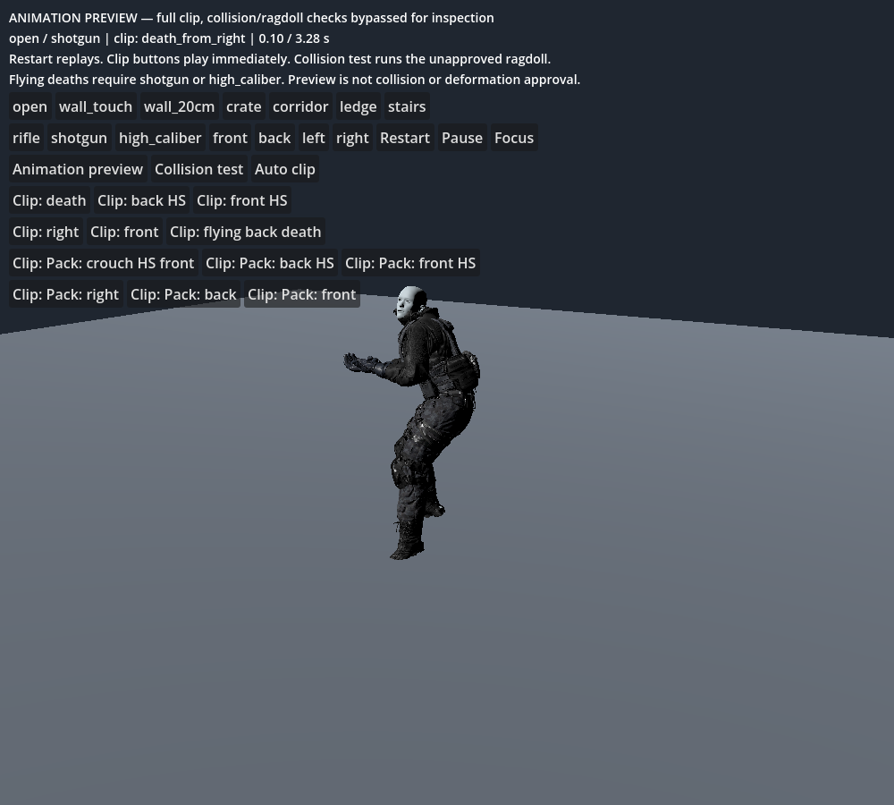
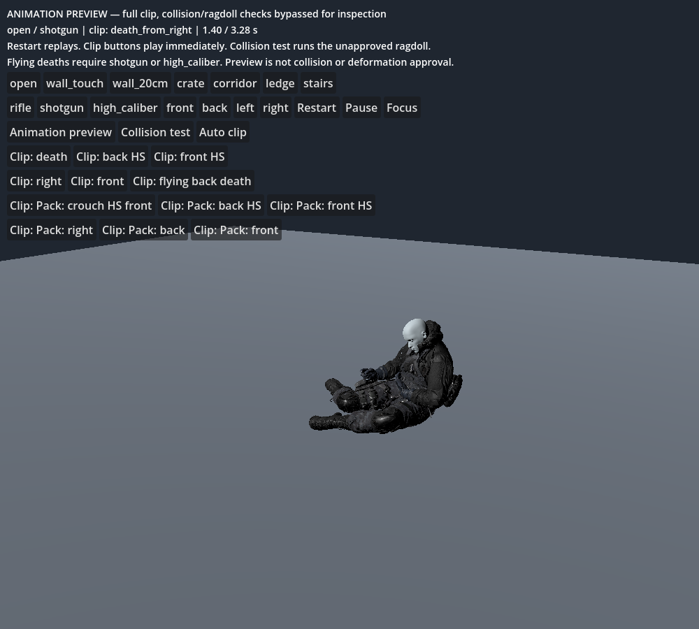
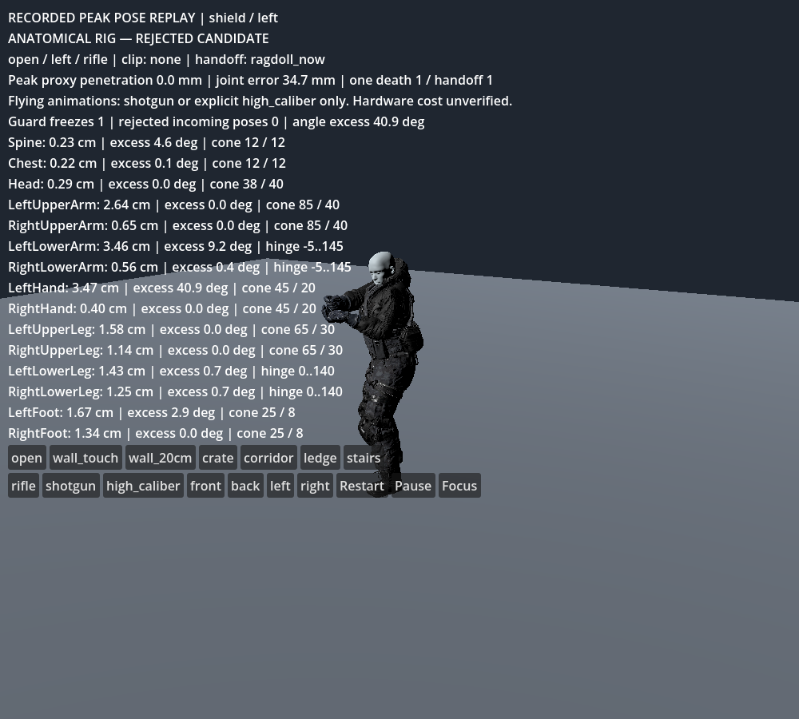
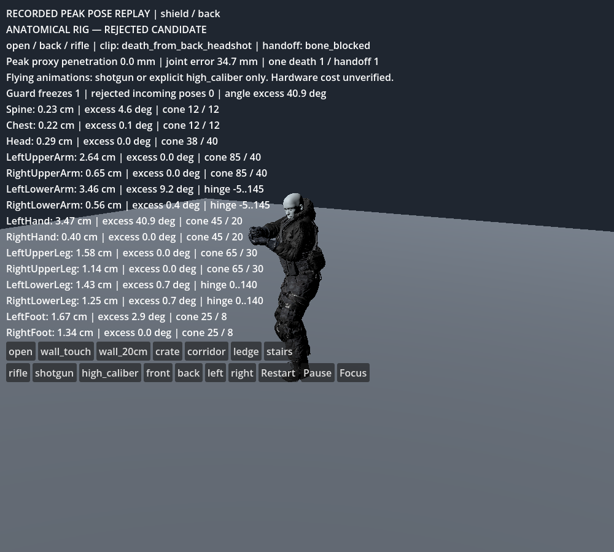
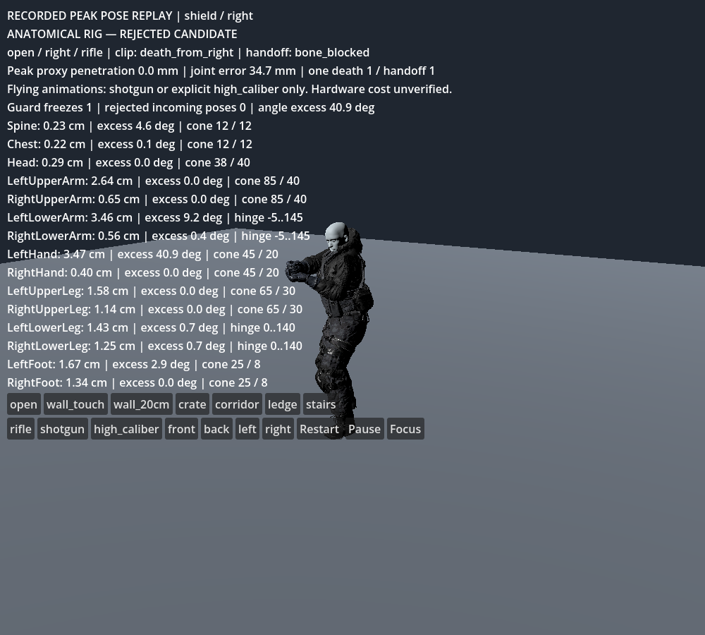

# Anatomical ragdoll candidate — REJECTED

2026-10-23. Godot 4.6.3 official (`7d41c59c4`), Jolt. This is a separate experimental review. The previous death-handoff review and playable game are unchanged. This does **not** complete the supplied requirements.

**Latest results:** [Ground-contact and handoff revision](GROUND_HANDOFF_REVIEW.md). Earlier matrices below and in the hinge report are historical baselines; the overall rig is still unapproved.

## Playback fix — 2026-10-23

The previous download defaulted directly to collision-aware death selection. Clearance could reject all candidates, and floor contact could interrupt a selected clip before visible motion. The failed ragdoll guard then froze the pose. Changing the scenario did restart the test, but did not provide a usable animation preview.

The review now defaults to **Animation preview**. Each of the 12 death clips has a button; selecting one replays the full authored motion without clearance interruption or ragdoll handoff. **Restart** and scenario changes replay the selection. Direction buttons return to automatic directional selection. Switching to rifle disables flying clips and falls back to an eligible clip. **Collision test** explicitly restores collision-aware selection and the existing unapproved ragdoll behavior. Selecting an individual clip returns to preview mode. Preview may pass through obstacles: it does not certify collision, skinning or ragdoll quality.

`tools/ragdoll/test_preview.gd` emits the actual button signals: all 12 clips change 71 bone transforms and reach their end; all seven scenarios start playback; pause/restart resumes; rifle disables flying; collision mode receives exactly one lethal presentation event. Native screenshots at 0.1, 0.8 and 1.4 seconds of `death_from_right` were captured and inspected, showing different poses. Software-rendered captures are not performance evidence.





## Result and scope

Twenty rifle cases (five mass profiles × four hit directions), 180 ticks each at 60 Hz: **0/20 accepted** under the new criteria. All 20 reached exactly one presentation handoff. Rest-pose collider audit: **16 bodies, zero overlapping pairs** in native Jolt shape queries with zero query margin. Three earlier overlaps were removed by using pelvis/abdomen boxes and toe-aligned foot capsules.

These are five gear-mass profiles on the same review soldier, not five approved role meshes. No live loot/score/wave integration was changed or tested. No gameplay RNG is used. Player layer 2 remains excluded: world 1, props 4, corpse 16; corpse/query mask 21. Six full ragdolls and 18 corpse slots remain inherited from the isolated controller. LITE still uses seven bodies, now with 16 compound shapes; its mass aggregation and performance have not been certified for this candidate.

The imported hold reference needed explicit neutral-twist offsets: right shoulder −90°, right ankle +15°. These offsets leave all anatomical limits unchanged and are stored in settings. After calibration, all 20 cases retained a valid initial guard snapshot (previously none did). This is a hold-reference calibration, not certification across every death clip. The peak separation remains 34.69 mm, angular excess 40.93°, and sampled skin stretch 23.42%. All cases still invoke the emergency guard and fail acceptance.

An Enforcer/left diagnostic identifies the left wrist at 34.24 mm separation and 40.69° excess. Removing the animation blend leaves those two peaks unchanged; that experiment was reverted. The guard now restores a measured last-valid pose, but it can visibly rewind or freeze upright/in air. This is diagnostic containment, not approved death behavior.

## Native backend verification

`tools/ragdoll/check_api.gd` checks PhysicalBone3D properties and hinge fields against the installed ClassDB. `check_backend.gd` constructs actual Jolt joints, sets parameters, reads them back and records native unsupported-setting warnings. Results:

| Parameter | Set | Read back | Accepted by backend |
|---|---:|---:|---|
| CONE_TWIST_JOINT_SWING_SPAN | 0.6 | 0.6000 | True |
| CONE_TWIST_JOINT_TWIST_SPAN | 0.4 | 0.4000 | True |
| CONE_TWIST_JOINT_BIAS | 0.9 | 0.3000 | False |
| CONE_TWIST_JOINT_SOFTNESS | 0.2 | 0.8000 | False |
| CONE_TWIST_JOINT_RELAXATION | 0.5 | 1.0000 | False |
| HINGE_JOINT_LIMIT_LOWER | -0.1 | -0.1000 | True |
| HINGE_JOINT_LIMIT_UPPER | 2.4 | 2.4000 | True |
| HINGE_JOINT_BIAS | 0.9 | 0.3000 | False |
| HINGE_JOINT_LIMIT_BIAS | 0.9 | 0.3000 | False |
| HINGE_JOINT_LIMIT_SOFTNESS | 0.2 | 0.9000 | False |
| HINGE_JOINT_LIMIT_RELAXATION | 0.5 | 1.0000 | False |

Cone bias, softness and relaxation, and hinge bias/limit bias/softness/relaxation are ignored. The candidate does not tune them. It uses supported limits, body damping, bounded velocity transfer and a measured guard instead. Readback confirms accepted parameters; it does not prove the rig stays inside them. The source audit of Godot's `4.6-stable` Jolt implementation agrees with these warnings; fetching the installed short commit from upstream returned 404, so exact-build confirmation relies on the runtime probe, not an invented source match.

No additional project settings were changed. The isolated review still has Jolt slop 0.002 m, velocity steps 20 and position steps 32 from the prior build. No target-hardware ms cost is claimed. The native capture environment uses llvmpipe/Compatibility; hardware GPU/frame-time acceptance remains unavailable.

## Body masses and gear

Dempster-style input sums to exactly 100%: head/neck 8%; each upper arm 2.8%, forearm 1.6%, hand 0.6%, thigh 10%, shin 4.7%, foot 1.5%; trunk 49.6% split chest 18%, abdomen 14%, pelvis 17.6%. Base mass is 80 kg. Gear adds to chest, pelvis/belt and head respectively: Rusher 2/2/0, Enforcer 8/3/1, Shield 15/5/2, Flusher 5/3/1, Elite 11/3.5/1.5 kg. These are explicit design assumptions, not weighed supplied assets.

| Body | Base kg | Rusher | Enforcer | Shield | Flusher | Elite |
|---|---:|---:|---:|---:|---:|---:|
| Hips | 14.08 | 16.08 | 17.08 | 19.08 | 17.08 | 17.58 |
| Spine | 11.20 | 11.20 | 11.20 | 11.20 | 11.20 | 11.20 |
| Chest | 14.40 | 16.40 | 22.40 | 29.40 | 19.40 | 25.40 |
| Head | 6.40 | 6.40 | 7.40 | 8.40 | 7.40 | 7.90 |
| LeftUpperArm | 2.24 | 2.24 | 2.24 | 2.24 | 2.24 | 2.24 |
| RightUpperArm | 2.24 | 2.24 | 2.24 | 2.24 | 2.24 | 2.24 |
| LeftLowerArm | 1.28 | 1.28 | 1.28 | 1.28 | 1.28 | 1.28 |
| RightLowerArm | 1.28 | 1.28 | 1.28 | 1.28 | 1.28 | 1.28 |
| LeftHand | 0.48 | 0.48 | 0.48 | 0.48 | 0.48 | 0.48 |
| RightHand | 0.48 | 0.48 | 0.48 | 0.48 | 0.48 | 0.48 |
| LeftUpperLeg | 8.00 | 8.00 | 8.00 | 8.00 | 8.00 | 8.00 |
| RightUpperLeg | 8.00 | 8.00 | 8.00 | 8.00 | 8.00 | 8.00 |
| LeftLowerLeg | 3.76 | 3.76 | 3.76 | 3.76 | 3.76 | 3.76 |
| RightLowerLeg | 3.76 | 3.76 | 3.76 | 3.76 | 3.76 | 3.76 |
| LeftFoot | 1.20 | 1.20 | 1.20 | 1.20 | 1.20 | 1.20 |
| RightFoot | 1.20 | 1.20 | 1.20 | 1.20 | 1.20 | 1.20 |
| **Total** | **80.00** | **84.00** | **92.00** | **102.00** | **89.00** | **96.00** |

The requested fractions and a universal 3:1 neighbor ratio are incompatible: bare chest/upper-arm is 14.4/2.24 = 6.43:1 before gear. Full exception list is in `mass_report.json`; no mass is silently redistributed. Gear increases shoulder ratios and can also put chest/head above 3:1. A future clavicle/shoulder-chain proxy may reduce solver ratios, but would add bodies and require a new budget/skin audit.

## Collider numbers (meters)

Capsule height includes hemispheres. All centers, shape dimensions and physical parents are in `rest_geometry_report.json`. Geometry is fitted physics proxies, not replacement character art. Dynamic penetration remains unapproved despite the rest-space pass.

| Body | Shape | Dimensions | Rest center |
|---|---|---|---|
| Chest | CapsuleShape3D | radius 0.1200, height 0.2931 | -0.0000, 1.3857, -0.0140 |
| Head | SphereShape3D | radius 0.0900, height 0.1800 | -0.0000, 1.7329, -0.0280 |
| Hips | BoxShape3D | [0.200000002980232, 0.0799999982118607, 0.140000000596046] | 0.0000, 1.0127, 0.0000 |
| LeftFoot | CapsuleShape3D | radius 0.0250, height 0.1239 | 0.1130, 0.0936, 0.1336 |
| LeftHand | CapsuleShape3D | radius 0.0350, height 0.0960 | 0.7286, 1.5622, 0.0140 |
| LeftLowerArm | CapsuleShape3D | radius 0.0350, height 0.2162 | 0.5935, 1.5022, 0.0140 |
| LeftLowerLeg | CapsuleShape3D | radius 0.0450, height 0.3602 | 0.1130, 0.3187, 0.0562 |
| LeftUpperArm | CapsuleShape3D | radius 0.0450, height 0.2094 | 0.3275, 1.5022, 0.0140 |
| LeftUpperLeg | CapsuleShape3D | radius 0.0650, height 0.3539 | 0.1130, 0.7650, 0.0562 |
| RightFoot | CapsuleShape3D | radius 0.0250, height 0.1239 | -0.1130, 0.0936, 0.1336 |
| RightHand | CapsuleShape3D | radius 0.0350, height 0.0960 | -0.7286, 1.5622, 0.0140 |
| RightLowerArm | CapsuleShape3D | radius 0.0350, height 0.2162 | -0.5935, 1.5022, 0.0140 |
| RightLowerLeg | CapsuleShape3D | radius 0.0450, height 0.3602 | -0.1130, 0.3187, 0.0562 |
| RightUpperArm | CapsuleShape3D | radius 0.0450, height 0.2094 | -0.3275, 1.5022, 0.0140 |
| RightUpperLeg | CapsuleShape3D | radius 0.0650, height 0.3539 | -0.1130, 0.7650, 0.0562 |
| Spine | BoxShape3D | [0.180000007152557, 0.0799999982118607, 0.119999997317791] | -0.0000, 1.1351, 0.0000 |

## Articulation, impact and guard

- Pelvis–abdomen–chest cones: 12° swing / 12° twist. Head: 38° / 40°. Shoulder: 85° / 40°. Wrist: 45° / 20°. Hip: 65° / 30°. Ankle: 25° / 8°.
- Elbows: hinge −5° to 145°. Knees: hinge 0° to 140°. The hinge axis is derived from the incoming upper/lower segment plane; this removes incoming off-axis pose error from the hinge frame but does **not** validate whether an authored pose bends anatomically forward. Directional extreme-pose validation is still required.
- PhysicalBone3D derives its parent frame when rebuilding a joint. The candidate temporarily aligns frames before a physics step, then restores the captured bodies, preserving flexion rather than treating every death pose as zero flexion. Helper-bone shoulder/neck translations are included in captured pivot placement. Right shoulder/ankle neutral-twist offsets repair the initial hold reference; dynamic wrist/chain stability still fails.
- Neighbor exclusions: pelvis–abdomen, pelvis–each thigh, abdomen–chest, chest–head, chest–each upper arm, each upper arm–forearm–hand, each thigh–shin–foot. All other ragdoll pairs can collide. Exact 15-pair list is repeated in each result. The root movement capsule excludes its own physical bodies.
- Gravity scale 1.4, friction 0.9, bounce 0.02. Damping holds linear 0.2 / angular 2.0 for 0.3 s, then linearly ramps to 0.5 / 5.0 by 1.5 s. Solver-space units match Godot's damping coefficients.
- Animation transfer clamps to 5 m/s and 8 rad/s. Hit impulse is clamped to total 160, distributed by `mass / max(distance, 0.25 m)`, then clamped to 5 m/s delta-v per body. The event adapter must provide `hit_position`; the review's zero-impulse rifle tests do not validate explosive distribution. Hard per-tick caps are 12 m/s and 25 rad/s. CCD remains enabled on all bodies, including head/hands/feet; thin-wall acceptance has not run.
- Every simulating tick measures anchor separation and angular excess. Above 1 cm it boosts body angular damping for six ticks and clamps relative linear velocity to 0.5 m/s while preserving pair momentum. Jolt has no honored per-joint damping parameter exposed here; body damping is the declared substitute.
- Above 2.5 cm or 10° excess for three ticks, restore a last-valid snapshot. If none exists, reject the incoming pose and hold it as described above. Snapshots require <=1 cm anchor separation, <=5° angular excess and <=2 cm proxy penetration. This guard catches errors; it does not make their pre-freeze peaks pass acceptance.
- Automatic sleep/settle inherits the supported-contact/quiet check. Seven seconds is a timeout attempt, not a guarantee that a clear supported pose exists. Emergency guard freezes deliberately follow a different fail-closed policy and may freeze in air.

## Measured matrix

Separation is cm; angular excess is degrees; skin is sampled edge length/rest length outside existing corrective zones. 152 body edges were sampled every 15th tick in each case. This is a sparse CPU skin check, not exhaustive cloth/gear clipping or GPU corrective validation. Ratios include underlying covered skin. Peaks during unsampled frames can be worse.

| Mass profile | Direction | Max separation cm | Angle excess ° | >5° ticks | Skin ratio | Max speed m/s | Max spin rad/s | Guard µs/tick | Pass |
|---|---|---:|---:|---:|---:|---:|---:|---:|---|
| rusher | front | 3.363 | 40.37 | 2 | 1.234 | 0.690 | 10.590 | 375.0 | NO |
| rusher | back | 3.363 | 40.37 | 2 | 1.234 | 0.690 | 10.587 | 404.2 | NO |
| rusher | left | 3.363 | 40.37 | 2 | 1.234 | 0.690 | 10.587 | 417.8 | NO |
| rusher | right | 3.363 | 40.37 | 2 | 1.234 | 0.690 | 10.587 | 736.8 | NO |
| enforcer | front | 3.424 | 40.69 | 2 | 1.234 | 0.689 | 10.772 | 380.4 | NO |
| enforcer | back | 3.424 | 40.69 | 2 | 1.234 | 0.689 | 10.771 | 433.0 | NO |
| enforcer | left | 3.424 | 40.69 | 2 | 1.234 | 0.689 | 10.770 | 352.6 | NO |
| enforcer | right | 3.424 | 40.69 | 2 | 1.234 | 0.689 | 10.771 | 372.2 | NO |
| shield | front | 3.469 | 40.93 | 2 | 1.234 | 0.689 | 10.953 | 500.2 | NO |
| shield | back | 3.469 | 40.93 | 2 | 1.234 | 0.689 | 10.958 | 481.2 | NO |
| shield | left | 3.469 | 40.93 | 2 | 1.234 | 0.689 | 10.956 | 370.8 | NO |
| shield | right | 3.469 | 40.93 | 2 | 1.234 | 0.689 | 10.958 | 352.4 | NO |
| flusher | front | 3.397 | 40.55 | 2 | 1.234 | 0.690 | 10.715 | 1499.2 | NO |
| flusher | back | 3.397 | 40.55 | 2 | 1.234 | 0.690 | 10.705 | 355.6 | NO |
| flusher | left | 3.397 | 40.55 | 2 | 1.234 | 0.690 | 10.703 | 432.0 | NO |
| flusher | right | 3.397 | 40.55 | 2 | 1.234 | 0.690 | 10.705 | 500.8 | NO |
| elite | front | 3.445 | 40.81 | 2 | 1.234 | 0.689 | 10.849 | 367.6 | NO |
| elite | back | 3.445 | 40.81 | 2 | 1.234 | 0.689 | 10.848 | 442.2 | NO |
| elite | left | 3.445 | 40.81 | 2 | 1.234 | 0.689 | 10.849 | 458.2 | NO |
| elite | right | 3.445 | 40.81 | 2 | 1.234 | 0.689 | 10.848 | 453.8 | NO |

Guard timings are CPU diagnostics for this function only. They exclude skin-probe, solver, renderer and capture work; they do not satisfy the requested total frame-cost budget. Runs last three seconds, so sleep time, seven-second expiry and post-settle variance are not certified. Frozen flags include guard intervention, not natural sleep.

## Captures

The capture script selects the three largest joint-separation rows from the headless report, then runs each case natively and replays its recorded peak-separation pose for capture. These are labeled pose replays, not uninterrupted simulation frames. Native values can differ. These images were inspected; none is a visual acceptance pass.







## Run

Use the separate `zero-line-anatomical-ragdoll-review.zip`, open `project.godot` in Godot 4.6.3 and press F5. It opens in **Animation preview**. **Collision test** displays **REJECTED CANDIDATE** and the per-joint limits/separation overlay. The prior death-handoff ZIP remains unchanged.

```sh
godot --headless --path . --script tools/ragdoll/check_api.gd
godot --headless --path . --script tools/ragdoll/check_backend.gd
godot --headless --path . --script tools/ragdoll/audit_rig.gd
godot --headless --fixed-fps 60 --path . --script tools/ragdoll/test_rig.gd
godot --fixed-fps 60 --path . --script tools/ragdoll/capture.gd
```

Backend warnings are intentional audit evidence. The matrix writes failures and currently exits normally: inspect each `pass` field. Do not treat process exit alone as acceptance.

## Acceptance checklist and remaining production work

- [x] Actual installed ClassDB/backend probe; ignored tuning controls identified.
- [x] Sixteen-body candidate, computed mass profiles, anatomical hinge/cone settings in JSON + Resource.
- [x] Zero rest-pose collider overlaps measured; explicit neighbor exclusions.
- [x] Damping curve, transfer caps, separation/angle monitor, numerical overlay and emergency stop.
- [x] Twenty measured prerequisite cases, sampled skin strain and three native failure captures.
- [ ] <=1 cm separation, angular-duration and <=10% skin-stretch limits. **Rejected.**
- [ ] Shoulder/forearm/thigh twist calibration and new extreme-pose corrective shapes; exhaustive clothing-shell measurements on ragdoll poses.
- [ ] Partial non-lethal ragdoll, severed-joint ownership/caps and child-chain idempotence integration. Existing gameplay/gore paths were not modified.
- [ ] Every role's actual assets, every authored death handoff, shotgun/explosion 2 m/5 m, fall 5 m, stairs, wall pin, moving props, colliding bodies, six-body-density matrix, 2 cm thin wall, full/LITE CPU cost, radius/sleep/jitter metrics.

The expanded stress matrix is deferred because the basic incoming-pose/skin prerequisites already fail; no broader approval is inferred. This is not evidence that Jolt cannot support the requested result. The next viable approach is to calibrate the wrist and remaining bind/neutral frames against the actual imported animation rig, author corrective shapes for that finite allowed pose set, then rerun these prerequisites before expanding the stress matrix. Keep the prior controller isolated until that passes; merely adding iterations or widening limits would conceal the incompatibility.

## Five likeliest failure points and tests

1. **Joint reference calibration across clips.** Log per-joint angles before the first solver tick for hold and every authored handoff; reject candidates before simulation, calibrate mirrored shoulder frames and repeat.
2. **No valid guard snapshot.** Inject known safe and unsafe poses, then separate an anchor by 3 cm for three ticks; verify last-valid restore, rejection fallback, pose delta and exactly one handoff independently.
3. **Skin/cloth distortion within allowed motion.** Sample all body/garment edges and shell intersections at each joint extreme; measure corrective regions separately and verify wound seams remain unchanged.
4. **Non-neighbor self-contact or thin-wall tunneling.** Test forearm–torso/shin–shin, dynamic collider fit and a 2 cm wall at velocity caps. Rest-space non-overlap alone is insufficient.
5. **Freeze, budget or gameplay regression.** Run >8 s at six full plus LITE fallback, record sleep/jitter and corpse eviction, then compare seeded live gore modes for identical kills/rewards. Hardware profiling must include the solver and rendering, not only guard timers.
