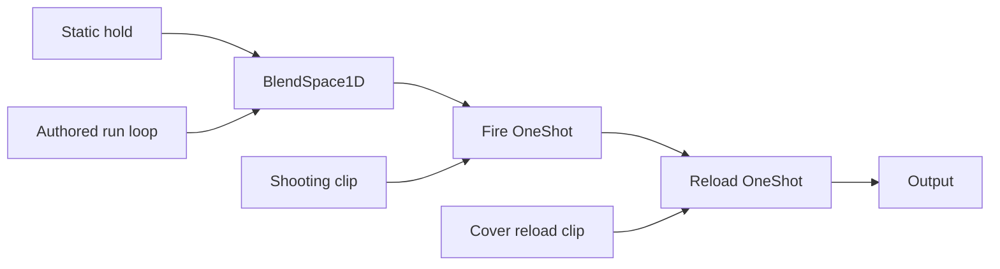

# Animation integration — first authored-motion checkpoint

Godot **4.6.3**, Blender **4.3.2**. Phase 1 remains unaccepted. The user authorized starting animation integration; this isolated review exposes deformation failures before replacing the current live enemy presentation. `enemy.gd`, `operator_visual.gd`, movement, damage, wave/director, drops and attack timing are unchanged. The main game's old procedural rig is still active; this new review contains no procedural gait.

## Implemented pipeline

Eight user-supplied ActorCore FBXs are converted to glTF 2.0, retaining authored animation. `source_manifest.json` records source paths, SHA256 hashes, clip lengths and source bone counts. The source is a 101-bone skeleton. `actorcore_bone_map.tres` uses `SkeletonProfileHumanoid`; the target has its existing humanoid BoneMap. Godot's native importer applies bone renaming, overwrite-axis retargeting, silhouette correction and normalized position tracks on **review copies** of the body and clothing. Existing production-candidate imports are unchanged.

The native import options were verified against Godot 4.6's `editor/import/3d/post_import_plugin_skeleton_rest_fixer.cpp`; runtime APIs were checked through ClassDB in 4.6.3. In that importer, retarget method `1` means Overwrite Axis, `2` means Use Retarget Modifier. This implementation uses `1`, not an invented method.

After native normalization, the baker samples the original authored motion at 60 Hz. It converts mapped global rotations back into the target parent hierarchy, so the target's extra twist/helper bones do not force the source hierarchy onto the body. **55 mapped target bones** receive sampled motion; the target retains **72 bones**. Remaining helpers retain their rest relationship to their animated parents. Dedicated animated twist redistribution and corrective drivers are not delivered.

All target segment translations remain at rest except vertical Hips motion. Hips X/Z and root displacement are removed; the gameplay capsule never consumes root motion. Vertical displacement is relative to the source rest height, preserving the initial cover crouch rather than incorrectly subtracting it. No animation method, audio or arbitrary property tracks are retained. Clip durations use the source manifest, avoiding the exporter's extra frame of padding.

The body, fitted fatigues and complete carrier kit share one target skeleton. Every donor rest/name is checked before rebinding; incompatible gear fails an assertion. Carrier and clothing each use their existing shared albedo/normal/ORM set. The body is a neutral gray deformation diagnostic, not a finished textured enemy skin. The **Gear** button exposes the body for inspection.

## Clip coverage

| Source clip | Duration | Current use |
|---|---:|---|
| Fast run start | 2.433 s | Full-clip review |
| Fast run loop | 0.633 s | Locomotion blend |
| Fast run end | 2.833 s | Full-clip review |
| Hold gun shooting | 3.933 s | Full-clip review and upper-body layer |
| Low wall reload | 4.883 s | Full-clip review and upper-body layer |
| Low gun turn left | 3.000 s | Full-clip review |
| Side shooting | 10.383 s | Full-clip review |
| Gun turn right | 2.833 s | Full-clip review |
| Extracted hold | 1.000 s loop | Static first shooting pose, **not an authored idle loop** |

These eight ActorCore clips are only part of the supplied motion intake. The larger MotionLibrary and first-person hands have not been retargeted in this checkpoint. A grenade file exists in that intake; this report does not claim it was integrated. Eight-way strafes, patrol, cover transitions, flinches, stagger, shield bash, elite dash and directional deaths are not available in this graph. Role-specific clip sets are not finished.

## Runtime graph and exact timing

`character_animation.gd` receives a target skeleton, shared AnimationLibrary and a typed AnimationProfile Resource with JSON export. Its AnimationTree uses:



Locomotion blend is `clamp(speed / 5 m/s, 0, 1)`, approaching its target over 0.15 s. Shooting fades in/out over 0.06/0.12 s; reload uses 0.12/0.18 s. Both layers filter Spine and its descendants, preserving pelvis and legs. Reload has priority because it is later in the graph. These are filtered replacement layers, **not additive hit reactions**. Start/stop and turn clips are manually inspectable; they are not wired as automatic locomotion transitions.

AnimationTree and AnimationPlayer both use manual advancement. The caller supplies world-scaled delta exactly once. Zero delta freezes the pose; the review Focus button passes `delta * 0.2`. The playback component has no gameplay timers, RNG, health, attacks, damage calls or reward ownership. `on_attack()` only requests a cosmetic layer. The full shooting clip is not trimmed into one recoil per bullet; repeated live firing cadence is therefore **not approved**.

`capture_pose()` returns 72 global bone transforms in skeleton space. `freeze_pose()` stops playback and retains that pose. This is a handoff boundary, not a completed animation-to-Jolt ragdoll blend. Partial ragdoll, joint limits, foot IK, aim/look-at IK and wound attachment integration remain pending.

## Actual validation

- **1,429 assertions passed**, including track-type restrictions, bone-path resolution, finite sampled transforms, fixed segment translations, zero root movement, pause/scaled-time equivalence, layer activation, lower-body filter preservation and frozen-pose capture. Many assertions are per-track checks, not independent gameplay scenarios.
- **67 native Godot captures**: three poses for nine clips, run/fire layer blend and 39 source-rate run frames. Contact sheet and `run_loop.mp4` are derived from those native captures.
- Captures inspected: neutral mid-clip run, shooting, crouched reload, early/late shooting and run/fire blend. The sheet also presents all clip midpoints.
- One skeleton, **72 bones**; three character mesh surfaces/materials.
- Body **26,756 tris**, fatigues **22,999**, carrier kit **21,918**: **71,673 total**, exceeding the requested 50,000 maximum LOD0 budget by 21,673. No lower character LODs are included in this review.
- Scene rendering counter: **35 draw calls**, including UI and floor. This is not per-enemy draw cost.
- Renderer: Compatibility / **llvmpipe software rendering**. Hardware frame times, 144 FPS and GPU delta are unverified.

## Visual failures found

The carrier initially rendered white without its atlas; the correct maps are now bound. Starting crouch height was initially removed by a bad vertical baseline; the baker now preserves it relative to the rest height. Both fixes were recaptured.

Visible body-through-cloth intersections remain at shoulders, chest and hips, especially when crouching and turning. They are not concealed with a body mask. Corrective shapes, fit and weight work must be reviewed against these motions. Foot contact/sliding is not solved by preserving bone lengths. No firearm is attached, so hands do not pass weapon-contact acceptance. The assembly lacks accepted role silhouettes and final skin/head art.

No screenshots here establish all-clip deformation acceptance. These failures are the reason the new presentation has not replaced the main game's enemies.

## Run and reproduce

Extract `zero-line-animation-review.zip`, open `project.godot` with Godot 4.6.3 and press F5. Use **Run**, **Fire layer**, **Reload layer**, **Pause**, **Focus**, **Rotate** and **Gear**. Lower-row buttons preview the full source clips.

The ZIP includes converted glTF sources, mandatory `.glb.import` retarget settings, BoneMaps, the baked shared library, JSON tuning, model copies, textures, captures and tools. Keep the import settings: deleting them loses rest normalization and invalidates the baked library's target axes. `.godot` caches are excluded.

In the extracted project:

```sh
godot --headless --editor --path . --import
godot --headless --path . --script tools/animation/bake_animation_library.gd
godot --headless --path . --script tools/animation/test_animation_integration.gd
```

Original FBX conversion requires the original supplied packs; hashes and relative paths identify them. The converted glTFs are sufficient to rebuild the animation library. The repository staging helper uses the current private intake paths; it is not needed to run the archive.

## Archive verification

The 51,271,024-byte archive passed ZIP CRC and all 127 SHA256 file checks. Fresh Godot 4.6.3 import completed without script/import errors; the extracted project passed all 1,429 assertions. A native fresh-package smoke test exercised the viewer, shared 72-bone skeleton, both clothing donors and AnimationTree run playback. Its screenshot was captured and inspected; the documented clothing intersections remain visible.

## Acceptance checklist

- [x] Supplied keyframed motion converted, mapped and retargeted onto the human rig.
- [x] Shared-skeleton clothing, explicit rest checks and three material surfaces.
- [x] Native AnimationTree locomotion and filtered upper-body layers.
- [x] Manual world-time advancement; no gameplay/root-motion ownership.
- [x] Native captures, source-rate run video and automated playback checks.
- [ ] Phase 1 art acceptance and clothing/corrective deformation fixes.
- [ ] Full per-role clip list, state transitions and single-shot timing alignment.
- [ ] Aim/foot IK, weapon contact, additive hits and partial/full ragdoll handoff.
- [ ] Wound seams across animated poses, all LODs and all body variants.
- [ ] LOD0 budget, target-hardware performance and live enemy presentation rollout.

## Five likeliest failure points and how to test them

1. **Lost rest normalization:** fresh-import the archive with its `.glb.import` settings, run the baker and tests, and compare run/reload captures. Gear and body rest-name/matrix assertions must pass.
2. **Cloth penetration or joint collapse:** inspect every clip from front/back/side with Gear on/off, especially crouch, turn and run midpoints. Current shoulder/chest/hip intersections fail this test; fixed bone lengths alone do not pass it.
3. **Double time scaling or layer leakage:** run the automated pause/Focus and pelvis/leg preservation checks. Advance the controller once per world tick; never multiply Focus again inside it.
4. **Gameplay changes from presentation:** reject non-transform tracks, root translation or method events; compare damage/rewards in the main game before a future live adapter is enabled. The isolated graph cannot prove full-game parity by itself.
5. **Pose/physics or performance discontinuity:** freeze at extreme poses and compare all 72 transforms before any future Jolt handoff; then measure stable joints and frame costs on target hardware. Ragdoll transitions and hardware performance are not implemented/verified here.

This starts animation integration. It does not mark either Phase 1 or Phase 2 production-complete.
