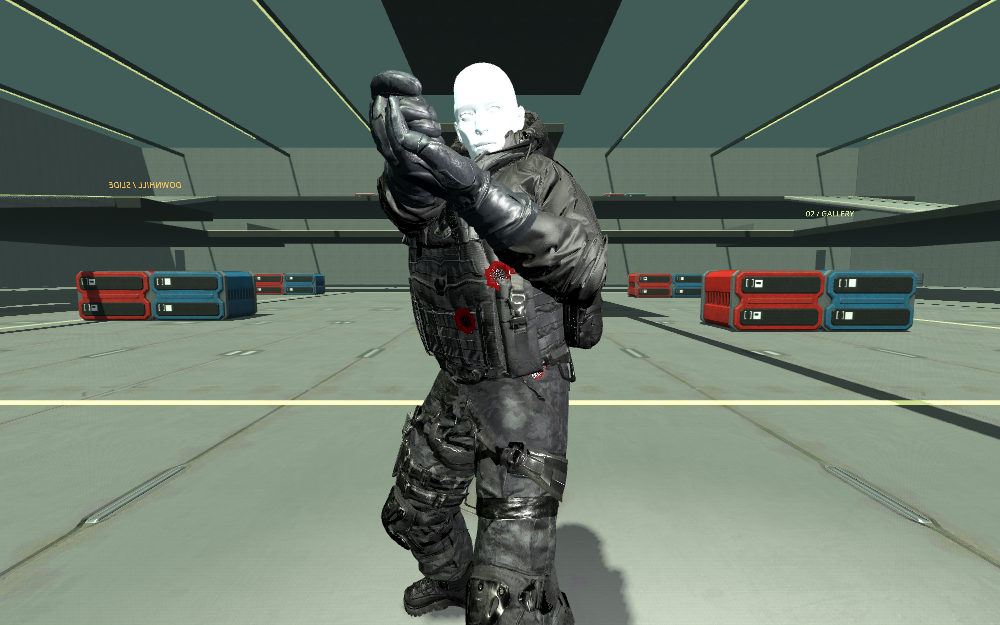

# Bone-attached bullet wounds

Replaces the chest-only flat red square. Gameplay ray results supply point, normal and shot direction through cosmetic metadata; damage, hitboxes and rewards are unchanged. Godot raycasts hit collision objects, not Skeleton3D or MeshInstance3D directly. The enemy/corpse adapter resolves the presentation actor. For a RayCast3D caller, use `wound_pool.add_from_raycast(ray, actor)`.

## Placement and rendering

`wound_pool.gd` refines the gameplay collision against the visible, posed skin/clothing using Godot 4.6.3's `MeshInstance3D.bake_mesh_from_current_skeleton_pose`, `Mesh.generate_triangle_mesh`, and `TriangleMesh.intersect_segment`. The closest intersected surface supplies position/normal. No surface means no wound. A CPU skinning fallback is used in headless tests because the dummy renderer does not register skeleton skins.

Each pooled BoneAttachment3D attaches to the closest bone segment. The visual's local transform is the inverse captured bone-world transform multiplied by the desired wound-world transform. Native decals align local +Y with the surface normal; Compatibility patches align +Z. The live-to-corpse reparent explicitly preserves attachments. Wounds on a severed bone chain are reclaimed rather than left floating; they are not transferred onto detached fragments.

Forward+/Mobile instantiate actual Decal nodes with shared albedo, OpenGL +Y normal and ORM textures. ORM is R=AO, G=roughness, B=metallic (zero). Decals project through a 12 cm box, reject angled surfaces with normal fade, and target character render layer 20. They fade from 18–30 m. **Native decals do not accept ShaderMaterial or height/parallax mapping.** Normal maps provide their depth cue. The normal green channel must not be inverted.

The current playable project uses Compatibility, where native decals are unsupported. It uses alpha-cutout MeshInstance3D patches and the shared `wound_surface.gdshader`: 12-layer steep parallax, a dark recessed center, irregular wet edges, normal/ORM response, and 1 mm geometric offset. Height displaces UV sampling, not geometry or the underlying character silhouette. This shader is separate from StandardMaterial3D/ORMMaterial3D, not an unsupported extension of their decal renderer. The shared 512² maps are generated by `tools/wounds/build_textures.py`; provenance is beside the images. They have mipmaps and no baked lighting.

## Pool and limits

`data/playtest/wounds.json` sets 50 wounds per character and 128 globally. All socket/visual nodes are allocated at startup; hits reuse them. At the character cap, its oldest entry is recycled; at the global cap, the globally oldest entry is recycled. Gore Off clears visible wounds, and character deletion returns its entries. This intentionally replaces the former four-stain limit. Native projected decals can still overlap another character within their small projection volume; render masks distinguish characters from the environment, not individual characters.

Only one new character surface refinement is allowed per physics frame. Same-character pellets share its posed BVH in that frame. Further characters' wound requests are skipped that frame; hits/damage still occur. Only one posed query cache is retained globally. Node pooling does **not** remove the skin-baking/BVH cost.

## Verification and remaining limits

Godot 4.6.3 ClassDB confirmed the Decal channels/properties and skin-bake/TriangleMesh APIs. The native Compatibility viewport capture below was inspected. A requested Vulkan/Mobile capture could not initialize VK_KHR_surface and fell back to Compatibility; native projected-decals' visual appearance is **unverified here**.

The native llvmpipe capture measured 54.211 ms for the first refined wound and 0.166 / 0.128 ms for two cached hits. These are event CPU timings on this host, not target-GPU frame times. Headless tests use slower script skinning. This is **not hitch-free or a 0.5 ms solution**: a reduced collision-query mesh or native batched skinned BVH is still needed for the expensive first query. Bone attachment follows the rig but cannot perfectly follow multi-bone deformation across elbows/shoulders; Compatibility patches may intersect lifted folds at extreme poses. No all-clip visual approval is claimed.

Pool tests cover 55 repeated placements, 50 retained wounds, zero new nodes after preallocation, retained local attachment transforms through ragdoll handoff, reclamation on corpse deletion, and Gore Off cleanup. Gore contract tests preserve rewards/RNG and fragment budgets. Native Decal appearance and a complete deformation-clip sweep remain open.
