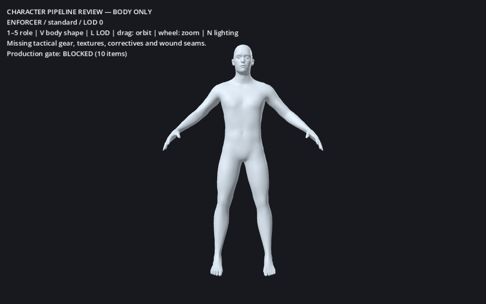

# Character pipeline — Phase 1 review

Latest supplied-asset work and current verification: [Phase 1 supplied-character review](PHASE_1_SUPPLIED_CHARACTER_REVIEW.md). The body-only measurements below describe the earlier foundation pass.

Status: **pipeline foundation implemented; production character acceptance blocked by art dependencies**. The game still uses its existing enemy presentation. The new bodies are isolated in a review scene so incomplete anatomy-only assets cannot enter combat. No movement, damage, attacks, drops, scoring, director, weapon or pickup code changed.

## Review and reproduce

Godot 4.6.3 / Blender 4.3.2 were used.

```sh
# Open the review scene (does not start the shooter):
godot --path . scenes/characters/character_review.tscn
# Offline integrity and skin checks:
python tools/characters/validate_sources.py
# Full rebuild from the bundled, pinned CC0 source data:
bash tools/characters/build.sh
# Refresh source data only if required (network):
python tools/characters/fetch_sources.py
# Native captures:
godot --path . --resolution 960x600 --script tests/capture_character_pipeline.gd
```

Review controls: 1–5 selects the role definition; V selects its body shape; L selects the explicit LOD; drag orbits; wheel zooms; N switches neutral/red review lighting. Role definitions currently share the body shapes: their required equipment is listed but missing. They do **not** yet have five distinct soldier silhouettes. The red review light is a diagnostic preset, not an arena-light validation.

`art/characters/*.blend` contains editable quad cages and authored skin weights. `assets/characters/generated/*.glb` contains twenty explicit body-only LOD exports. Godot ignores the raw source and Blender directories; it imports the GLBs. `data/characters/variants/*.tres` contains 25 typed variants, with a JSON export in `catalog.json`.

## Source and license

MakeHuman revision `a8bc2d54ff0ac92e78ff71431b1023eda42bf482` supplies the base mesh, authored body targets, rig landmarks and skin weights. The base mesh explicitly states CC0 release in September 2020. Bundled graphical data is CC0 under upstream `LICENSE.md` and `LICENSE.ASSETS.md`; upstream application source is AGPL and is **not copied or executed** by this pipeline. The conversion script is independently implemented. Every bundled source and derived body asset has a source/license/modification/hash record in `assets/characters/provenance.json`.

MakeHuman tactical vest/helmet/clothing packs were located, but their two download hosts returned HTTP 403 in this environment. The user selected available CC0 assets and has no existing pack. A separately inspected community catsuit identifies AGPL3 and was not included. No license is inferred from a thumbnail, repository name or downloadable file alone.

## What is implemented

- Five authored-target fits: lean, standard, broad, stocky and slender. Shoulder breadth, pelvis width and soft-tissue parameters are in `pipeline.json`. Shape parameters are **build-time sliders**, not runtime morph controls. Each shape gets matching fitted bone landmarks, skin and all four LODs. Height normalization is applied after shape fitting to keep 1.80 m; variation is not produced by whole-body scaling.
- 72 standard-named bones, including fingers, metacarpals, jaw/eyes, upper/lower arm twist sections and upper/lower leg twist sections. Source weights from removed face/toe bones merge into retained ancestors. Export retains the four largest influences and normalizes them.
- Original body UVs and a quad-only LOD0 authoring cage. Triangulation occurs at glTF export. Helpers are excluded from the displayed body.
- A `BoneMap` with `SkeletonProfileHumanoid` maps every required profile bone. The GLB import settings reference this Resource. Authored A-rest is preserved; axis overwrite/silhouette correction waits for the real animation source and Phase 2 review.
- Typed `ZLCharacterVariant` and `ZLCharacterPart` Resources, JSON export, part swaps, shape/rest compatibility checks, socket attachment support and shared-skeleton skin rebinding. Failed assembly rolls back. Parts cannot introduce collision bodies. Assemblies over three distinct material Resources are rejected.
- Four explicit LODs with switching thresholds 12/25/45 m and 1 m hysteresis, so exactly one is visible. Godot's additional automatic LOD generation is disabled for these assets.
- UV-mask PBR shader for future clothing: albedo, OpenGL normal, RGB ORM and RGB camo mask. Primary/secondary/tertiary colors come from each variant. Metallic is disabled by default. This shader is supplied for authored textures; the current body deliberately uses a labelled clay review material.
- `configure(variant, true)` rejects every current variant because its art gates are incomplete. `configure(variant, false)` is explicitly review-only. No adapter to the old procedural walk code has been added.

## Validation

The full Blender → source validator → Godot import → Resource generation → BoneMap import cycle completed successfully. The final focused suite passes **93 assertions**, including pre-instantiation rejection of scripts/collision in parts and shared camo materials across modular pieces. The offline verifier checks **37 file hashes and 20 GLBs**. These validate the foundation, not the missing production artwork.



## Measured content budgets

| Asset | LOD0 | LOD1 | LOD2 | LOD3 |
|---|---:|---:|---:|---:|
| Each body preset, triangles | 26,756 | 12,000 | 4,500 | 1,200 |
| Target complete soldier, triangles | 35–50k | 15–20k | 5–8k | 1.5–2k |
| Remaining space under maximum | 23,244 | 8,000 | 3,500 | 800 |

Each exported body has 72 joints and one material surface. It has zero animations and zero corrective shapes. The original cage has 13,378 quads and zero triangular faces. Standard LOD0 has 60.17% of exported vertices using more than one nonzero skin influence. This is an integrity measurement, not proof of correct deformation.

Lower LODs are Blender collapse **candidates**. They do not meet the requirement for artist-reviewed joint loops or matched wound boundaries yet. Do not pad triangle counts to reach the soldier minimum; equipment should occupy that budget. Body art approval, gear completion and final assembled counts are separate gates.

Native 960×600 captures of lean/standard/stocky LOD0 and stocky LOD3 were inspected. LOD0 shows continuous authored human anatomy; LOD3 visibly loses facial/hand form at close inspection. Close-up LOD3 is a diagnostic, not its intended distance. Captures measured two draw calls including UI (one body mesh draw), with 27,136–27,144 total rendered primitives including text. Mesa llvmpipe software rendering was used. No valid hardware frame-time delta, 144 FPS result or 0.5 ms gore result is available. Moving 20 m silhouette and full clip deformation acceptance remain untested.

## Production authoring contract

These are acceptance requirements for the next asset intake, not claims about the review bodies.

1. **Coordinates and naming.** Meters; feet at Y=0 after glTF import; 1.80 m adult; head target 0.24 m. Blender Z-up exports through glTF Y-up conversion. The imported body faces +Z; a future visual adapter must account for the shooter's facing convention without changing its capsule. Preserve standard skeleton names. Parts use `role_part_shape_lodN`; wound boundaries use stable IDs such as `left_forearm_cut_a`. No negative object scale or unapplied nonuniform scale.
2. **Garments and gear.** Fit licensed fatigue sleeves/trousers, boots, carrier, pouches, helmet and role-specific parts to all five shapes. All five role requirements are enumerated in `pipeline.json`. Hide covered body faces using authored coverage masks only after seam and animation checks. No primitives used as replacement garments or armor. A character artist or suitable licensed CC0 asset is still required for these parts.
3. **UVs.** Body and gear target 1,024 texels/m at LOD0; exposed head target 2,048 texels/m, validated with a checker and measured surface area. Use 16 px island padding at 2K and bake dilation. Put seams away from face/front-joint focal regions; protect cut boundaries. Do not claim existing upstream UVs meet those densities without measurement. Pack at most three material slots; each role gets a 2K body/gear texture set plus a shared 1K detail set, with mipmaps. Skin/fabric/blood/polymer metallic remains zero.
4. **Deformation topology.** Primary cages use quads across shoulders, elbows, wrists, hips and knees; place poles away from bend/compression centers. Use at least three supporting loops around each elbow/knee bend and enough shoulder loops to follow deltoid/armpit compression. Triangle-free authoring zones are required at every accepted LOD; runtime GLB triangles are expected. Collapse candidates must be replaced or repaired where they violate this rule.
5. **Weights and correctives.** Four influences maximum; normalized; no unweighted vertices. Preserve twist distribution rather than assigning whole limbs to one bone. Author shoulder elevation/forward reach, elbow flexion and knee flexion correctives against the actual clip set. Corrective names and trigger ranges belong in Resources. No generated bulges or empty shape keys count as completion. Pose tests include elbow/knee 0/45/90/130 degrees and shoulder down/forward/side/overhead, plus weapon hand contact.
6. **Wound seams.** Author matching loops and shared seam IDs on intact parts, detached pieces and every cap layer. Keep seam UVs aligned across skin/fat/muscle/bone openings. Preserve seam vertices from decimation; hand-retopologize lower LOD boundaries. Validate boundaries at rest and all extreme poses. The current body has no authored cuts; arbitrary runtime cutting is not part of this pipeline.
7. **LOD export.** Use the same 72-bone hierarchy/rest per body shape at every LOD. Keep key silhouette and joint loops; strip hidden garment interior detail before reducing anatomy. Body/gear parts for a shape must agree exactly on bone names and rest transforms. Validate 35–50k / 15–20k / 5–8k / 1.5–2k triangles on the assembled soldier, not on each part. No more than three material Resources after assembly.
8. **Godot import.** Tangents enabled, named skins enabled, explicit LODs only, root scale 1.0, no generated physics, current body animation import disabled. `retarget/bone_map` references `humanoid_bone_map.tres`; rest retarget method is None for this phase. Animation sources will receive separate Phase 2 import rules. Verify options against the shipped editor version before changing them. The option names were checked against Godot 4.6.3's scene importer and skeleton post-import plugins.
9. **Portability.** Source meshes/UVs/weights and exports are glTF 2.0; standard names and ORM conventions are preserved. Godot Resources, BoneMap and visibility logic are engine-specific presentation configuration. JSON exports preserve portable selection/tuning data. No Unreal implementation is supplied.

## Acceptance checklist

- [x] Pinned licensed human source, no primitive character generation.
- [x] Editable Blender bodies and twenty glTF exports.
- [x] Five independently fitted shapes and 25 role/shape Resource definitions.
- [x] 72-bone rig, normalized blended weights and humanoid BoneMap.
- [x] Runtime assembly, explicit LOD selection and failure gates exercised.
- [x] Native captures inspected; measurements recorded with software-rendering limit.
- [ ] Tactical modular gear and five finished role silhouettes.
- [ ] Authored UV-specific PBR textures/camo masks.
- [ ] Joint correctives and full-range deformation approval.
- [ ] Matched wound seams and accepted low-LOD topology.
- [ ] Every complete-soldier budget and moving-distance visual test.

Phase 1 is **not production-accepted**. The pipeline work is reviewable; unavailable authored assets remain a real dependency. Animation integration has since started in an isolated review; see [ANIMATION_INTEGRATION_REVIEW.md](ANIMATION_INTEGRATION_REVIEW.md). Phase 1 acceptance remains open.

## Five likely failure points and tests

1. **Bone/rest mismatch on a modular part:** load each shape/part pair, compare all bone names/rest transforms and verify every skin resolves to the single body skeleton. Reject mismatch before rendering.
2. **Shoulder/elbow/knee collapse:** inspect extreme static poses and the eventual complete clip set in wireframe and shaded views. Reject volume loss, skin-through-cloth and hand-contact drift; add authored correctives.
3. **Cut seams diverge between parts or LODs:** compare seam IDs, positions, normals and UVs across poses and LOD swaps. Reject visible gaps, z-fighting or stretched connecting triangles.
4. **LOD switching or material cost exceeds budget:** sweep the camera across 12/25/45 m in both directions, count visible LODs, inspect silhouette popping and record complete-soldier triangles/draw calls/materials on a hardware GPU.
5. **Presentation leaks into gameplay:** reject collision-bearing parts and gameplay scripts, keep review assembly separate until its adapter is tested, then replay identical combat seeds with each variant and compare hits, kills, rewards and drops.
