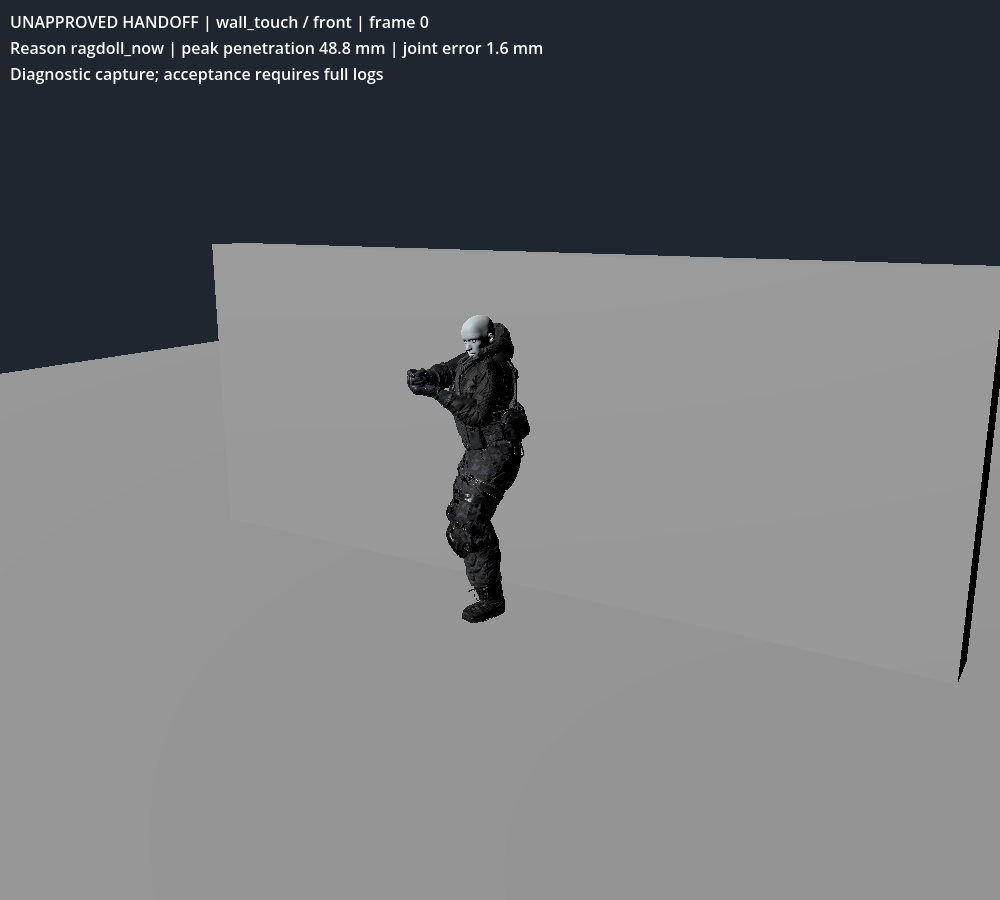
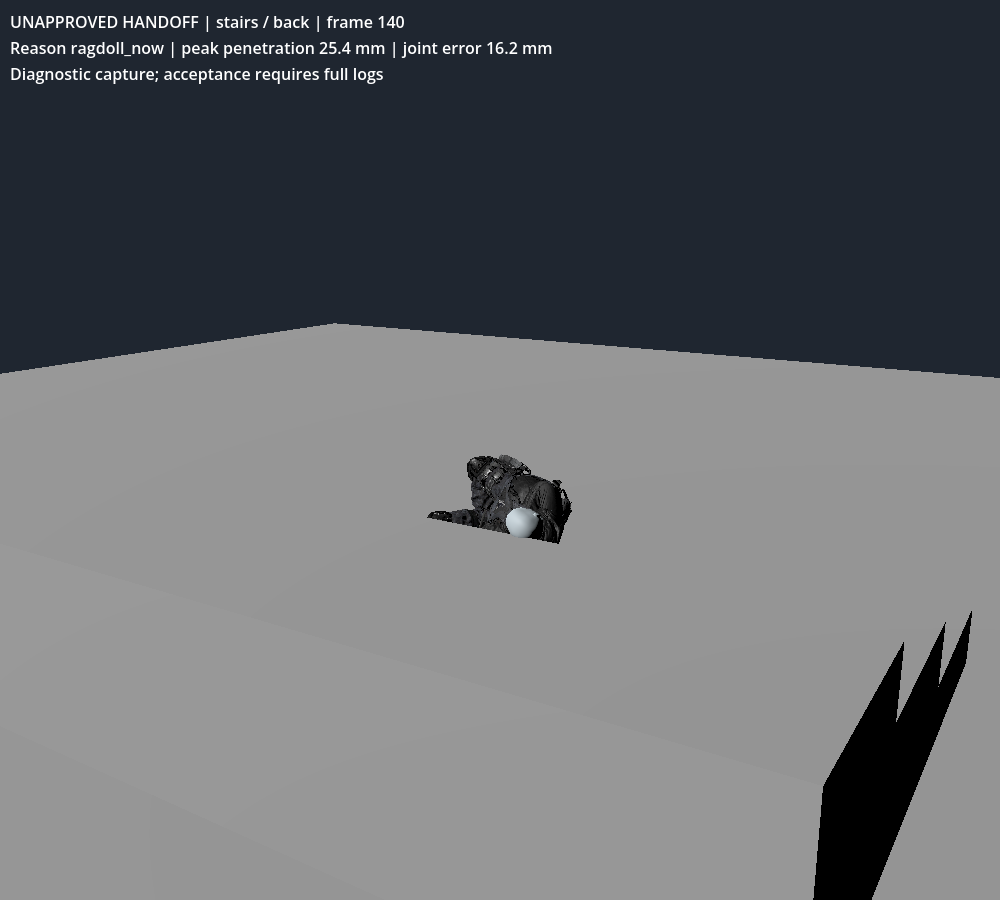
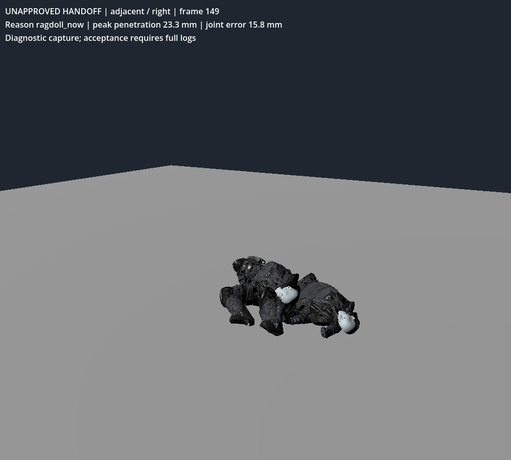

# Death animation / ragdoll handoff review — UNAPPROVED

2026-10-22. Godot 4.6.3 official, Jolt; Blender 4.3.2. This is an isolated presentation review, not a replacement playable game. Existing movement, weapons, damage, waves, drops and rewards were not edited.

## Run

Extract `downloads/zero-line-death-handoff-review.zip`, import its `project.godot` in Godot 4.6.3 and press F6/F5. Main scene: `death_review.tscn`. Buttons select obstacle, weapon tag and impact direction; Restart repeats; Pause and Focus control simulation. Every view is labelled UNAPPROVED.

Flying Back Death is eligible ONLY with `shotgun` or explicit `high_caliber`. A rifle name or damage value does not imply high caliber. Settings map SPAS-12 to shotgun, M4A1 and USP45 to no flying tag. This fixture accepts tags; a future gameplay adapter must forward the existing weapon's classification without changing damage.

## Implemented candidate

Imported 14 authored motions from 74 supplied FBX files: 12 deaths, one hit reaction and one strafe. The other 60 are inventoried, not integrated or approved. BoneMap + SkeletonProfileHumanoid import normalizes the 65-bone source rigs; sampled retargeting writes a 72-bone target library at 60 Hz. Source keys drive motion; no generated walk/death cycles. Supplied provenance/hashes are in `data/death/source_intake.json` and `source_manifest.json`; these are user-supplied assets with their original licenses, not newly claimed CC0 assets.

No left death is supplied: left impact falls back to immediate ragdoll. Hit reaction/strafe are baked but not connected to live AI. Metadata usability is not visual approval. Target clothing retains the prior unapproved fitting patch.

Capsule-clearance metadata samples nine physical proxy centers every 0.1 seconds and at the exact planned handoff. It is a conservative proxy test, not skinned-surface collision measurement. Selection checks overlap and capsule sweeps through planned handoff, then checks motion each physics tick. Horizontal root motion uses `move_and_collide`; motion below 60% for three ticks triggers handoff. Bone sweep blockage, lost support within 0.30 m, heavy second hit or impulse >=8 also trigger handoff. Unsupported flying motion can hand off before its authored endpoint.

Pose and velocities are captured before handoff. Fifteen Jolt physical bones total 75 kg; impulses clamp to 80, linear speed to 5 m/s, angular speed to 8 rad/s. Joint anchors are rebuilt after placing every body at the captured pose. Pose blending lasts 0.18 s; depenetration clamps at 9 mm. These limits do not guarantee solver stability; failures below remain open. Masses, capsule radii, swing/twist limits and all thresholds are in JSON plus custom Resource exports.

Six full ragdolls and 18 corpses are allowed. Budget eviction uses camera distance. If eviction is refused, fallback retains seven physical bodies with 15 compound collider shapes; omitted limbs inherit their retained ancestor's pose. Godot's bone-list simulation includes descendants, so fallback actually removes the unselected bodies rather than relying on a filtered Hips list. Quiet bodies freeze after 0.6 s below 0.1 m/s and 0.15 rad/s; the five-second timeout now also requires quiet velocities. Both timeout and budget freezes reject unsupported poses and proxy penetration above 20 mm. A 20 m airborne regression with a 0.05 s timeout confirms that the falling corpse stays simulated. The support query still uses the documented 0.30 m range, so this is not a final grounded-contact certification. Frozen poses use static compound collisions; inactive PhysicalBoneSimulator avoids duplicate kinematic colliders.

Layers: world 1, player 2, dynamic props 4, corpses 16; corpse queries/collisions mask 21 excludes player. The review overrides Jolt penetration slop to 0.002 m, velocity iterations to 20 and position iterations to 32. This has an unmeasured CPU cost and has NOT been applied to the gameplay project. No detached-limb/cap integration is claimed.

Godot API checks used runtime ClassDB and 4.6 source for PhysicalBone3D, PhysicalBoneSimulator3D, Skeleton3D, PhysicsServer3D CCD and direct-space queries. A future engine port would replace these native physics/import components; no Unreal implementation is present.

## Measured acceptance

- Selection: 10 assertions passed, including ordinary/unknown weapon exclusion, shotgun/high-caliber inclusion and missing-left fallback.
- Presentation lifecycle: pause and Focus passed; six Focus ticks advanced 0.033333 s; one death receipt / one handoff; six-full budget and seven-body fallback passed. Freeze pose delta was 0.000321 mm.
- Full collision matrix: **208 event/gating assertions passed; 39/52 cases passed geometric checks**. Eleven cases exceeded 20 mm penetration for more than two ticks; 2 exceeded the additional 20 mm joint-anchor separation threshold. Four began with >2 mm proxy overlap before death.
- The `authoritative_event_count` field in the contract fixture counts received presentation events only. No live kill/reward transaction test was performed. Gore-setting checks establish that this component has no gore-dependent selection branch, not end-to-end gameplay equivalence.
- Initialization displacement stayed within 10 mm. This metric does NOT certify the first rendered solver frame or full visual pop requirement. Constraint error measures physical joint-anchor separation, not anatomical bone length.
- 150 physics ticks per case at 60 Hz; not a long-duration stability test. Raw per-frame nine-proxy measurements are in `handoff_frames.json`. CPU query timers measure diagnostic queries only, not total gore/frame cost.
- Native screenshots were captured and inspected using llvmpipe software rendering, Compatibility renderer. Hardware/GPU frame-time acceptance, Forward+ visuals and 144 FPS remain unverified. No draw-call or triangle optimization is claimed; the reused soldier is 71,673 triangles, 72 bones and three materials, above the requested LOD0 triangle budget.

### Stability correction

Cone twist uses local X, whereas this fixture constructs the capsule length along local Y. Joint rotation now maps X to Y using a data-defined 90-degree Z rotation. Masses, angular limits, CCD, iteration counts and velocity limits are unchanged. This improves the matrix from 11/52 to 39/52; it does not approve the remaining 13 cases. Frozen-corpse joint error is preserved from the last physical pose instead of measuring reset inactive physical bones.

The native captures below show the remaining wall, stair and adjacent-body failures. Foot-proxy contact dominates several failures. A toe-aligned collider candidate reduced penetration but rejected authored clips and worsened constraint acceptance; it was not adopted. Collider fit and ankle constraints still need a combined solution, with clearance metadata rebaked after any geometry change.

### Full matrix

Depths are mm. Streak = longest consecutive ticks above 20 mm. Joint = maximum anchor separation. Init = overlap before death. Pop = initialization-only displacement.

| Fixture | Direction | Clip | Trigger | Init | Max depth | Streak | Joint | Pop | Pass |
|---|---|---|---|---:|---:|---:|---:|---:|---|
| open | front | flying_back_death | no_support | 0.00 | 14.91 | 0 | 14.75 | 0.00 | YES |
| open | back | death_from_back_headshot | planned | 0.00 | 3.98 | 0 | 9.94 | 0.00 | YES |
| open | left | none | ragdoll_now | 0.00 | 16.34 | 0 | 15.95 | 0.00 | YES |
| open | right | death_from_right | planned | 0.00 | 3.91 | 0 | 3.56 | 0.00 | YES |
| wall_touch | front | none | ragdoll_now | 63.37 | 48.83 | 49 | 19.17 | 9.00 | NO |
| wall_touch | back | none | ragdoll_now | 63.37 | 48.83 | 49 | 19.17 | 9.00 | NO |
| wall_touch | left | none | ragdoll_now | 63.37 | 48.83 | 25 | 19.01 | 9.00 | NO |
| wall_touch | right | none | ragdoll_now | 63.37 | 48.83 | 36 | 18.70 | 9.00 | NO |
| wall_20cm | front | death_from_front_headshot | planned | 0.00 | 9.50 | 0 | 5.37 | 0.00 | YES |
| wall_20cm | back | death_from_back_headshot | planned | 0.00 | 3.98 | 0 | 9.94 | 0.00 | YES |
| wall_20cm | left | none | ragdoll_now | 0.00 | 10.68 | 0 | 15.95 | 0.00 | YES |
| wall_20cm | right | death_from_right | planned | 0.00 | 3.91 | 0 | 3.56 | 0.00 | YES |
| crate | front | death_from_front_headshot | planned | 0.00 | 12.71 | 0 | 9.75 | 0.00 | YES |
| crate | back | pro_rifle_pack_death_from_the_back | planned | 0.00 | 8.67 | 0 | 14.91 | 0.00 | YES |
| crate | left | none | ragdoll_now | 0.00 | 6.67 | 0 | 15.95 | 0.00 | YES |
| crate | right | none | ragdoll_now | 0.00 | 6.67 | 0 | 15.95 | 0.00 | YES |
| corridor | front | none | ragdoll_now | 0.00 | 8.67 | 0 | 14.29 | 0.00 | YES |
| corridor | back | none | ragdoll_now | 0.00 | 9.95 | 0 | 13.97 | 0.00 | YES |
| corridor | left | none | ragdoll_now | 0.00 | 8.67 | 0 | 14.29 | 0.00 | YES |
| corridor | right | none | ragdoll_now | 0.00 | 9.95 | 0 | 13.97 | 0.00 | YES |
| ledge | front | death | planned | 0.00 | 3.79 | 0 | 1.71 | 0.00 | YES |
| ledge | back | death_from_back_headshot | planned | 0.00 | 0.00 | 0 | 3.33 | 0.00 | YES |
| ledge | left | none | ragdoll_now | 0.00 | 0.21 | 0 | 12.54 | 0.00 | YES |
| ledge | right | death_from_right | planned | 0.00 | 2.21 | 0 | 5.21 | 0.00 | YES |
| stairs | front | death | no_support | 0.00 | 4.66 | 0 | 5.12 | 0.00 | YES |
| stairs | back | none | ragdoll_now | 0.00 | 25.40 | 19 | 16.21 | 0.00 | NO |
| stairs | left | none | ragdoll_now | 0.00 | 25.40 | 19 | 16.21 | 0.00 | NO |
| stairs | right | none | ragdoll_now | 0.00 | 14.28 | 0 | 16.25 | 0.00 | YES |
| explosion_pillar | front | flying_back_death | no_support | 0.00 | 18.35 | 0 | 18.18 | 0.00 | YES |
| explosion_pillar | back | death_from_back_headshot | planned | 0.00 | 5.04 | 0 | 4.51 | 0.00 | YES |
| explosion_pillar | left | none | ragdoll_now | 0.00 | 10.68 | 0 | 15.95 | 0.00 | YES |
| explosion_pillar | right | death_from_right | planned | 0.00 | 2.65 | 0 | 7.10 | 0.00 | YES |
| adjacent | front | death_from_front_headshot | planned | 0.00 | 11.03 | 0 | 14.48 | 0.00 | YES |
| adjacent | back | death_from_back_headshot | planned | 0.00 | 6.87 | 0 | 10.65 | 0.00 | YES |
| adjacent | left | none | ragdoll_now | 0.00 | 15.24 | 0 | 16.20 | 0.00 | YES |
| adjacent | right | none | ragdoll_now | 0.00 | 25.57 | 17 | 15.81 | 0.00 | NO |
| corpse_behind | front | death | root_blocked | 0.00 | 12.86 | 0 | 9.88 | 0.00 | YES |
| corpse_behind | back | death_from_back_headshot | root_blocked | 0.00 | 13.08 | 0 | 20.10 | 0.00 | NO |
| corpse_behind | left | none | ragdoll_now | 0.00 | 15.47 | 0 | 17.41 | 0.00 | YES |
| corpse_behind | right | death_from_right | root_blocked | 0.00 | 19.28 | 0 | 16.32 | 0.00 | YES |
| second_hit | front | death | disturbed | 0.00 | 22.48 | 6 | 17.12 | 0.00 | NO |
| second_hit | back | death_from_back_headshot | disturbed | 0.00 | 20.47 | 1 | 7.94 | 0.00 | YES |
| second_hit | left | none | ragdoll_now | 0.00 | 16.34 | 0 | 15.95 | 0.00 | YES |
| second_hit | right | death_from_right | disturbed | 0.00 | 19.09 | 0 | 20.48 | 0.00 | NO |
| moving_prop | front | death | root_blocked | 0.00 | 25.42 | 16 | 13.39 | 0.00 | NO |
| moving_prop | back | death_from_back_headshot | disturbed | 0.00 | 9.74 | 0 | 19.33 | 0.00 | YES |
| moving_prop | left | none | ragdoll_now | 0.00 | 22.38 | 25 | 13.58 | 0.00 | NO |
| moving_prop | right | none | ragdoll_now | 0.00 | 23.46 | 23 | 13.58 | 0.00 | NO |
| budget_full | front | death | planned | 0.00 | 3.76 | 0 | 1.71 | 0.00 | YES |
| budget_full | back | death_from_back_headshot | planned | 0.00 | 6.35 | 0 | 9.91 | 0.00 | YES |
| budget_full | left | none | ragdoll_now | 0.00 | 15.47 | 0 | 17.41 | 0.00 | YES |
| budget_full | right | death_from_right | planned | 0.00 | 3.91 | 0 | 3.55 | 0.00 | YES |

The native interactive capture exposed root recovery against the actor's own physical bodies. Bidirectional collision exceptions now prevent it. A regression test compares actual root displacement with the authored curve in free space: error 0.000805 mm. The matrix above was rerun after that fix.

### Death clip metadata

Authored duration and planned handoff in seconds; actual handoff can be earlier. All clips remain visually unapproved.

| Clip | Direction | Duration | Planned handoff | Root path m | Flying |
|---|---|---:|---:|---:|---|
| death | front | 3.017 | 1.600 | 1.210 | False |
| death_from_back_headshot | back | 3.700 | 2.100 | 1.242 | False |
| death_from_front_headshot | front | 2.833 | 1.300 | 1.046 | False |
| death_from_right | right | 3.283 | 2.000 | 1.046 | False |
| death_from_the_front | front | 3.417 | 1.700 | 1.473 | False |
| flying_back_death | front | 3.017 | 0.900 | 1.949 | True |
| pro_rifle_pack_death_crouching_headshot_front | front | 1.900 | 1.000 | 1.385 | False |
| pro_rifle_pack_death_from_back_headshot | back | 3.700 | 2.100 | 1.233 | False |
| pro_rifle_pack_death_from_front_headshot | front | 2.833 | 1.400 | 1.044 | False |
| pro_rifle_pack_death_from_right | right | 3.300 | 2.000 | 1.044 | False |
| pro_rifle_pack_death_from_the_back | back | 2.967 | 1.800 | 1.454 | False |
| pro_rifle_pack_death_from_the_front | front | 3.433 | 1.700 | 1.452 | False |

## Inspected failure captures

These are separate native-render runs; physics values can differ from headless runs. Images record the peak proxy penetration frame, not necessarily peak joint error. They are diagnostic full views, not acceptance closeups or all-clip clothing heatmaps.





The wall fixture begins with body proxies outside the root capsule. Removing tens of millimeters of initial overlap cannot also satisfy a sub-10 mm correction limit. A collision-aware alive pose/spawn-clearance solution is needed before this case can pass. Corpse contact and solver joint separation also fail after valid handoffs; increasing iterations alone did not resolve them. The existing clothing/body deformation remains visibly unapproved; the new death clips have not undergone the all-role clothing-shell audit.

## Reproduce

Within the extracted review project:

```sh
godot --headless --editor --path . --import
godot --headless --path . --script tools/death/test_selection.gd
godot --headless --fixed-fps 60 --path . --script tools/death/test_contracts.gd
godot --headless --fixed-fps 60 --path . --script tools/death/test_handoff.gd
# Native display required for actual captures:
godot --fixed-fps 60 --path . --script tools/death/test_handoff.gd -- capture
```

The matrix exits normally after writing a report even when acceptance fails; inspect `all_acceptance_passed`. Reports are not a passing CI gate yet.

To rebuild from supplied FBX, run Blender 4.3.2 with `tools/death/convert_supplied.py -- SOURCE_DIR death_motions`, import the project, run `configure_imports.gd`, reimport, repeat configuration/import if paths changed after skeleton normalization, then run `bake_library.gd`, `generate_settings.gd`, and `bake_clearance.gd`. Each Godot tool runs with `--headless --path . --script tools/death/NAME.gd`. Existing body/gear files, their import sidecars and the base ActorCore hold library are included in the review ZIP. No raw purchased FBX is needed to run it.

## Acceptance checklist

- [x] Authored death motions imported and data-baked; explicit flying weapon gate tested.
- [x] Pause/Focus, single presentation handoff, full-ragdoll budget and reduced fallback tested.
- [x] Joint axes corrected; unsupported/penetrating freeze refused; frozen joint metric regression tested.
- [x] All 52 collision scenarios measured; raw failures and native images retained.
- [ ] Collision penetration, joint stability and first-rendered-frame pop accepted.
- [ ] All-role/all-clip body-clothing audit and corrective approval.
- [ ] Long-duration settle/eviction, torn gear, detached-limb and wound continuity integration.
- [ ] Live one-authoritative-kill/reward and gore-mode equivalence tests.
- [ ] Target hardware frame cost, full stress density and Forward+ visual approval.

## Five likeliest failure points and next tests

1. **Initial body overlap outside the actor capsule.** Measure alive-pose shell clearance at each wall/prop spawn before death; retain both pre-death overlap and rendered-pop deltas. Do not silently teleport the corpse.
2. **Joint separation under impact/contact.** Capture joint anchors each tick through at least 10 seconds, including stacked corpses and both near/far fallback. Fail above the configured tolerance; inspect collider overlap and joint frames before further solver tuning.
3. **Early airborne fallback / forced freeze.** Record support rays, authored root path and vertical pose for flying and ledge cases. Verify continuous descent and require grounded/quiet freeze or an explicitly reviewed alternative.
4. **Retargeted clothing and wound seams.** Re-run the measured shell audit on every new clip and every role/body, including extreme frames; inspect preserved seam coordinates. This review does not approve their deformation.
5. **Gameplay adapter or performance regression.** Before connecting live enemies, compare identical seeded Off/Reduced/Full runs for hits, kills, credits and drops, then profile 6 ragdolls/18 corpses with real hardware. Verify actual first-frame transition and total frame cost, not diagnostic query time alone.
