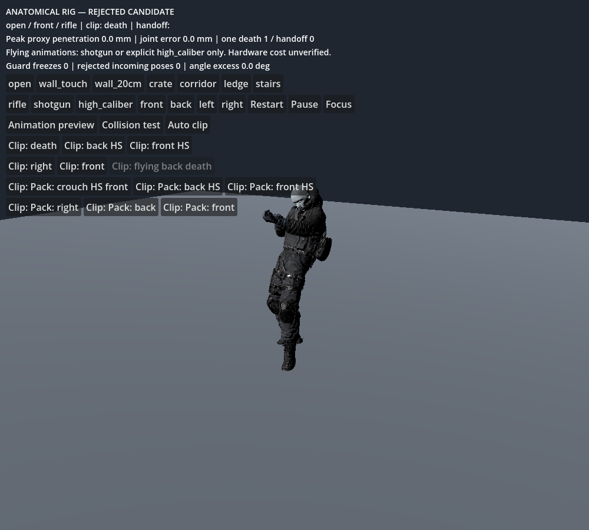
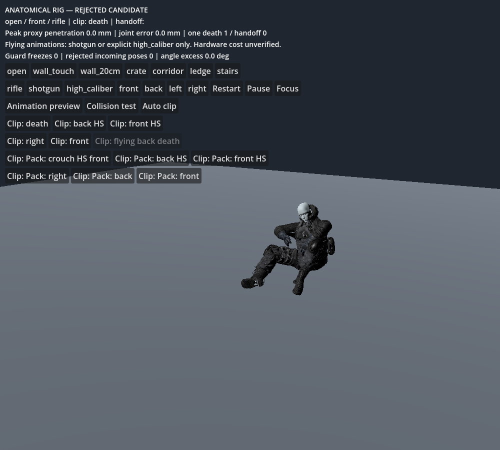

# Ground-contact and handoff revision — 2026-10-24

**Partial fix; overall rig remains unapproved.** This report supersedes earlier matrices. Gameplay damage, movement, rewards and waves are unchanged; this remains the isolated presentation review.

## Implemented

- Bake a separate anatomical-rig clip set using the current 16-body offsets and query radii, sampled at 60 Hz. Old death-review metadata remains separate.
- Store a bounded initial presentation offset in each clip Resource and JSON. Actual offsets are 3.00–19.34 mm, capped at 25 mm. This moves only the cosmetic model, not the gameplay capsule. It aligns initial foot query proxies; it is not a measured boot-sole or complete visual fit. The largest offset exceeds 10 mm, so no <=10 mm animation-entry pop approval is claimed. A test of extending alignment across the first 250 ms exceeded the bound and was rejected.
- Stop sampling at the exact planned handoff time instead of stepping beyond the validated animation segment into a floor collision.
- Seek the first death frame and reset velocity history at entry, avoiding transfer of the unrelated rifle-hold-to-death jump.
- Reject an already-invalid handoff pose before a solver tick. The diagnostic fallback freezes the incoming pose, may remain unsupported, and explicitly fails acceptance. It does not make a bad pose valid or silently widen limits.
- Record initial joint coordinates, distinguishing swing/twist from hinge flexion, and identify sampled stretched edges with their skin weights and animation time.

## Flat-floor selection and obstacle tests

Every supplied clip can now be selected on a flat floor. Eleven reach a planned handoff; the flying clip hands off when it loses support. The two right-side clips still have genuinely short validated windows and remain unsuitable for full collision-aware playback until retarget/foot-contact correction. Full-clip preview remains available and is labeled separately.

For every clip, an inserted chest-level wall was rejected. Rifle selection still rejects flying death. Each test receives exactly one presentation handoff. These are selection/handoff assertions, not ragdoll acceptance.

| Clip | Model lift mm | Authored seconds played | Handoff reason |
|---|---:|---:|---|
| death | 4.39 | 1.650 | planned |
| death_from_back_headshot | 7.83 | 0.133 | planned |
| death_from_front_headshot | 7.83 | 1.500 | planned |
| death_from_right | 7.83 | 0.017 | planned |
| death_from_the_front | 7.83 | 0.467 | planned |
| flying_back_death | 19.34 | 0.317 | no_support |
| pro_rifle_pack_death_crouching_headshot_front | 3.00 | 0.400 | planned |
| pro_rifle_pack_death_from_back_headshot | 7.83 | 0.133 | planned |
| pro_rifle_pack_death_from_front_headshot | 7.83 | 1.517 | planned |
| pro_rifle_pack_death_from_right | 7.83 | 0.033 | planned |
| pro_rifle_pack_death_from_the_back | 7.83 | 1.850 | planned |
| pro_rifle_pack_death_from_the_front | 7.83 | 0.483 | planned |

## Ragdoll matrix after corrected playback

The controller now reaches different authored poses instead of almost always handing off from the hold pose. These cases are not a like-for-like solver benchmark against the old hold-pose matrix. Immediate rejection prevents a bad pose from developing solver-driven separation; a tiny gap on a rejected row is **not** a physical pass.

| Profile | Direction | Clip seconds | Initial pose rejected | Peak gap mm | Peak angle excess ° | Sampled skin ratio | Overall |
|---|---|---:|---:|---:|---:|---:|---|
| rusher | front | 1.650 | 1 | 0.00 | 115.56 | 2.507 | FAIL |
| rusher | back | 0.133 | 1 | 0.00 | 10.80 | 1.581 | FAIL |
| rusher | left | 0.000 | 0 | 5.27 | 13.55 | 1.234 | FAIL |
| rusher | right | 0.017 | 1 | 0.00 | 13.27 | 1.580 | FAIL |
| enforcer | front | 1.650 | 1 | 0.00 | 115.56 | 2.507 | FAIL |
| enforcer | back | 0.133 | 1 | 0.00 | 10.80 | 1.581 | FAIL |
| enforcer | left | 0.000 | 0 | 5.33 | 13.39 | 1.384 | FAIL |
| enforcer | right | 0.017 | 1 | 0.00 | 13.27 | 1.580 | FAIL |
| shield | front | 1.650 | 1 | 0.00 | 115.56 | 2.507 | FAIL |
| shield | back | 0.133 | 1 | 0.00 | 10.80 | 1.581 | FAIL |
| shield | left | 0.000 | 0 | 5.36 | 13.29 | 1.370 | FAIL |
| shield | right | 0.017 | 1 | 0.00 | 13.27 | 1.580 | FAIL |
| flusher | front | 1.650 | 1 | 0.00 | 115.56 | 2.507 | FAIL |
| flusher | back | 0.133 | 1 | 0.00 | 10.80 | 1.581 | FAIL |
| flusher | left | 0.000 | 0 | 5.32 | 13.41 | 1.378 | FAIL |
| flusher | right | 0.017 | 1 | 0.00 | 13.27 | 1.580 | FAIL |
| elite | front | 1.650 | 1 | 0.00 | 115.56 | 2.507 | FAIL |
| elite | back | 0.133 | 1 | 0.00 | 10.80 | 1.581 | FAIL |
| elite | left | 0.000 | 0 | 5.34 | 13.35 | 1.378 | FAIL |
| elite | right | 0.017 | 1 | 0.00 | 13.27 | 1.580 | FAIL |

Twenty cases, 180 ticks each, 152 sampled edges every 15 ticks. These use a shared mesh with five mass profiles. The report retains failed measurements and does not certify full geometry, clothing, all roles, stable sleep or hardware cost. Some newly reached poses already exceed joint limits before the solver runs. For example, the right-death pose starts with left-ankle swing around 38.27° against its 25° limit. The sparse skin probe identifies thumb/index webbing influences rather than only reporting a global number; these measurements include authored animation deformation. They do not establish a fix for hand skinning.

## Native captures

Actual collision-aware animation playback, not preview bypass or reconstructed pose replay, captured at 0.25 and 1.2 seconds and inspected. Captures use llvmpipe/Compatibility and cannot validate hardware frame cost.

## Acceptance checklist

- [x] Current-rig clearance bake, Resources and JSON.
- [x] 12/12 flat-floor selections; 12/12 inserted walls rejected.
- [x] Exact planned-frame sampling; death-local velocity history.
- [x] Existing selection tests (10) and lifecycle contracts pass: pause/Focus, one event/handoff, budget/LITE and unsupported-freeze refusal in the base controller.
- [x] Native visual evidence of collision-aware playback.
- [ ] Right-side clips have a usable collision-aware duration.
- [ ] Every authored incoming pose satisfies anatomical limits.
- [ ] No emergency freezes; supported natural settling and full stress suite.
- [ ] Hand webbing, all skin/gear deformation and wound-seam criteria pass.
- [ ] Hardware performance and all role assets validated.

## Five remaining failure points and tests

1. Right-side floor contact at 17/33 ms: measure actual boot soles alongside the proxy at every frame, correct the retargeted planted-foot pose, rebake, and repeat wall/stair tests. Do not extend the height offset to conceal deeper intersections.
2. Out-of-range initial ankle/head/hand poses: use the recorded swing/twist values to correct retarget poses and joint neutral frames, validate them across the full clip set, then rerun before allowing simulation.
3. Thumb/index webbing stretch: inspect recorded edge indices and weight distributions, author local hand deformation corrections, and measure all affected edges including corrective regions separately.
4. Frozen-in-air fallback: remains a rejected diagnostic stop; validate supported settling and eviction only after incoming poses meet the constraints.
5. Validation blind spots: expand sparse skin sampling and rerun full garment shells, all role meshes, partial ragdoll, severed ownership and six-corpse density on target hardware.
