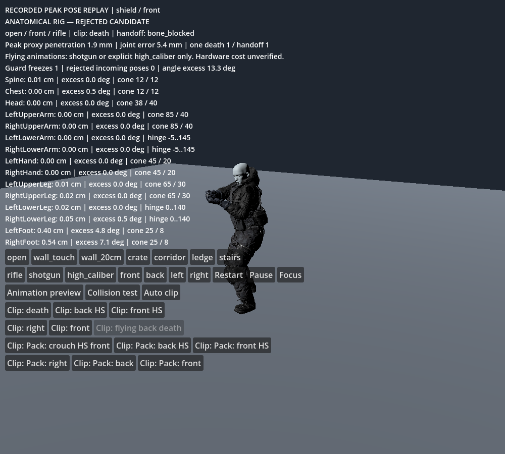
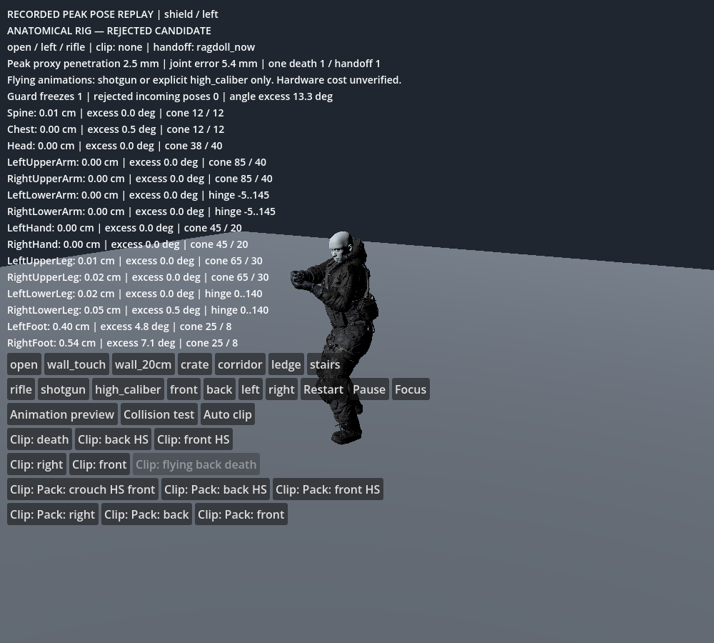
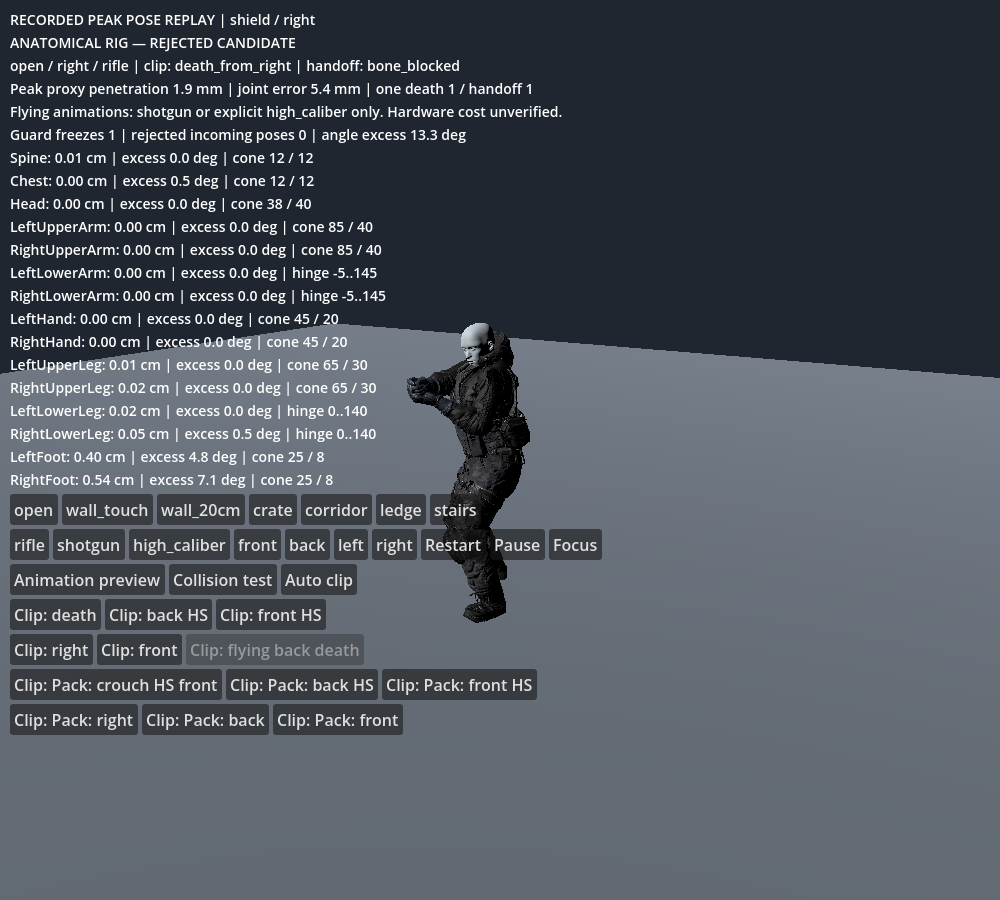

# Hinge convention correction — 2026-10-24

Godot 4.6.3 official (`7d41c59c4`), native Jolt. **Overall rig remains unapproved.** This report supersedes the numerical matrix in ANATOMICAL_RAGDOLL_REVIEW.md; that report remains the historical baseline and explains the review controls.

## Retained fix

The hinge diagnostic previously measured B relative to A, while native Godot/Jolt limits use the opposite sign. The elbow/knee axes and the reported flexion now use the same convention as the backend. No joint limits, masses, damping, collision masks, solver iterations, gameplay or animations were changed. Preview mode remains the default.

An isolated native regression creates two bodies with a hinge, tests −60°, 60°, 120° and 170° flexion against elbow limits −5..145° and knee limits 0..140°, then samples after 60 physics ticks. All eight cases pass: valid poses remain unchanged; out-of-range poses return within 0.001° of the nearest limit. See `data/ragdoll/hinge_convention_report.json`. This checks actual simulation, not parameter readback.

All 20 role-mass/direction cases now meet the 10 mm anchor-separation criterion. They still fail the full acceptance gate because angular excess persists and skin strain exceeds 10%. Every case still needs the guard. Acceptance now explicitly requires zero guard freezes, a valid snapshot and exactly one presentation handoff; a guard that truncates a failing run can no longer accidentally produce a pass.

The matrix uses one soldier with five mass profiles, 180 ticks each at 60 Hz, and 152 sampled skin edges outside existing corrective masks every 15th tick. This is not exhaustive garment or mesh acceptance. Guard timing covers only that CPU function. Target-hardware cost remains unverified.

| Mass profile | Direction | Before gap mm | After gap mm | Angle excess ° | Excess ticks | Skin ratio | Guard freezes | Overall |
|---|---|---:|---:|---:|---:|---:|---:|---|
| rusher | front | 33.63 | 5.27 | 13.55 | 9 | 1.234 | 1 | FAIL |
| rusher | back | 33.63 | 5.27 | 13.55 | 9 | 1.234 | 1 | FAIL |
| rusher | left | 33.63 | 5.27 | 13.55 | 9 | 1.234 | 1 | FAIL |
| rusher | right | 33.63 | 5.27 | 13.55 | 9 | 1.234 | 1 | FAIL |
| enforcer | front | 34.24 | 5.33 | 13.39 | 10 | 1.384 | 1 | FAIL |
| enforcer | back | 34.24 | 5.33 | 13.39 | 10 | 1.384 | 1 | FAIL |
| enforcer | left | 34.24 | 5.33 | 13.39 | 10 | 1.384 | 1 | FAIL |
| enforcer | right | 34.24 | 5.33 | 13.39 | 10 | 1.384 | 1 | FAIL |
| shield | front | 34.69 | 5.36 | 13.29 | 10 | 1.370 | 1 | FAIL |
| shield | back | 34.69 | 5.36 | 13.29 | 10 | 1.370 | 1 | FAIL |
| shield | left | 34.69 | 5.36 | 13.29 | 10 | 1.370 | 1 | FAIL |
| shield | right | 34.69 | 5.36 | 13.29 | 10 | 1.370 | 1 | FAIL |
| flusher | front | 33.97 | 5.32 | 13.41 | 10 | 1.378 | 1 | FAIL |
| flusher | back | 33.97 | 5.32 | 13.41 | 10 | 1.378 | 1 | FAIL |
| flusher | left | 33.97 | 5.32 | 13.41 | 10 | 1.378 | 1 | FAIL |
| flusher | right | 33.97 | 5.32 | 13.41 | 10 | 1.378 | 1 | FAIL |
| elite | front | 34.45 | 5.34 | 13.35 | 10 | 1.378 | 1 | FAIL |
| elite | back | 34.45 | 5.34 | 13.35 | 10 | 1.378 | 1 | FAIL |
| elite | left | 34.45 | 5.34 | 13.35 | 10 | 1.378 | 1 | FAIL |
| elite | right | 34.45 | 5.34 | 13.35 | 10 | 1.378 | 1 | FAIL |

## Floor-contact audit

The initial foot query proxies begin approximately 4.8 mm below the floor for most supplied standing death clips; the flying clip reaches 16.3 mm. The static clip-clearance data was baked with the older foot proxy construction. These are query-proxy measurements, not measured visible boot penetration. `audit_clip_floor.gd` records all 12 clips in `clip_floor_report.json`. Retargeted sole geometry and current proxies must be reconciled before collision-aware playback is approved; ignoring the floor or disabling collision checks would conceal the defect. Full animation playback remains available in the explicitly labeled preview mode.

## Rejected experiments

Disabling self-contact did not resolve the original hinge failure. Direct server joints did not resolve it either. After the sign fix, box foot colliders increased the representative gap to 11.93 mm and angle excess to 19.12°; stronger angular damping left a 5.33 mm gap and 13.36° excess. Both were reverted. The retained candidate keeps its previous capsule geometry and damping curve.

## Acceptance checklist

- [x] Native hinge-convention regression: 8/8.
- [x] Joint separation <=10 mm in 20/20 prerequisite cases.
- [x] Guard invocation explicitly fails the overall test.
- [ ] Angular excess <=5° for no more than two consecutive ticks.
- [ ] Skin strain <=10%, full clothing-shell and wound-seam audit.
- [ ] Supported settling without guard freeze, full stress matrix and hardware performance.
- [ ] Partial ragdoll, severed-joint integration and all actual role assets.

## Five remaining failure points and tests

1. Ankle limits under floor contact: log swing/twist separately at every tick, verify neutral frame and boot collision geometry against posed meshes.
2. Retargeted sole/proxy mismatch: measure actual boot soles and proxy surfaces for every clip, rebake current-proxy clearance, rerun floor/wall/stair cases.
3. Skin deformation: expand sparse edge sampling to all deformation regions, locate worst vertices and measure correctives plus garments at the same poses.
4. Guard freeze disguising failure: preserve peak metrics and assert every emergency freeze fails the acceptance gate; inject a known >25 mm separation.
5. Incomplete stress coverage: rerun every authored handoff, shotgun/explosion/fall and six simultaneous bodies with corpse eviction; measure total frame cost on target hardware.

## Native captures

Recorded peak-separation pose replays for three worst-gap cases (ties included), captured and inspected under llvmpipe/Compatibility. These still show an unapproved pose and guard intervention; they are not visual acceptance.

