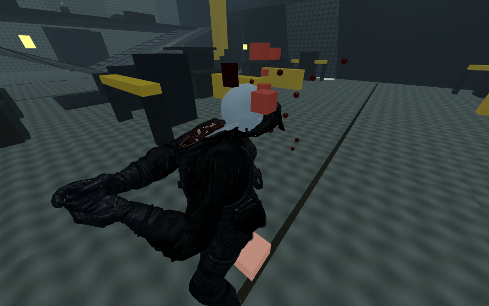
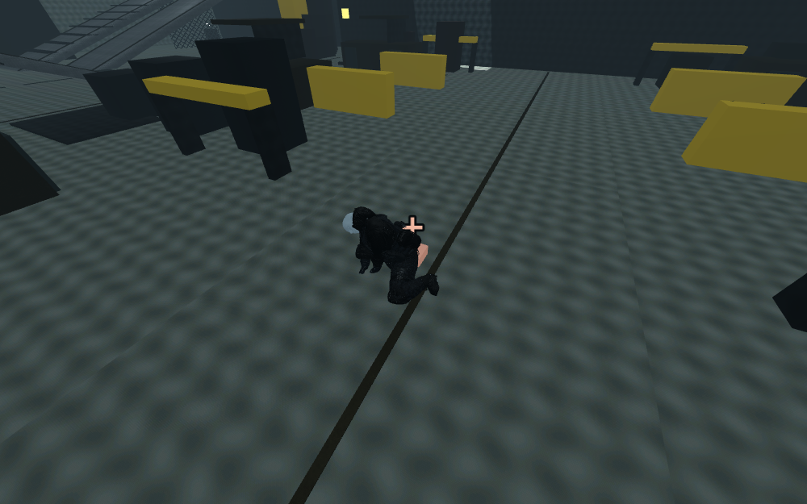

# New-model gore integration — 2026-10-26

The current human soldier now supports corpse head, left/right arm and left/right leg separation. All five gameplay roles use this same review model, so the feature applies to each role. The reviewed ragdoll solver and tuning remain unchanged; detached pieces are separate cosmetic rigid bodies.

## Behavior

Resolved hits accumulate through the existing trauma Resources. Live enemies retain their complete appearance until authoritative death; queued cuts are applied afterward. Additional hits on simulating or settled corpses can sever remaining regions. These callbacks never issue gameplay damage, drops or rewards. Four cuts per corpse and 16 simultaneous fragments are enforced by the shared ledger. Evicted corpse owners do not orphan fragments outside that ledger.

The cut operation clips the actual imported body and clothing triangles, interpolating UVs, normals, tangents and normalized four-bone skin weights. The remaining mesh stays skinned; the removed section is baked at its current pose and receives a world-only rigid collider. The existing rifle LOD1 neck, upper-arm and thigh tissue caps are fitted to the measured cross-section bounds and weighted to the cut boundary. Both ends have tissue geometry. One shared atlas/material is reused: the two prior cap archives had byte-identical atlases.

Gore Off restores original meshes and removes new caps/fragments. Reduced and Full both permit cuts; existing blood-drop density differentiates them. F6 tests a lethal head hit; Shift+F6 additionally cuts the left arm. Ordinary corpse hits still need sufficient accumulated trauma. The old-enemy toggle is no longer required to see dismemberment.

## Verified

- Native Godot 4.6.3 / Jolt tests exercise all five major cut locations across two test cases, repeated-cut rejection, four-per-corpse enforcement, exactly one handoff and unchanged rewards.
- Off / Reduced / Full yield identical five-role kills, score, credits, pickup sequence and gameplay RNG state. Each gives 5 kills and 1,906 score in the deterministic fixture.
- Budget test: **16 ledger fragments and 16 actual fragment nodes**, despite creating more corpses than the ragdoll budget can retain actively. Selecting Off clears them all.
- Settled corpses have **16 cosmetic hit-forwarding colliders**; no physical solver parameters or joints were edited.
- Repeated restart: **1,314 nodes before and after** in the fixture.
- Original anatomical actor, base death actor, clearance code, ragdoll budget and settings match the pre-integration SHA-256 fingerprints.
- Actual Linux debug export smoke: 14 clips loaded, 3 animated deaths, 3 single handoffs ending frozen, 3 new-model fragments, zero errors/warnings. Windows debug/release exports succeeded; Windows execution remains untested here.
- Native viewport captures were inspected for head separation, body/limb separation and Off restoration. These are real warehouse/player-camera images, rendered using llvmpipe / Compatibility; they do not certify hardware performance or seam quality.

## Limits and budget tradeoffs

This is five major corpse cuts, not the complete 22-zone anatomy system. Caps use one authored rifle variant per region, with no weapon-specific ablation, head-pop, angular cut-plane selection, cavities or arterial pulse integration. Tube/bone/muscle detail comes from the existing authored cap meshes. Fitting scales their cross-section and interpolates boundary skin weights; it is **not a welded or all-pose seam validation**. Gaps or tissue/cloth overlap can remain. Original skeleton/collision shapes remain inside the corpse, including invisible severed sections, to preserve the frozen ragdoll implementation.

A cut corpse adds one shared tissue material beyond the original three-material soldier budget. The five initial cuts are precomputed by `tools/playtest/bake_gore.gd` into `data/playtest/gore_geometry.res` (8.7 MiB), and the shared tissue assets load at startup. Split geometry is cached for the current single review body with a 32-entry limit; cap meshes are shared. Uncached combinations of successive cuts still split geometry on a hit and can hitch. Fragment pose baking always runs on the hit. In the headless CPU fixture, first-head-cut time fell from 1,627.158 ms before precomputation to 10.949 ms; ten measured head cuts ranged from 10.686–15.936 ms. This is event CPU time, not GPU or steady-frame cost, and still exceeds a 144 Hz frame budget. These caches are not a general four-body variant pipeline. Hardware frame cost and the 0.5 ms gore target remain unverified.

## Acceptance checklist

- [x] Actual new-model geometry separates; no legacy replacement body is spawned.
- [x] Matching clothing is removed with each piece, and both ends receive authored tissue.
- [x] Corpse hits, repeat rejection, fragment budgets, Off restoration and reward parity pass.
- [x] Native captures inspected; ragdoll fingerprints unchanged.
- [ ] Full anatomical states, all weapon variants and welded deformation seams.
- [ ] Three-material budget and target-hardware timing.

## Five failure points to test

1. Neck/cloth seams: inspect close-up at extreme animation and ragdoll poses; report exposed holes or cap overlap.
2. Cosmetic hit localization: shoot hands/feet and overlapping limbs on settled corpses; report the wrong limb detaching.
3. First-use hitch: record first versus subsequent cuts on target hardware; cached clipping still requires pose baking.
4. Dense deaths: exceed 16 fragments and restart; fragments must evict without rewards or orphan nodes.
5. Off restoration: switch Off after multiple cuts and back to Full; meshes must restore without permanent holes or duplicated rewards.
