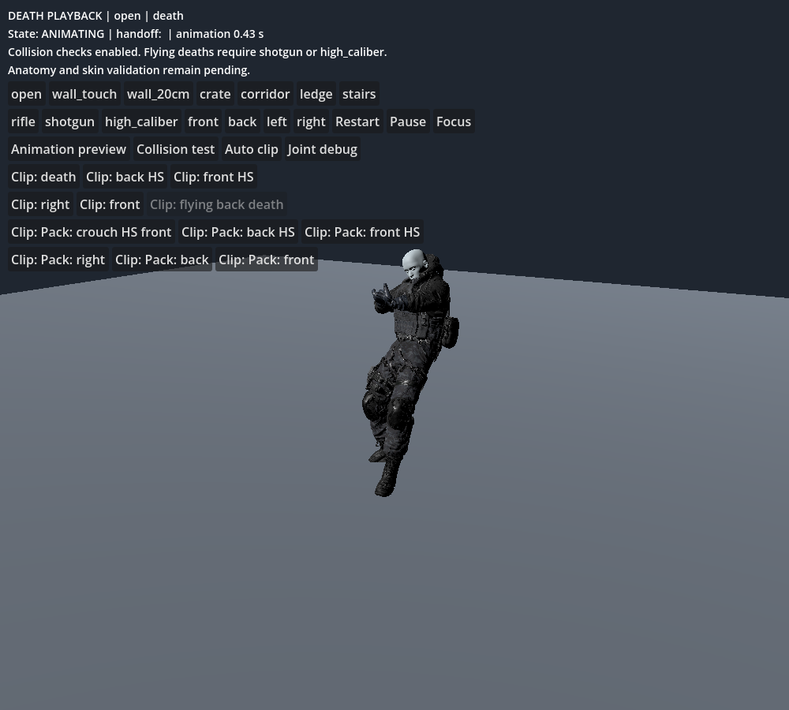
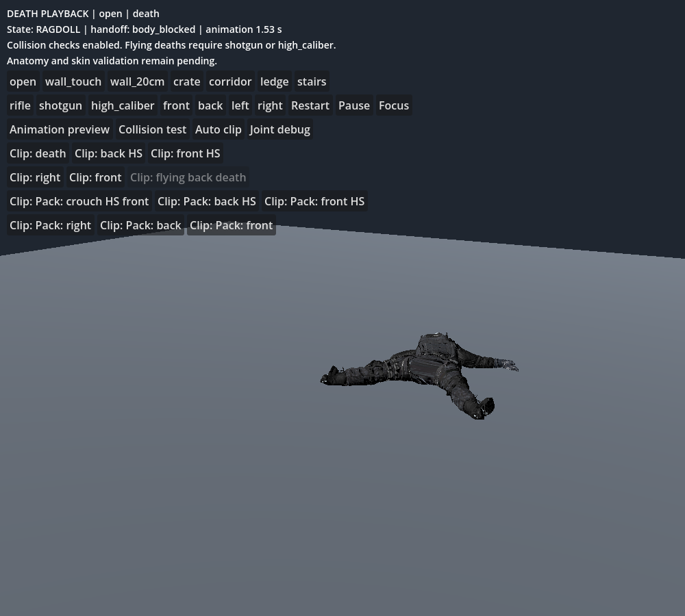
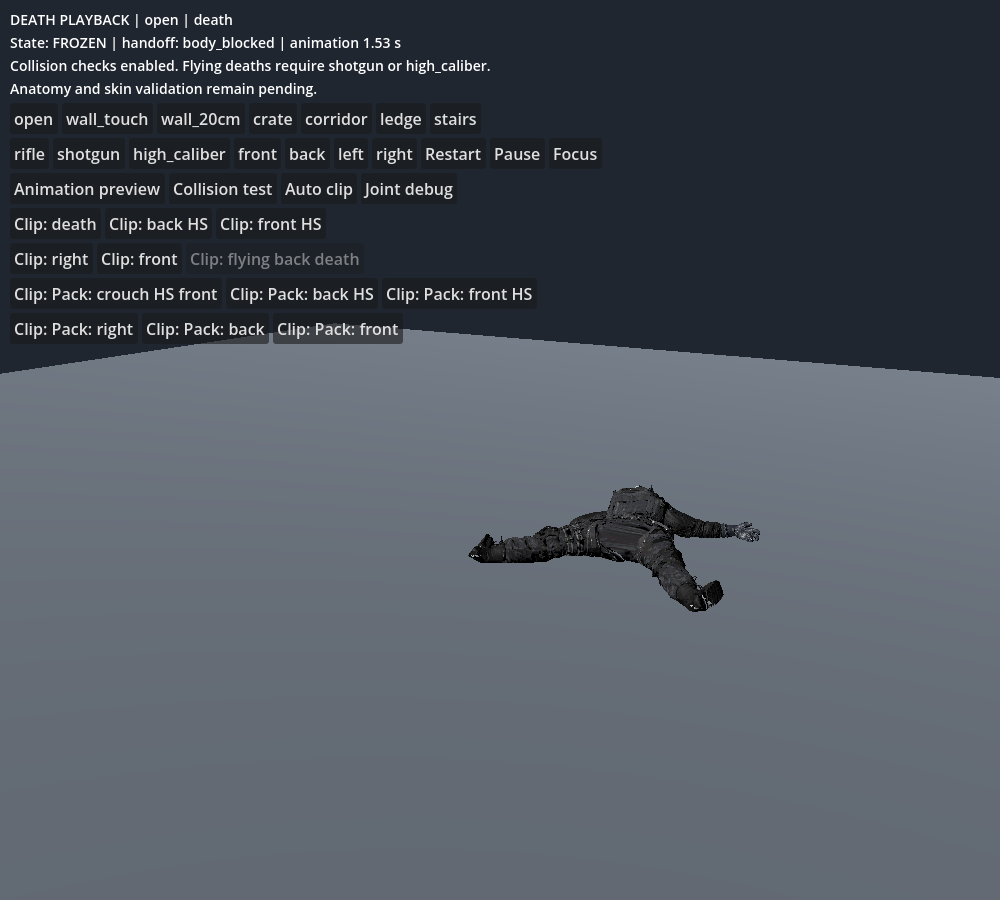

# Death playback and ragdoll transition fix — 2026-10-24

Latest follow-up: [right-side death foot-plant correction](RIGHT_DEATH_PLANT_FIX.md). The table below is the pre-follow-up baseline; current machine results are in `data/ragdoll/playback_transition_report.json`.

## Fixed behavior

The review now opens in collision-aware death playback. Clicking a clip respects that mode; it no longer silently activates collision-free preview. Full authored preview remains an explicit option. Joint diagnostics are behind **Joint debug** so the controls do not obscure the corpse.

The old initial-pose rejection froze the corpse at handoff, sometimes in midair. The controller now projects the initial physical pose into the configured hinge/cone limits and blends into physics. Existing authored poses may require substantial correction; this is not anatomical or skinning approval. Runtime guard interventions cap velocities instead of stopping physics. Jolt owns ongoing contact and joint solving. Initial contact correction translates the physical rig together, is capped at 0.5 m total travel, and does not move the gameplay capsule. Repeated whole-rig translations were tested and rejected after causing unstable corridor motion; they are not in the retained code.

Full ragdoll collision shapes are checked at three interpolated samples per animation step, in addition to the existing swept point probes. A blocked body triggers handoff before continuing the animation. Planted-foot floor contacts remain governed by the existing sole probes; long rigid foot capsules are still checked against walls. This does not establish zero penetration for every skin/gear triangle.

Settling checks now use actual rigid shapes rather than oversized spherical query proxies. After seven seconds, a slow, supported corpse may freeze if its actual collider penetration is within the existing 20 mm acceptance ceiling. The linear settle cap is 0.5 m/s; runtime recovery caps are 4 m/s and 4 rad/s. JSON and Resource tuning contain these values. One authoritative presentation death and one handoff are preserved; gameplay/rewards remain outside this fixture.

## Functional validation

18/18 cases reached active physics, moved at least 30 mm, stayed within the 12 m movement bound, and received exactly one death/handoff with no guard freeze. All 18 finished supported and frozen after simulation. Cases cover all 12 supplied clips plus wall-touch, wall-gap, crate, corridor, stairs and ledge. Final collider penetration was at most 6.99 mm; sampled transient penetration reached 27.22 mm in the flying death. Queries include a 2 mm margin. These results establish functional playback/settling, not the original stricter skin/gore/constraint quality bar. Transient contact penetration remains a polish issue.

| Clip / scenario | Animation s | Physics frames | Hip movement m | Peak collider depth mm | Final depth mm | Guard freezes | Final state |
|---|---:|---:|---:|---:|---:|---:|---|
| death / open | 1.533 | 421 | 0.090 | 6.55 | 4.05 | 0 | FROZEN |
| death_from_back_headshot / open | 0.133 | 421 | 0.855 | 12.64 | 4.04 | 0 | FROZEN |
| death_from_front_headshot / open | 1.483 | 421 | 0.273 | 12.23 | 4.44 | 0 | FROZEN |
| death_from_right / open | 0.017 | 421 | 0.866 | 11.11 | 4.01 | 0 | FROZEN |
| death_from_the_front / open | 0.467 | 421 | 1.039 | 12.52 | 4.03 | 0 | FROZEN |
| flying_back_death / open | 0.317 | 421 | 1.109 | 27.22 | 4.07 | 0 | FROZEN |
| pro_rifle_pack_death_crouching_headshot_front / open | 0.400 | 421 | 0.802 | 13.32 | 4.03 | 0 | FROZEN |
| pro_rifle_pack_death_from_back_headshot / open | 0.133 | 421 | 0.870 | 12.65 | 4.30 | 0 | FROZEN |
| pro_rifle_pack_death_from_front_headshot / open | 1.500 | 421 | 0.275 | 9.06 | 4.10 | 0 | FROZEN |
| pro_rifle_pack_death_from_right / open | 0.033 | 421 | 0.866 | 10.64 | 4.13 | 0 | FROZEN |
| pro_rifle_pack_death_from_the_back / open | 1.683 | 421 | 0.096 | 10.93 | 4.03 | 0 | FROZEN |
| pro_rifle_pack_death_from_the_front / open | 0.483 | 421 | 0.878 | 14.12 | 4.04 | 0 | FROZEN |
| death / wall_touch | 0.000 | 420 | 0.824 | 10.15 | 6.99 | 0 | FROZEN |
| death / wall_20cm | 0.000 | 420 | 0.862 | 16.07 | 4.04 | 0 | FROZEN |
| death / crate | 0.000 | 420 | 0.812 | 11.07 | 5.20 | 0 | FROZEN |
| death / corridor | 0.000 | 420 | 0.833 | 12.66 | 4.54 | 0 | FROZEN |
| death / stairs | 1.333 | 421 | 0.393 | 5.04 | 4.01 | 0 | FROZEN |
| death / ledge | 1.533 | 421 | 0.090 | 5.49 | 4.10 | 0 | FROZEN |

The 12-clip preview regression and existing lifecycle contracts also pass. Rest-space collider audit remains 16 bodies with zero overlapping pairs. The strict anatomical matrix remains separate and unapproved; any runtime recovery intervention fails that matrix. Hardware performance has not been certified, especially the added shape queries. Runs/captures use software-rendered Compatibility, not target Forward+ hardware.

## Inspected native captures

Actual playback at frame 30 (animation), frame 150 (ragdoll), frame 600 (settled corpse). These are direct viewport captures, not reconstructed poses.

## Acceptance checklist

- [x] Normal clip buttons retain collision-aware playback.
- [x] Animation transitions to articulated physics without a guard freeze.
- [x] All 18 functional cases settle supported, without runaway displacement.
- [x] Explicit full-clip preview still works; flying eligibility remains gated.
- [x] State progression captured and inspected; one-death/handoff contracts pass.
- [ ] Strict angular error, skin stretching, gear clipping and all role assets approved.
- [ ] Zero visible clipping under every contact and target-hardware performance verified.

## Five remaining failure points and tests

1. Transient penetration: sample all collider contacts every tick and inspect flying/deep-contact frames, including actual mesh surfaces.
2. Corrected initial pose: inspect blend-time displacement and every corrected joint; retarget/authored pose fixes are preferable to large corrections.
3. Frequent runtime guard interventions: review raw angular excess separately; functional settling does not prove natural unconstrained joint motion.
4. Small or fast obstacles: test thin walls and moving props with full-shape rotation sweeps beyond the current three samples.
5. Skin/gear and performance: remeasure the hand webbing and garment shells on these physics poses and profile six simultaneous ragdolls on target hardware.
