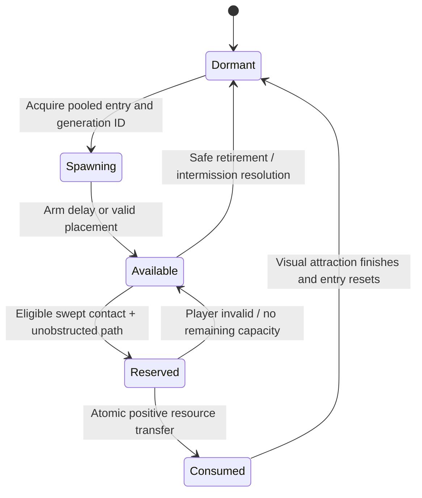
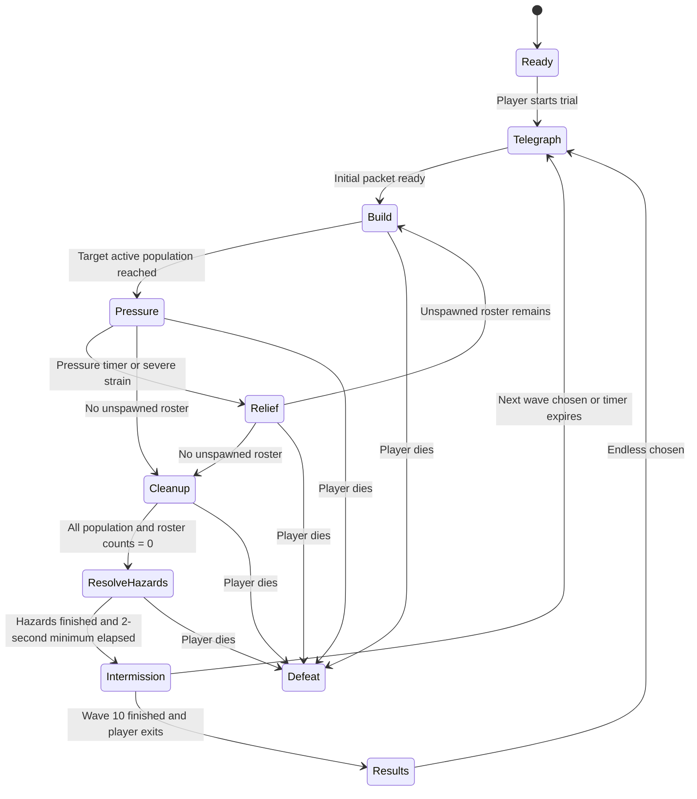

# PROJECT: ZERO-LINE

**Standalone Survival Trial — Technical Design Document v1.0**<br>
**Working subtitle:** Sanguine Protocol<br>
**Scope:** Single-player PC demo, one arena, ten authored waves and optional endless escalation.<br>
**Status:** Implementation baseline. Values are initial tuning specifications, not playtest results or measured engine performance.

## 1. Product definition and production boundaries

The player is an escaped experimental operator placed inside a brutalist weapons-testing facility. Survival depends on maintaining speed, creating openings with Focus and Shroud, killing at close range, and crossing the resulting supply drops before the next formation closes in.

The intended rhythm is **read the formation → break its angle → kill → traverse the drops → reload or reposition → counter the next formation**. A typical exchange lasts 6–12 seconds; a wave lasts approximately 60–100 seconds, measured in unpaused real time. Ten waves plus shopping target a 16–22 minute successful first clear. These durations require playtesting.

The handling reference is the tactile credibility of Modern Warfare (2019); the combat reference is the speed and controlled chaos of Trepang2. All animations, weapons, sounds, environments, and implementation are original. The handling proposals below do not claim knowledge of either game's proprietary pipeline.

| Pillar | Player-facing requirement | Acceptance evidence |
|---|---|---|
| Immediate aggression | Movement never disables ordinary firing or pickup | Fire tests in every locomotion state; swept pickup tests at maximum speed |
| Convincing weapon mass | Hands maintain believable contact; reload stages have mechanical consequences | Contact review, sight-alignment capture, interruption tests |
| Legible chaos | Major threats remain distinguishable during Focus, smoke, and impacts | Threat-recognition playtests with full effects and reduced effects |
| Earned recovery | Combat drops restore health and armor during traversal | Telemetry shows kills and route choice driving recovery |
| Repeatable trials | Ten authored waves teach and combine identifiable threats | Seeded completion runs and progression tests |
| Responsive presentation | 144 Hz is a qualified performance target on a defined PC | Packaged-build frame-time captures on the reference machines |

**Content commitment:** one approximately 60 × 48 m arena; five enemy archetypes; three primary weapons and one emergency sidearm; two abilities; one execution family with positional variants; six attachment choices; three utility upgrades; one trial ruleset; selectable gore and camera intensity. The demo includes onboarding prompts, pause/settings, controller support, restart, results, and a local best score.

**Release constraints:** no multiplayer, campaign, open-world streaming, persistent account economy, fully destructible buildings, or arbitrary procedural arenas. Multiplayer would require separate authority, prediction, rewind, and time-dilation design. The demo uses local gameplay authority; authority boundaries are still explicit to keep systems testable.

**Engine baseline:** Unreal Engine 5.6 release family, C++ gameplay modules, Blueprint asset assembly, Enhanced Input, Gameplay Ability System (GAS), Animation Blueprints/Montages, Control Rig for authoring and limited procedural corrections, Niagara, Chaos, and Unreal Insights. Pin the exact installed patch/changelist, plugins, compiler, and content versions in the implementation repository before production. Engine behavior discussed here must be verified against that pinned build.

## 2. Controls and player contract

| Input | Action | Behavior |
|---|---|---|
| WASD / left stick | Move | Camera-relative ground and air steering |
| Mouse / right stick | Look | Unscaled by Focus; raw mouse path available |
| LMB / right trigger | Fire | Available during sprint, slide, wall-run, dash, and jump |
| RMB / left trigger | ADS | Hold/toggle option; transitions preserve a valid aim solution |
| Left Shift / left-stick click | Sprint; second tap tactical sprint | Hold/toggle settings; no sprint stamina |
| Space / south face button | Jump / wall-run entry / wall-jump | Jump buffering and coyote time apply |
| Left Ctrl / right-stick click | Crouch / slide | Sprinting above threshold starts a slide |
| Left Alt / right bumper | Directional dash | Uses input direction; forward if neutral |
| Q / left bumper | Focus | Press toggles; resource-limited |
| E / west face button | Active Shroud | Press toggles; resource-limited |
| R / north face button | Reload | Tap reload; hold on a ready weapon performs chamber check |
| F / D-pad down | Melee / eligible execution | Execution requires a valid close-range target |
| 1, 2, 3 / D-pad or weapon wheel | Weapons | Two equipped primaries plus emergency sidearm |
| Tab / view button | Trial information / intermission shop | Shop opens only in intermission |
| Esc / menu button | Pause | Freezes gameplay clocks, simulation, and audio appropriately |

All actions are rebindable. Controller assignments are defaults and must support independent aim and ability activation. Simultaneous Q/E requests resolve in event order; only one ability can be active. Explicit failure feedback distinguishes insufficient energy, recharge lockout, and incompatible action.

At the ready screen, choose two of the three primary weapons; the emergency sidearm is always carried. The default loadout is carbine plus shotgun. Primary selection is fixed for the run, while attachments can change between waves. Ordinary melee is a 150 cm forward swept strike for 50 damage, with a 180 ms impact marker and a 600 ms action cycle. It interrupts a cancellable weapon action and briefly owns the hands; it is distinct from the locomotion-driven slide-kick.

Locomotion, weapon action, and ability status are independent state machines. A slide does not restart a reload, a wall-run does not discard ADS, and an ability visual effect does not reset recoil. Reload, weapon switching, a committed melee strike, death, and a committed execution are explicit weapon-use constraints.

## 3. First-person animation and gunplay

### 3.1 Rig, assets, and animation ownership

Use a dedicated first-person arms/weapon rig and a simplified owner body for feet, legs, and shadows. Third-person enemy/world representations have separate animation budgets. Align the body representation to the gameplay capsule; a first-person flourish must never displace the collision capsule or muzzle authority accidentally.

Author first-person animation at 60 fps in centimeters with a documented Unreal coordinate conversion. Export skeletal clips through the pinned DCC/FBX pipeline. Lock a common skeleton and weapon interface: root, wrist/hand controls, grip sockets, magazine, charging handle, bolt, trigger, muzzle, ejection port, and attachment sockets. Mechanism bones are per-weapon where necessary. Grip definitions and attachment offsets live in data assets.

The dominant hand and weapon establish the authored motion. Solve the support hand onto a weapon grip or magazine target with two-bone IK/FABRIK as appropriate. Animate IK weights across release and regrip windows. Do not pin a hand to a socket while the authored hand is reaching elsewhere. Weapon-specific linked animation layers supply poses and actions to the shared player animation graph.

| Required asset set per weapon | Variants and notes |
|---|---|
| Idle / presentation | Hip, ADS, sprint, tactical sprint, slide, airborne, wall-run |
| Fire | Hip and ADS recoil; first shot and sustained additive response |
| Reload | Tactical reload, empty reload, interrupted recovery segments |
| Handling | Equip, unequip, chamber check, obstruction compression |
| Mechanisms | Magazine release/insertion, bolt travel, bolt lock, selector as applicable |
| Integration | One-handed melee accommodation, landing, dash, damage additive |

Use hand-keyed motion for contact, finger articulation, magazine weight, latch behavior, and mechanical settling. Small asymmetries and overshoot communicate effort; large random shakes obscure aim. Camera animation is a separate authored curve/layer with amplitude controls, so camera comfort can change without breaking hand contact.

### 3.2 Pose evaluation and sight alignment

Evaluate in this order: locomotion/handling base → weapon-action montage → local recoil and breathing additives → inertial translation/rotation springs → ADS alignment and obstruction correction → support-hand IK → finger/mechanism corrections. Validate the actual graph ordering because component-space operations and local-space additives are not interchangeable.

Weapon inertia follows a critically damped or mildly underdamped spring driven by camera angular acceleration and movement acceleration. Clamp cosmetic lag to approximately 2.5° hip and 0.35° ADS, with up to 3 cm hip translation and 0.5 cm ADS translation. These limits are initial authoring budgets. Use frame-rate-independent spring integration; verify identical settling at 60, 144, and 240 fps.

At full ADS, the rear/front sight line must match the gameplay aim solution. Any cosmetic sight motion that is excluded from ballistic aim must remain small and recover predictably. Camera recoil that changes aim applies to control rotation once; do not add the same rotation again to the ballistic ray. An optional aiming dot can expose the authoritative aim during accessibility testing.

Use the normal opaque rendering path for arms/weapons initially. A short obstruction sweep compresses the weapon and adjusts the elbow pose near surfaces. A separate foreground rendering pass is a contingency requiring its own lighting, depth, and shadow validation; it is not assumed to be a free fix for clipping.

### 3.3 Firing model and weapon roster

Primary weapons use immediate hitscan for responsive combat, with decorative tracers separated from damage. Enemies use visible, swept projectile simulation so Focus enables readable evasion. This asymmetry is intentional for the single-player power fantasy.

First trace from the gameplay camera to the aim point, then trace from the authoritative muzzle toward that point. The muzzle trace decides the actual obstruction and impact. A wall between muzzle and aim point blocks the shot even when the camera can see over cover. Hip-fire dispersion modifies the aim sample before the muzzle trace; sights display their current spread honestly.

| Weapon | Damage and cadence | Capacity | ADS / tactical reload / empty reload | Role |
|---|---|---|---|---|
| ZL-4 carbine | 24 body; 750 rpm | 30 + chamber; 150 reserve | 180 / 1,650 / 2,100 ms | Reliable mid-range chaining |
| B-8 automatic shotgun | 8 pellets × 12; 180 rpm | 8 + chamber; 40 reserve | 220 / 1,950 / 2,450 ms | Close formation break; magazine-fed |
| V-9 machine pistol | 15 body; 1,000 rpm | 36 + chamber; 180 reserve | 140 / 1,450 / 1,850 ms | High mobility and brief exposure |
| P-2 emergency sidearm | 20 body; 300 rpm | 12 + chamber; infinite reserve | 150 / 1,400 / 1,800 ms | Always-available recovery route |

Damage values are close-range, before location multipliers and armor. Carbine falloff starts at 20 m and reaches 70% at 45 m; machine pistol starts at 12 m and reaches 55% at 30 m; shotgun pellet damage reaches 40% at 22 m. Sidearm reaches 75% at 35 m. Use authored curves between these points. Arena sightlines normally stay under 35 m.

Ordinary exposed heads receive 2× damage; limbs receive 0.8×. Enemy armor uses separate damage-zone rules in section 8. Recoil is a deterministic sequence plus small seeded variation: the first four shots climb predictably, sustained fire adds lateral challenge, and releasing the trigger decays the spring. Never use large independent per-frame random camera offsets.

Firing cadence uses a player action clock and a next-shot timestamp. Low-frame-rate catch-up may resolve elapsed automatic shots with a bounded loop and explicit shot timestamps; a stall must not emit an unlimited burst. Cap catch-up at two shots per frame and carry bounded debt, with telemetry for cadence loss. Ammo and damage are authoritative before cosmetic events.

### 3.4 Reload and chamber-check state

Each weapon owns `MagazineRounds`, `ChamberRounds` (0 or 1), reserve ammunition, the current action ID, and the completed action stages. Capacity notation above means a full inserted magazine plus an independently chambered round.

Reload stages are `Begin → MagazineOut → MagazineIn → ChamberResolved → Ready`. Timed action markers commit transactions once per action ID. Animation notifies request presentation at matching markers; they are not the sole authority for ammunition changes, because notifies can be skipped or reordered during interruption.

- A tactical reload preserves the chambered round. Remaining magazine ammunition returns to reserve; dropped magazines are cosmetic.
- At `MagazineOut`, magazine rounds are transferred out of the weapon exactly once. Firing can cancel the reload if a chambered round remains, producing one shot and an empty magazine state.
- At `MagazineIn`, transfer the available reserve into the magazine once. The weapon can become usable after a short regrip if the chamber remains loaded.
- An empty reload transfers a round from the magazine into the chamber at the appropriate bolt/charging marker. Cancelling before that marker leaves the chamber empty.
- Weapon switching preserves completed mechanical stages. Resuming uses a compatible recovery segment, not an ammunition-restoring restart.
- Death and restart cancel actions and invalidate stale action IDs. Cosmetic magazines cannot grant or remove ammunition.

Removed rounds may temporarily take reserve above its normal pickup cap; preserve them rather than clamping away ammunition during an interrupted reload. Pickup eligibility remains false until reserve falls below its cap. The firing cycle consumes the chamber round and feeds the next magazine round at its mechanical action marker, subject to the normal cadence. Empty mechanisms cannot fire merely because reserve ammunition exists. The sidearm models unlimited replacement magazines without performing arithmetic on an infinite numeric reserve.

Chamber checks last approximately 650 ms, do not change ammunition, and yield to fire in at most 80 ms. They give truthful loaded/empty feedback. Slow-motion visuals, interrupted montages, and skipped frames must not duplicate rounds.

### 3.5 Tactical sprint, ADS, and sliding transitions

Tactical sprint raises and rotates the weapon while acceleration and camera response convey mass. On fire, blend rapidly to a compatible firing pose within 60 ms; accept the shot on the normal cadence immediately and use wider initial spread. On ADS, begin the firing-capable aim blend immediately and complete sight alignment in the weapon's ADS time plus 60 ms of sprint settling. There is no separate sprint-to-fire lockout.

On slide, lower the body/capsule and blend the weapon toward a stable low firing posture over 100–140 ms. Keep the barrel and camera aim coherent while the support hand absorbs the transition. A short landing additive may affect presentation; it does not block fire or cancel reload. Dash and wall-run use compatible upper-body layers for the same reason.

Recoil and sprint settling are separate springs. ADS reduces the visible sway budget; it does not abruptly zero velocity or snap a sight into place. Acceptance capture must demonstrate a continuous pose with no magazine teleport, wrist inversion, or double-applied camera rotation.

## 4. Momentum and collision architecture

Implement `UZLCharacterMovementComponent` on the standard Character Movement foundation with custom slide, wall-run, and dash modes. Use swept capsule movement, floor checks, and collision resolution. Ordinary locomotion does not use animation root motion. Reserve bounded root motion or motion warping for execution alignment after validating free space.

| Parameter | Initial value | Constraint |
|---|---:|---|
| Walk / sprint / tactical sprint | 500 / 800 / 950 cm/s | Tactical sprint ramps over 250 ms |
| Ground acceleration | 5,000 cm/s² | Input-driven; tune stopping independently |
| Crouch speed | 300 cm/s | Remains available below slide threshold |
| Momentum cap | 1,100 cm/s | Preserved hops cannot exceed this |
| Dash speed / duration | 1,400 cm/s / 160 ms | 2 charges; one charge returns every 2.5 s |
| Jump vertical speed | 560 cm/s | Gravity 1,470 cm/s² |
| Coyote time / jump buffer | 100 / 120 ms | Player action time |
| Capsule standing / crouched half-height | 88 / 48 cm | Radius 34 cm; validate arena dimensions |
| Slide minimum entry speed | 650 cm/s | Initial boost at most 120 cm/s; cap 1,100 |
| Slide duration | 850 ms | Exits early below 350 cm/s on flat ground |
| Slide re-entry | 350 ms after exit | Requires valid speed and grounded entry |
| Wall-run | 1.25 s maximum | Minimum entry speed 700 cm/s |

Ground movement approaches the intended velocity using acceleration limits. Air control adds acceleration along requested movement while restricting the projection of velocity onto that direction; it does not multiply the whole velocity vector every frame. Buffered landing jumps preserve up to 95% of horizontal speed and suppress the initial ground-braking impulse for 80 ms. Repeated jumps cannot manufacture speed beyond the cap.

Wall-running requires an airborne player, a valid lateral surface probe, a near-vertical tagged surface, sufficient forward speed, and jump intent. Accept wall normals within approximately 15° of vertical-wall orientation. Move along the wall tangent with reduced gravity and a small inward constraint. Exit on lost contact, opposing input, jump, duration expiry, or invalid clearance. Wall-jump adds an outward impulse while preserving tangential momentum. Reusing the same surface requires landing or 500 ms off that surface; corner probes prevent infinite attachment loops.

Dash applies a swept directional displacement with collisions respected. It grants no invulnerability and cannot pass through enemies or closed doors. On completion, blend back toward the preserved pre-dash momentum, capped at 1,100 cm/s. ADS remains active; the camera should show displacement without an excessive FOV pulse.

Slide enters only from valid ground movement and shrinks the capsule while maintaining its foot position. Friction and slope gravity evolve speed; no constant-speed rail is used. Reduce steer authority to approximately 45% of grounded movement, allow jumping out, and preserve the resulting velocity. On exit, test standing clearance; remain crouched if a ceiling blocks expansion.

**Slide-kick:** a forward capsule sweep during the first 300 ms of a slide can apply 30 damage and a 550 ms stagger to an ordinary enemy once per target per slide. A shield unit is staggered for 350 ms without losing its shield; an elite takes damage but receives only a 120 ms aim interruption outside protected attacks. Stagger does not cancel a grenade already released. Kick contact uses the movement path, so a fast slide cannot tunnel through a target.

Movement collision and weapon obstruction are separate. A navigable player path does not prove muzzle clearance. Off-map falls kill the player, while world-geometry penetration failures return the player to a validated recent safe position and emit a diagnostic; do not award an advantage or erase damage history during recovery.

## 5. Focus and Active Shroud

### 5.1 Explicit clock domains

The demo has one combat world, so Focus dilates that world's gameplay. It is not a spatial bubble and does not imply a multiplayer-compatible local timeline. Menus and the HUD use a separate clock.

| Clock | Advances during Focus | Consumers |
|---|---:|---|
| World simulation | 0.20× | Enemy movement, AI reactions, enemy projectiles, physical debris, ragdolls |
| Player action | 1.00× | Player movement, firing, reload, abilities, dash recharge, combo duration |
| Director | 1.00× but spawn gates respect Focus | Wave pacing and fairness rules |
| Presentation/UI | 1.00× with authored exceptions | HUD, pickups attraction, UI feedback, camera input |

All gameplay clocks stop during pause. Use an explicit unpaused monotonic action-clock service rather than scattering wall-clock reads through actors. Loading and application suspension cannot refill energy or expire a wave.

The initial engine implementation uses global dilation of 0.20 and compensates the player actor's tick using the inverse scale, returning both to 1.0 on exit. This is only the starting mechanism: actor custom dilation does not automatically compensate world timers, every component, attached actor, or Chaos body. Player movement, weapon scheduling, animation playback, GAS duration/cooldown handling, and presentation must each consume the declared clock exactly once. Audit for double compensation. Cosmetic weapons can be components of the compensated owner; separately ticking actors require explicit handling.

Do not assume GAS duration effects provide an undilated player timer. Ability activation, tags, costs, and cancellation use GAS; the action-clock service owns durations and applies expiration/cooldown completion explicitly. Avoid fragile reliance on global TimerManager behavior for real-time gameplay contracts.

During Focus, long compensated player movement steps are subdivided for collision. Enemy projectiles integrate on world time and sweep their entire segment; hitscan traces resolve immediately. Loot availability and collection use player-action timing even if the visual drop briefly follows slowed physics.

### 5.2 Q: Focus

Focus sets the world target scale to 0.20 on the activation tick; blend the visual/audio treatment over approximately 50 ms. Returning to normal takes 80 ms with the player compensation adjusted to the current scale, avoiding a player-speed spike.

Initial charge is 100. Entry costs 10; drain is 25 charge per real gameplay second, yielding 3.6 seconds from full charge. Require at least 20 charge to activate. Manual deactivation is immediate; re-entry has a 500 ms action-clock lockout. Recharge begins two seconds after exit at 10 charge/s. A qualifying kill while Focus is inactive grants 8 charge; kills while active do not extend its duration. Reject duplicate kill IDs.

Focus does not increase weapon damage, negate incoming damage, freeze explosions, or alter pickup amounts. It increases the player's decision and action advantage. Enemy windups retain their world-time duration and therefore remain visible longer. Limit the director to existing threats while Focus is active so real-time pacing does not accumulate a burst of new enemies.

Audio preserves player weapon transients and key enemy warning cues. Apply designed time-stretched/pitched layers to ambience and selected enemy sounds; do not simply pitch every sound down and lose threat intelligibility. Limit trails and screen distortion to preserve silhouettes.

### 5.3 E: Active Shroud

Shroud enters on the activation tick. Entry costs 15 from a separate 100-charge reserve and drains 17/s, giving five seconds from full charge. Require at least 25 charge to enter. Recharge begins three seconds after exit at 8/s. A qualifying kill while inactive grants 6 charge. Re-entry lockout is 750 ms.

On entry, reduce the player's visual target signature to zero for ordinary sight acquisition, suppress new footstep and movement-noise stimuli, and clear continuous direct tracking. AI retains its last-known position and any already committed shots or grenades. Cloak is not invulnerability, and enemies can still hit an occupied space.

Enemies transition from `Engage` to `SearchLastKnown` after their current perception update. Searching enemies investigate evidence and cover routes; they do not read the hidden player's transform. Already emitted sound events remain valid memories. Surface impacts caused by the player can still reveal a location, even if the player's own movement is silent.

Firing, dealing slide-kick damage, ordinary melee, or starting a committed execution breaks Shroud before the corresponding offensive event resolves. Reloading, jumping, wall-running, and sliding without contact are allowed. Taking damage produces a 200 ms visible shimmer and a location stimulus without granting the attacker permanent tracking. Enemies regain normal sight acquisition after reveal; no instant omniscient aim.

Elite proximity scanners are explicitly telegraphed: 600 ms charge, visible sweep, 6 m radius, occluded by structural cover. A successful pulse reveals the current location for 800 ms. The scanner is a deliberate counter introduced late, not an invisible exception to the cloak rule.

Focus and Shroud are mutually exclusive. Switching abilities terminates the old state and restores its clock/presentation first, then spends the new activation cost. If the new ability cannot activate, keep the existing one. Death, pause transition, restart, level exit, and lost possession must have tested cleanup paths.

### 5.4 Executions

An execution is eligible against an ordinary staggered target or an unaware target approached from behind, within 150 cm, with line of sight and collision clearance. Shields are eligible from behind; elites are eligible only during a designated stagger/low-health window. Preview eligibility with a small contextual mark; pressing melee elsewhere performs ordinary melee.

Reserve one target, align within a short bounded displacement, then commit death at the authored impact marker of a roughly 650 ms animation. Shroud breaks at commitment start. Grant 50% incoming damage reduction during the animation, never invulnerability. Death interrupts the sequence. Before the lethal marker, interruption leaves the victim alive with its existing health; after it, the death event and rewards remain committed. No teleport through props, stairs, or railings is permitted.

Executions guarantee a med drop in addition to the victim's normal primary recovery drop. They do not directly heal the player. Collection remains governed by the same pickup state machine.

## 6. Damage, drops, and aggressive recovery

### 6.1 Health and armor

Start each run with 100 health and 75 armor; maximum armor is 100. No passive in-wave health or armor regeneration. Standard ballistic damage sends 75% of incoming damage to armor while armor remains, with the rest applied to health. Overflow from depleted armor transfers to health:

```text
absorbed = min(Armor, IncomingDamage * 0.75)
Armor -= absorbed
Health -= IncomingDamage - absorbed
```

Explosions use an armor fraction of 0.50, melee 0.25, and environmental fall hazards 0.0. Location modifiers and attacker damage modifiers apply before the split. The effective total reservoir against sustained ordinary bullets is health plus armor, but the 25% health leakage can kill a heavily armored player early. At zero health, commit death before pickups with the same simulation timestamp; no posthumous healing.

Incoming directional markers and armor/health audio make depletion readable. Low health uses restrained edge effects; the reticle and enemy warnings remain clear. Screen shake never changes the authoritative aim unless it is specifically weapon recoil.

### 6.2 Drop contract

Each authoritative enemy death emits one uniquely identified reward event. Enemy ragdoll/gib events cannot create additional rewards. A valid player-attributed environmental kill counts; a script despawn or cleanup does not. Reward attribution requires the player to have damaged or displaced the target within the previous five action-clock seconds.

Each ordinary enemy drops one primary recovery object. Its type is selected from a seeded 60% bandage / 40% plate distribution. Deficit protection overrides the selection: when health is at or below 35, the next eligible primary drop is a bandage; otherwise, when armor is at or below 20, it is a plate. Resolve simultaneous deaths in stable death-event order so the result is deterministic.

| Drop | Recovery | Physical representation |
|---|---:|---|
| Small bandage pack | +20 health | Compact pale package with a red identifier |
| Composite plate | +25 armor | Dark beveled plate with cyan identifier |
| Ammunition pack | +one current primary magazine, up to reserve cap | Distinct amber cartridge bundle |

If both resources are critically low, alternate the forced primary type across qualifying kills. Every third ordinary kill also drops ammunition; every elite drops both recovery types and two ammunition packs. Ammo packs select the equipped primary if it needs reserve, otherwise the other equipped primary. Keep the emergency sidearm's unlimited reserve and normal reload cadence as the final recovery route.

Drop selection depends only on committed player state at death and the seeded rules. It does not change the number or damage of enemies. Log forced-drop reasons so balance analysis can distinguish authored generosity from randomness.

Spawn drops with a short upward/lateral toss of roughly 1–2 m/s and gravity. Use simple collision, no player blocking, and no influence on enemy navigation. Enable collection after 80 ms of action time or after valid ground placement, whichever occurs first. Presentation may continue its toss after logical collection begins.

Place the logical pickup on a reachable nearby surface on the victim's tier. If the body is falling outside the arena, use its last validated reachable death-adjacent point, then the nearest suitable pickup anchor. Do not put a drop behind a locked door, across an untraversable gap, or on a different floor merely because it is close in Euclidean distance.

### 6.3 Automatic collection state machine

There is no pickup key, inventory animation, or movement interruption. Collection checks use the player capsule's swept path, not only an overlap at the final frame position. This is required at dash and slide speeds.



**Availability:** a logical record stores pickup ID, pool generation, source death ID, type, remaining quantity, location, spawn time, and claim state. The mesh/physics actor is its presentation proxy. Logical records remain authoritative if a pooled mesh is reclaimed.

**Candidate detection:** at each movement update, query pickups along the swept lower-capsule path with a 100 cm collection radius. Limit vertical separation to 100 cm around the collection anchor; interpolate the anchor through capsule-height changes. Broadphase candidates require a short world-geometry visibility sweep at the candidate's closest path point. Floors and walls block collection. Do not perform a wide spherical vacuum through adjacent rooms.

**Eligibility:** player alive, pickup armed and available, unobstructed contact, and resource below capacity. At full capacity the item remains in the world and does not play a fake collection sound. Preserve any unused quantity after a partial transfer; a 20-point bandage collected at 95 health restores 5 and retains 15.

**Claim and transfer:** process gameplay on the authority/game thread. Reserve by pickup ID and generation, recalculate eligibility, atomically apply `min(remaining, deficit)`, and subtract the amount. Each successful claim increments a transfer sequence; its transaction key is pickup ID + generation + transfer sequence, allowing a partial stack to be collected again without replaying an earlier transfer. A zero transfer returns to `Available`. A partial transfer returns the remainder to `Available` with a brief per-player retry delay; full transfer becomes `Consumed`. Disable consumed entries' query participation before posting cosmetic events. A reused pool slot cannot accept a late callback from an older generation.

**Presentation:** after a successful transfer, an optional duplicate visual travels toward a chest/HUD anchor over 80–120 ms, using action time. Health/armor change at the transfer, not when the visual arrives. The cosmetic can be dropped under load without changing recovery. Batch sounds and HUD numbers within 100 ms to avoid a dozen identical simultaneous cues.

```text
ResolvePickup(pickupId, generation, player, contact):
    record = LookupCurrentGeneration(pickupId, generation)
    if record is missing or record.state != Available: return
    if !player.alive or !record.armed: return
    if !ValidSweptContactAndOcclusion(contact): return
    deficit = CapacityFor(record.type, player) - CurrentFor(record.type, player)
    if deficit <= 0: return

    record.state = Reserved
    amount = min(record.remaining, RecheckedDeficit(player, record.type))
    if !player.alive or amount <= 0:
        record.state = Available
        return

    record.transferSequence += 1
    transaction = (record.id, record.generation, record.transferSequence)
    ApplyResourceExactlyOnce(transaction, amount)
    record.remaining -= amount
    record.state = Consumed if record.remaining == 0 else Available
    EmitPickupPresentation(amount)  // never grants resources
```

Movement contacts and damage carry simulation timestamps and are resolved chronologically; damage precedes healing on an exact tie. After lethal damage, later contacts do not revive the player. This prevents frame ordering from changing survival at high speed. The implementation must define the same ordering for physics callbacks, projectile hits, and hitscan shots.

**Lifetime and saturation:** keep uncollected gameplay recovery for the current wave. Physical proxies sleep after settling; merge nearby same-type logical stacks only when they share a reachable surface and unobstructed route. Budget 64 visible proxies and 160 logical records. The authored wave roster produces fewer than 160 records even with execution bonuses; endless waves cap roster size as described below. On visible-pool exhaustion, keep the logical item and use a cheap icon/instanced representation. Never silently delete needed recovery to meet a cosmetic budget.

At confirmed wave clear, resolve remaining drops into the player up to capacity, in stable spawn order, and retire excess quantities. The director's hazard-resolution state supplies the minimum two-second final-exchange window before this transfer. Intermission grants a further 25 health up to maximum, replenishes ammunition and ability/dash charges, and does not fully restore armor. This removes tedious end-of-wave scavenging while preserving the need to collect under live pressure.

### 6.4 Economy balance constraints

Recovery should make successful aggression sustainable without making every kill a full reset. A normal primary drop averages 22 resource points when both resources have capacity, before deficit overrides. At six ordinary kills per 30 seconds, that is roughly 4.4 resource points/s of potential supply; actual collection, wasted capacity, and armor leakage reduce its value. Compare this against observed incoming damage, not just nominal enemy DPS.

Initial target: competent players recover 55–75% of available useful recovery during waves, spend 20–35% of combat time below 50 health, and survive an isolated mistake while dying to sustained crossfire. These are hypotheses. If recovery is insufficient, adjust drop amount or encounter geometry before inflating player health. If recovery is excessive, reduce surplus supply or threat overlap predictably; do not secretly raise enemy accuracy based on player success.

## 7. Arena: Test Chamber K-17

The arena is a compact industrial test chamber with three connected elevations: service trench at −3 m, main processing floor at 0 m, and broken inspection galleries at +4.5 m. A central machine block creates circular routes and interrupts long sightlines. Brutalist concrete, steel baffles, hydraulic equipment, harsh work lights, and limited alarm color communicate the facility's function.

| Space | Approximate footprint | Combat purpose |
|---|---|---|
| Central processing floor | 24 × 20 m | Main recovery crossings; three routes around machine mass |
| North inspection gallery | 22 × 5 m | Elevated pressure with two stair routes and one drop exit |
| West service trench | 18 × 6 m | Slide-cover path; exposed exits prevent permanent safety |
| East wall-run corridor | 18 × 4 m | Alternate route with interrupted firing angles |
| South staging platform | 14 × 8 m | Shop terminal and low-pressure orientation point |
| Four spawn vestibules | 5 × 5 m each | Occluded staging with readable doors/lights/audio |

Every sustained fighting position has two traversable exits. No spawn vestibule has direct sight to the player at insertion. Structural cover is permanent; authored destructible cover changes local angles without removing all safety in a sector. Railings, signs, glass, loose crates, and selected machine panels are destructible. Concrete pillars, main stairs, major wall-run surfaces, and essential navigation routes remain intact.

Use at least one 110–130 cm clear slide passage, subject to capsule and camera testing. Corridors carrying enemies stay broad enough for shield movement and player flanking. Wall-run surfaces use a consistent painted or material cue and lead to useful combat positions. They are shortcuts, not mandatory precision-platforming gates.

Navigation uses a baked Recast mesh and explicit links for galleries, drops, and jump-down points. Destroyed props use pre-authored obstacle changes where required; avoid whole-arena navmesh rebuilds during combat. Enemies use supported routes instead of attempting player wall-running.

Local spawn scoring considers visibility, path distance, firing-lane occupancy, and recent use. Prefer paths 8–22 m from the player. A door telegraphs deployment for at least 800 ms in world time before combatants emerge, and newly activated units wait at least 600 ms of world time before attacking. If no fair spawn exists, delay the packet. Do not spawn inside the player's current view or immediately behind the player's collision capsule.

## 8. Enemy architecture and ten-wave blueprint

### 8.1 Archetypes

| Archetype | Initial durability | Behavior and counter | Threat constraints |
|---|---:|---|---|
| Enforcer | 100 health | Short carbine bursts, basic cover; susceptible to kicks and flanks | 450 ms visible aim tell; 3 × 10 damage burst; projectile speed 7,000 cm/s |
| Rusher | 85 health | Uses close routes and shotguns; forces movement | 600 ms close attack tell; 5 × 6 damage pellets; poor range |
| Riot shield | 150 health | Advances to anchor a lane; frontal shield blocks direct small arms | Exposed legs/flanks; kick staggers; 700 ms bash tell; 25 damage |
| SF flusher | 130 health + 50 breakable vest | Relocates, suppresses, throws a telegraphed fragmentation grenade | Vest absorbs 50% torso damage until exhausted; grenade budget below |
| Elite supersoldier | 650 health + 150 breakable armor | Alternates rifle pressure, telegraphed dash, and scanner/search | 2-second post-dash recovery; vulnerable back/limbs; no permanent tracking through Shroud |

Enemy vest/elite armor uses the player-style overflow formula with a 50% torso absorption factor, applied only to the covered damage zone. Exposed heads receive normal head multipliers; helmets, if included, have an explicit visible break state and fixed protective pool. Shields use actual frontal trace geometry, not an omnidirectional damage-reduction flag.

The elite has three states: `Pressure` (rifle bursts and repositioning), `Breach` (800 ms dash tell followed by a swept dash and melee attempt), and `Recover` (two-second vulnerability). At 50% health it adds a scanner pulse and shorter reposition intervals, rather than multiplying damage. Focus slows its world actions normally. Boss armor plates visibly detach when exhausted; cosmetic pieces do not create loot.

Flusher grenades deal up to 40 damage with linear distance falloff over 4 m, structural line-of-sight occlusion, and an audible/visual fuse of at least 1.5 world seconds after release. Only one grenade may be live at once in waves 1–5 and two afterward. A grenade token remains occupied until detonation or confirmed removal.

Baseline enforcers fire three shots at 120 ms spacing, then wait at least 1.2 world seconds before their next aim tell. Rushers wait 1.6 seconds between shotgun attempts and favor distances under 8 m. Flushers fire four-shot bursts of 10 damage with the same projectile speed as enforcers, a 500 ms tell, and 1.5 seconds of recovery; grenades have an eight-second personal cooldown. Elites fire four-shot bursts of 12 damage after a 600 ms tell, recover for 1.4 seconds, and deal 30 melee damage after a successful breach. All these intervals use world time and still require director attack tokens. Projectiles have at most a two-world-second lifetime and use swept collision; the enemy can aim with imperfect estimated player velocity but cannot retarget a projectile already in flight.

Standard AI uses Behavior Trees/Blackboards, AI Perception, and sparse EQS cover queries. Blackboard facts distinguish confirmed sight, last-seen position/time, heard stimulus, and inferred search location. Never store a permanently updated hidden-player position as a target. State transitions are `Deploy → Acquire → Engage/Reposition → Search → Stagger → Dead`, with attack-specific substates.

### 8.2 Wave roster

Notation: **E** enforcer, **R** rusher, **S** shield, **F** flusher, **X** elite. Roster is the total committed population, not the simultaneous population. Spawn in packets of 2–5 while obeying the active cap and director gates.

| Wave | Exact roster | Total / active cap | New lesson | Base credits |
|---|---|---|---|---:|
| 1 | 8E | 8 / 4 | Fire, reload, collect under light pressure | 150 |
| 2 | 8E + 4R | 12 / 6 | Slide escape and close pursuit | 175 |
| 3 | 8E + 4R + 2S | 14 / 8 | Break a frontal formation with flanking | 200 |
| 4 | 8E + 4R + 2S + 2F | 16 / 10 | Leave cover before grenades arrive | 225 |
| 5 | 8E + 4R + 2S + 2F + 1X | 17 / 10 | First elite; small escorts | 250 |
| 6 | 10E + 6R + 4S + 2F | 22 / 12 | Interlocking lanes and vertical pursuit | 275 |
| 7 | 10E + 6R + 4S + 4F | 24 / 14 | Maintain recovery routes under flushing | 300 |
| 8 | 10E + 6R + 4S + 4F + 1X | 25 / 14 | Elite plus split-level formations | 325 |
| 9 | 12E + 8R + 4S + 4F + 1X | 29 / 16 | Peak combined pressure | 350 |
| 10 | 12E + 8R + 4S + 4F + 2X | 30 / 18 | Final test; elites introduced in separate packets | 500 |

The two wave-10 elites may overlap only after the first has entered its recovery phase or lost half its health; no simultaneous initial breach. Waves 1–4 briefly present a mechanic hint when its first relevant situation occurs, without pausing combat. The player can disable hints.

After wave 10, present completion results and an explicit choice to finish or continue endless. Endless increases roster size by four per wave to a maximum of 40; active population caps at 20, simultaneous elites at two, and grenade concurrency at two. Rotate formations and arena entry routes. Enemy damage stays fixed. Health can scale by 3% per endless wave to a 30% maximum; further difficulty comes from composition and reduced downtime, not unlimited bullet sponges.

### 8.3 Director and combat pacing loop



Death is a global transition from every active run state, including telegraphing and intermission setup. Pause is an orthogonal mode that freezes the current state and all relevant clocks.

**Build:** release one packet, observe routes, then release another after 3–6 director seconds if the active cap and visibility rules permit. **Pressure:** maintain attacks for 8–12 seconds. **Relief:** withhold new packets for 3–5 seconds and reduce concurrent attack permissions; active enemies remain present. **Cleanup:** make remaining enemies actively search/reposition and show a subtle directional hint after 12 seconds without contact.

Attack tokens limit actual simultaneous commitments, not just AI population: 2 baseline firing attackers on wave 1, rising to 5 by wave 9, plus at most one committed melee attacker and the separate grenade limits. Elite burst/dash actions consume the corresponding tokens. Others reposition, aim, or suppress near cover without secretly dealing unrestricted damage. Tokens release on completion, death, cancellation, or a watchdog timeout.

Calculate a normalized pressure estimate from recent incoming damage (35%), aimed firing lanes with unobstructed access (30%), nearby flank threats (20%), and depleted recovery resources (15%). Normalize damage as health-plus-armor loss over the last two action seconds divided by 60; firing lanes as committed visible attackers divided by five; flank threats as attack-capable enemies within 8 m outside the forward 120° divided by three. Normalize resource depletion as `0.7 * (1 - Health/100) + 0.3 * (1 - Armor/100)`. Clamp each input to 0–1, then weight the terms. Use a two-second smoothing window and hysteresis. Above 0.8 with health below 30, request a four-second spawn relief, no more than once per 20 seconds. Already released projectiles and grenades continue. Below 0.35, allow the next scheduled packet sooner, subject to telegraphs. The wave roster and enemy damage never change in response to this estimate.

During Focus, suspend new packet release and freeze attack-token expansion. On exit, resume normal spacing rather than paying accumulated spawn debt. Shroud changes AI perception but does not remove living units from the active count. Maintain separate `Alive`, `PendingSpawn`, `ReservedSpawn`, and `UnspawnedRoster` counts. Once all are zero and all death/reward events for that simulation step have resolved, enter `ResolveHazards`: prevent new attacks, return Focus to normal time, and let committed projectiles and grenades finish. Wait at least two action-clock seconds and until all damaging hazards have expired before committing wave-clear rewards and opening the shop. Death during this interval remains defeat. Grenades use a fixed 1.5-world-second fuse in the demo; together with projectile lifetime this gives resolution a bounded duration. Log and safely retire an invalid overdue hazard rather than leaving the shop transition blocked indefinitely.

Stuck-enemy recovery first asks the unit to path toward an alternate reachable combat anchor. After ten seconds without useful movement/contact, attempt an occluded relocation through a valid spawn vestibule with a new tell. Relocation preserves health and reward ID. If recovery is impossible, remove the unit without kill score or loot, record the defect, and release its roster/token accounting so the run cannot softlock.

## 9. Style, credits, and intermission purchases

Kills provide a base 100 style points; an elite provides 500. Eligible modifiers add points before the combo multiplier: Focus kill +25; kill while sliding +25; headshot +20; execution +50. A slide multi-kill adds +75 once when a slide action produces its second kill within 1.5 action-clock seconds. Each modifier uses a kill/action ID and cannot repeat through duplicated damage events.

A qualifying kill within four action-clock seconds raises the combo by 0.25, from 1.0 to a maximum 3.0. On timeout it decays by 0.25 each second until 1.0. Taking health damage reduces it by 0.5, no more than once per 500 ms; armor-only hits leave it unchanged. Focus does not extend the real-time combo window. Script removals, shooting corpses, and damage to already dead targets never count.

At wave clear, award the table's base credits plus `min(200, floor(WaveStylePoints / 100))`. Credits persist within the run only. The first four base rewards total 750, enough for multiple meaningful early choices even with weak style performance. Purchases are not required to keep baseline weapons viable through wave 10.

Intermission starts after drop resolution, lasts 20 seconds, and can be advanced immediately. Opening the shop pauses its countdown; enemies and projectiles have already been cleared or resolved. Display the next wave's introduced threat, exact cost, current balance, effect, and tradeoff. There is no paid reroll or random shop stock.

| Purchase | Cost | Effect | Limit/tradeoff |
|---|---:|---|---|
| Reflex optic | 150 | Clearer sight picture | Replaces optic slot; no damage increase |
| Muzzle brake | 200 | −18% vertical recoil | +8% hip spread |
| Control foregrip | 200 | −15% horizontal recoil | +20 ms ADS |
| Extended magazine | 250 | +30% magazine capacity, rounded down | +180 ms reload; spare reserve unchanged |
| Lightweight stock | 200 | −30 ms ADS | +10% sustained recoil |
| Laser module | 150 | −20% hip spread | Only active while revealed; no Shroud signature leak |
| Recovery field | 250 | Pickup radius 100 → 125 cm | One level; all occlusion rules remain |
| Capacitor | 300 | Focus or Shroud maximum +20 | Choose one per purchase; max one each |
| Dash actuator | 300 | Dash charge interval 2.5 → 2.1 s | One level; speed and collision unchanged |

Two attachment slots per primary are active in the demo, with explicit optic/muzzle/underbarrel/magazine/stock/laser compatibility. Purchased attachments remain owned for that run and can be switched free during intermission; no sell/refund loop. Confirm and debit a purchase atomically, and reject duplicate transaction IDs or insufficient balance. Preview should compute final combined stats so multiplicative bonuses do not hide unintended stacking.

Intermission resets short cooldowns and refills ability/dash resources; it does not grant permanent progression. Results show wave reached, completion time, kills, style score, collected recovery, damage taken, accuracy, and chosen modifiers. Save settings and best scores locally; restart clears run rewards and returns the arena to its initial state.

## 10. Impact, gore, physics, and sound

### 10.1 Impact authority and presentation

An authoritative hit event records shot ID, target ID, physical material, bone/damage zone, impact position, direction, damage result, and lethal status. A presentation router uses this event to select impact animation, audio, Niagara, decals, and optional gore. Disabling gore does not change damage, hit confirmation, drops, or AI behavior.

Living enemies use short additive reactions and bounded physical animation on permitted bones. Blend only compatible regions; a hit reaction cannot cancel every enemy attack indefinitely. On death, snapshot the current pose, disable normal movement/attack authority, and hand off to a Chaos ragdoll with a clamped impulse derived from hit direction and authored force category. Avoid feeding raw high-speed projectile momentum into the body and launching it across the arena.

For localized exit wounds, resolve a body entry hit and a short same-body continuation query or authored thickness region. Spawn an exit effect only when a valid opposite surface is established; use an entry-only fallback for ambiguous geometry. Static decals alone deform poorly on animated skin, so use limited wound-mask/material slots or attached wound geometry on the damaged region. Reserve world decals for walls and floors. Limit a body to four visible wound regions.

Gore uses authored detachable regions, prebuilt caps, and limited pooled gibs. No runtime arbitrary skeletal mesh cutting is required. Separate flesh impact, armor strike, shield hit, and machinery impact. Blood spray follows impact direction with gravity and collision approximations; nearby surfaces receive a bounded traced decal. Cosmetic blood never creates navigation or collision hazards.

### 10.2 Resource budgets and reset rules

| System | Initial hard budget | Degradation order |
|---|---:|---|
| Fully simulated ragdolls | 6 near-player bodies | Settle oldest low-significance body, retain static pose |
| Visible retained corpses | 18 | Fade occluded oldest bodies; preserve near-player readability |
| Active physics gibs | 16 | Replace secondary gibs with Niagara sprites/meshes |
| Live shell bodies | 32 | Sleep after 0.35–0.7 world s; keep up to 96 cheap resting instances |
| World blood decals | 96 | Drop tiny/distant decals; fade oldest low-priority decals |
| Skeletal wound regions | 4 per visible body | Reuse oldest region |
| Simultaneous grenade debris sets | 2 | Remove secondary fragments before primary telegraphs |
| Destructible cover events | 12 per wave | Use authored broken mesh swap after budget exhaustion |

Pool corpse presentation actors and effects rather than repeatedly spawning complex skeletal/physics actors. Reset bone transforms, velocities, collision filters, material wounds, hidden sections, timers, and event subscriptions on reuse. Never return a body still referenced by an execution or active gameplay collision operation. Pooling reduces allocation churn; it does not make active physics free.

Shell ejection is synchronized with the authoritative shot and animated mechanism. Apply randomized but bounded initial velocity/spin from the ejection socket; collide only with appropriate world geometry, not player movement or enemy hitboxes. Use a small set of material-specific bounce sounds with voice limiting. Under load, replace distant shell physics with cosmetic ballistic motion or omit them.

Geometry Collections are reserved for a few hero props. Most destruction uses a pre-authored intact/broken mesh switch plus bounded debris. Structural navigation and cover identity have explicit ownership independent of debris.

### 10.3 Sound and camera grammar

Layer each player shot from a dry mechanical transient, muzzle report, room response, and weapon mechanism. Use separate close and distant enemy reports. Helmet/plate impacts, flesh impacts, and shield strikes have distinct confirmation without drowning directional threats. Limit repeated voices and prioritize enemy grenade, elite charge, player low-health, and hit-confirmation cues.

The loudness mix ducks ambience around important impacts, not the threat warning bus. Indoor reverb zones and limited occlusion traces sell the chamber. A compact voice budget starts at 64 audible voices with priority-based stealing and maximum instances per event type.

Camera response separates recoil, locomotion, explosion impulse, and cosmetic shake. Weapon recoil changes gameplay aim; other shake is presentation-only and capped. Expose screen shake, roll, head bob, motion blur, chromatic aberration, blood overlays, and gore independently. Provide an FOV range of 80–110 horizontal-equivalent at 16:9 with correct aspect handling; state the convention in settings. Default motion blur and chromatic aberration are off for the performance preset. Wall-run roll caps at 4° and can be disabled.

## 11. Unreal implementation architecture

| Module/component | Owns | Key outputs |
|---|---|---|
| `ZLCore` / clock and event services | Clock domains, stable IDs, seeded randomness, run lifecycle | Timestamped gameplay events, reset contract |
| `UZLCharacterMovementComponent` | Locomotion velocity, swept collision, custom modes | Movement state, path contacts, kick candidates |
| Player ability component / GAS | Ability activation, attributes, costs, tags, cancellation | Focus/Shroud state, health/armor/resource changes |
| `UZLWeaponComponent` | Ammo, shot cadence, action-stage transactions, aim solution | Authoritative shot/reload events |
| Player AnimInstance / linked layers | Presentation poses, IK, recoil springs, montage visualization | Arms, weapon mechanisms, camera curves |
| `UZLPickupSubsystem` | Logical drops, spatial queries, claims, transfers, proxy pool | Resource deltas and pickup presentation requests |
| `AZLTrialDirector` | Wave roster, spawn reservations, pressure, attack tokens | Spawn packets, relief state, wave-clear event |
| Enemy controller / components | Perception, tactical state, zone armor, attacks | Damage requests and one authoritative death |
| `UZLImpactSubsystem` | Cosmetic effects and bounded physics presentation | Audio, wounds, blood, shell, corpse handling |
| Trial GameMode / GameState | Run state, score/credits, intermission, defeat/results | Authoritative run transitions and HUD snapshots |
| SaveGame/profile | Settings, local best score, schema version | Validated local persistence |

Data assets define weapon stats, mechanism/action timing, enemy archetypes, wave entries, attachments, ability tuning, pickup types, and performance tiers. Designers tune assets; C++ enforces invariants and transactions. UI receives immutable snapshots and events rather than changing gameplay attributes directly.

Suggested gameplay tags include `Movement.Slide`, `Movement.WallRun`, `Action.Reload`, `Action.Execution`, `Ability.Focus.Active`, `Ability.Shroud.Active`, `State.Dead`, and `Status.Staggered`. Centralize activation/cancellation rules instead of duplicating tag checks in unrelated Blueprints.

Resolve combat in a documented order: consume input → update clock/ability transitions → swept movement and timestamped contacts → weapon/projectile/AI hit generation → ordered damage and recovery transactions → death/reward deduplication → director accounting → presentation/HUD. Where engine tick groups split these phases, queue events and resolve them at the defined boundary. Attach physics-derived events to the appropriate substep time; do not silently assume callback arrival order is gameplay order.

Presentation listeners cannot deal damage, spend credits, or spawn logical loot. Every delayed callback carries a run generation plus object/action generation. Restart increments the run generation, drains queues, resets time dilation, returns owned pools, clears input buffers, and reinitializes the director. This prevents a previous run's grenade or montage callback from affecting the next run.

Use soft asset references for loadout/content definitions and preload the chosen arena roster, weapons, common impacts, and wave assets before the trial countdown. The small arena does not require World Partition. Maintain an explicit collision-channel matrix for player capsule, enemy capsule, shield, projectile, pickup query, ragdoll, and cosmetic debris; test shield occlusion and pickup occlusion separately.

## 12. Rendering and performance specification

### 12.1 What 144 FPS means

A frame at 144 Hz has **6.94 ms**. A design document cannot guarantee that budget before implementation and hardware measurement. This specification establishes a release target and a response when it is missed.

Reference A: Ryzen 5 5600, RTX 4060 8 GB, 16 GB dual-channel RAM, NVMe SSD, Windows 11, DX12, 1920 × 1080 output, Performance preset, native rendering initially. Reference B: the same CPU/memory class with Radeon RX 7600 8 GB. Record exact OS, BIOS, drivers, build, cooling/power settings, and resolution in each qualification run. Other machines require separate qualification; “mid-range” alone is insufficient.

Frame generation is excluded from simulation/latency and base-FPS claims. If an upscaling mode is offered, report its internal resolution and results separately. Dynamic resolution may be a user option but cannot silently redefine the native-resolution acceptance run.

| Budget | Target ceiling | Notes |
|---|---:|---|
| Game thread | 3.5 ms | AI, movement, gameplay, dispatch |
| Render thread / RHI critical work | 3.0 ms | Platform-dependent overlap must be measured |
| GPU | 5.8 ms | Leaves margin below 6.94 ms |
| Frame-time release target | 6.94 ms | CPU/GPU pipelines overlap; these rows are not additive |
| GPU memory | 6.5 GB | Reserve headroom on 8 GB cards |
| Working set | 10 GB | Leave OS/background room on 16 GB systems |

An initial GPU allocation is: depth/base/lighting 2.2 ms; shadows 1.0 ms; translucency/Niagara 0.7 ms; post/AA 0.8 ms; decals/other 0.5 ms; GPU margin 0.6 ms. Measure categories to avoid double counting passes. Initial game-thread allocations are player/weapons 0.6 ms, AI/navigation 0.9 ms, animation dispatch 0.5 ms, physics integration 0.5 ms, director/pickups/UI 0.3 ms, and remaining overhead/margin 0.7 ms.

### 12.2 Rendering strategy

Use baked static lighting and a small number of movable shadow-casting lights in the Performance preset. Lumen, hardware ray tracing, and expensive volumetric effects are off in that preset. Muzzle flashes use emissive surfaces and a pooled, tightly limited light budget; only selected nearby flashes cast shadows, if profiling allows.

Benchmark Nanite on dense opaque static structures against conventional LODs. Do not enable it indiscriminately for tiny props, masked surfaces, or effects. Use conventional LODs/HLODs and instancing for repeated pipes, wall modules, and distant gallery clusters. HLOD helps distant clusters and draw-call pressure; it does not reduce nearby skeletal animation or translucent blood cost. In this small indoor arena, occlusion, material simplicity, instancing, and actor/component count are likely to matter more.

Keep first-person weapons at consistent quality, but audit skeletal mesh sections, materials, and attachment draw calls. Limit expensive layered materials and overdraw around the reticle. Select TAA or TSR based on measured cost and sight clarity; both require testing for ghosting during Focus and rapid strafing. Avoid promising a specific AA feature before the target machine capture.

### 12.3 Simulation, AI, and effects scaling

- AI: stagger perception updates; nearby engagement decisions at 10–20 Hz, distant searching at 5 Hz. Projectile/collision and attack timing remain simulation-correct. Run expensive EQS queries only on meaningful tactical changes and cache valid cover candidates.
- Animation: preserve full update rates for first-person arms and near enemies. Use visibility/significance-based update reduction for distant enemies. Audit Animation Budget Allocator or update-rate optimization against hitbox poses and aim readability; throttled presentation cannot leave gameplay hitboxes at invalid stale positions.
- Physics: keep bounded near-player ragdolls, simple collision hulls, sleeping props, and explicit substep limits. Pooling addresses creation cost; distance and significance caps address ongoing solver cost.
- Niagara: use Effect Types/significance settings, bounds, distance/visibility culling, instance-count limits, and scalable spawn counts. GPU simulation suits cosmetic high-count spray; CPU gameplay traces remain authoritative. GPU particles still cost simulation, sorting, collision, and overdraw, so culling must prevent unnecessary work rather than merely hide pixels.
- Pickups: central spatial queries and sleeping/instanced visuals replace per-item full-rate ticks. Logical collection remains active when visuals are culled.
- Spawning: preload assets, reuse pools, and stagger activation across frames. Never perform synchronous asset loads during a pressure peak.
- Shaders: build and validate PSO precaching/caches for the packaged target, then test both warm and cleared-cache first encounters. No shader compilation hitch should be dismissed as an expected combat feature.

Degrade in this order: small cosmetic particles → secondary debris/shells → distant decals/corpses → optional local-light shadows → selected post effects. Preserve hit confirmation, enemy warning effects, collision, loot logic, and authored enemy counts. A performance tier that changes gameplay population requires a separately labeled ruleset and score category.

### 12.4 Qualification protocol

Capture Unreal Insights, GPU profiles, stat counters, memory traces, and packaged-build frame times. Editor results are diagnostic, not the release benchmark. Run at least three seeded ten-minute stress sessions per reference GPU: wave-10 density, maximum allowed grenades/ragdolls/decals, sustained weapon fire, repeated Focus/Shroud switching, and rapid arena traversal. Also run the complete ten-wave trial and a 30-minute restart/endless soak.

Report median, p95, p99, p99.9, worst frame, 1% low, GPU time, game/render thread time, and memory high-water marks. The **sustained 144 target** requires 1% low at least 144 FPS, at least 99.9% of active-combat frames at or below 6.94 ms, and no frame above 13.89 ms. A literal “locked 144” claim requires every measured combat frame to meet 6.94 ms; even that claim is limited to the tested build, workload, and machines. Exclude loading screens from combat statistics and report their duration separately.

If qualification fails, identify the limiting thread/pass, change the responsible content or system budget, and rerun the same seed. Do not compensate by silently reducing simulation correctness or reporting generated frames as native performance.

## 13. Validation, telemetry, and acceptance

| Area | Required test | Pass condition |
|---|---|---|
| Movement | Fire/ADS/reload across every mode and transition | No locomotion-induced fire lock, lost action, or invalid ammo |
| Collision | Dash/slide into walls, stairs, thin props, shields | No tunneling or through-wall damage/collection |
| Frame independence | Replay movement/spring inputs at 60/144/240 fps | End position within 2 cm over a 10-second controlled run; no growing drift |
| Reload | Interrupt each mechanical stage; switch, die, restart | Ammo conserved; each transfer occurs once |
| Focus | Compare 10 seconds at normal and dilated world scale | Player cadence/cooldowns stay on action time; world actions scale as specified |
| Pause | Pause during Focus, reload, attraction, grenade fuse | No resource gain, elapsed gameplay time, or stale callback on resume |
| Shroud | Break line of sight, cloak, fire, take splash, enter scanner | AI uses permitted evidence; no hidden-transform tracking |
| Pickup | Sweep maximum-speed routes at 30/60/144 fps | Every eligible unobstructed pickup transfers exactly once |
| Pickup edge cases | Full resource, partial use, adjacent floor, lethal tie, reused pool slot | Correct remainder, occlusion, ordering, and generation validation |
| Death/rewards | Pellets/explosion hit the same dying enemy repeatedly | Exactly one kill, roster decrement, score event, and drop set |
| Director | Seeded waves, pause, Focus, stuck AI, simultaneous final deaths | Exact roster totals; caps respected; no premature clear or softlock |
| Economy | Minimum-style purchases, duplicate transaction, max stat combinations | No negative balance, duplicated purchase, or hidden unbounded stacking |
| Restart | Restart repeatedly during each active action | Time scale 1.0; no old enemies, input, damage, or reward callbacks |
| Presentation | High/low gore and shake settings | Same gameplay outcomes and legible threat cues |
| Performance | Reference-PC qualification protocol | Budget report meets chosen label; results attached to release candidate |

Automate pure calculations, transaction IDs, clock conversions, reward deduplication, wave counts, and purchase rules with engine unit/automation tests. Use functional maps for movement, collision, pickup sweeps, ability interaction, and director behavior. Use visual review and gameplay capture for animation contact, sight alignment, gore, sound, and telegraph readability. An automated pass cannot substitute for these perceptual checks.

Emit telemetry for wave/seed, frame time, active enemies, attack tokens, pressure state, damage source, movement mode, ability activation/duration, kill modifiers, generated/collected/wasted recovery, death position, ammo starvation, and purchase choice. Record aggregate spatial heatmaps locally for playtests; do not require an online account or analytics service for the demo.

Balance acceptance begins with at least 12 external testers spanning shooter experience. Look for a readable first-wave clear, clear explanations of deaths, increased use of slide/Focus/Shroud by wave 4, and multiple viable loadouts by wave 10. Track time spent motionless, recovery collection, empty-ammo time, ability uptime, and deaths during unavoidable attack overlap. Targets in this document are revised from those observations with versioned tuning changes.

## 14. Production sequence and delivery gates

| Gate | Deliverable | Dependency and exit evidence |
|---|---|---|
| A: Combat foundation | Graybox arena, carbine, movement modes, health, one enemy, pickup transactions | Fire while moving; swept recovery; clean death/restart; initial CPU/GPU capture |
| B: Time and stealth | Focus clock service, Shroud perception, execution prototype | Clock matrix tests, no AI tracking leakage, no stale ability state |
| C: Trial systems | Director, ten wave data assets, all enemy prototypes, shop and score | Seeded full-run completion, exact rosters, no economy/cleanup softlocks |
| D: Handling and content | Final weapon rigs, reload variants, primary roster, arena art, audio | Contact/sight review, reload interruptions, material and physics budgets |
| E: Release qualification | Scalability presets, PSO prep, accessibility, packaged build, results/save | Reference-PC performance report, functional suite, external playtests, clean-machine install/run |

Plan an indicative 10–14 week vertical-slice effort for an experienced 8–10 person team: gameplay/technical lead, two gameplay engineers, animation specialist, technical artist, environment artist, character/weapon artist, designer, audio support, and QA support with some shared roles. This is a staffing assumption, not a delivery guarantee. Original first-person animation, enemy readability, and performance iteration are the largest content and iteration costs.

Integrate performance checks from Gate A. Gate C does not wait for final art; Gate D assets must fit the measured budgets before wholesale replacement. If schedule pressure emerges, reduce cosmetic destruction varieties, execution variants, and attachment presentation first. Movement, both abilities, auto-pickup, ten-wave progression, and readable enemy counters remain core scope.

Release package contents: Windows build, controls/readme, versioned tuning assets, automated/functional test report, performance captures and reference-PC specification, known-issues list, licensed asset inventory, and reproducible packaging instructions. Acceptance requires a complete playable run; this document itself is not evidence that the game has been built or benchmarked.

## 15. Technical references and unresolved verification

The following official Epic documentation URLs are implementation references. Access from the current environment returned an HTTP proxy 403, so their current contents were not verified during preparation. No current-documentation claim or performance result is inferred from those failed requests.

- [Gameplay Ability System](https://dev.epicgames.com/documentation/en-us/unreal-engine/gameplay-ability-system-for-unreal-engine): activation, attributes, effects, tags, and cancellation architecture.
- [Animation Montages](https://dev.epicgames.com/documentation/en-us/unreal-engine/animation-montage-in-unreal-engine): montage sections, slots, and action presentation.
- [Character Movement Component movement architecture](https://dev.epicgames.com/documentation/en-us/unreal-engine/understanding-networked-movement-in-the-character-movement-component-for-unreal-engine): movement modes and extension concepts; networking is outside this demo's scope.
- [Actor CustomTimeDilation API](https://dev.epicgames.com/documentation/en-us/unreal-engine/API/Runtime/Engine/GameFramework/AActor/CustomTimeDilation): actor-level timing behavior; independently verify component, timer, and physics behavior in the pinned engine.
- [Niagara scalability and best practices](https://dev.epicgames.com/documentation/en-us/unreal-engine/scalability-and-best-practices-for-niagara): effect budgeting and scalability configuration.
- [Unreal Insights](https://dev.epicgames.com/documentation/en-us/unreal-engine/unreal-insights-in-unreal-engine): runtime tracing and performance investigation.

Before committing engine integration, verify the exact engine patch and plugin availability, time-dilation behavior across all declared clock consumers, first-person rendering/collision alignment, physics substep behavior under Focus, and PSO preparation on both GPU vendors. These are engineering validation tasks. The content scope, gameplay rules, state transitions, data ownership, budgets, and release gates above provide the implementation baseline while those engine-specific checks are completed.
