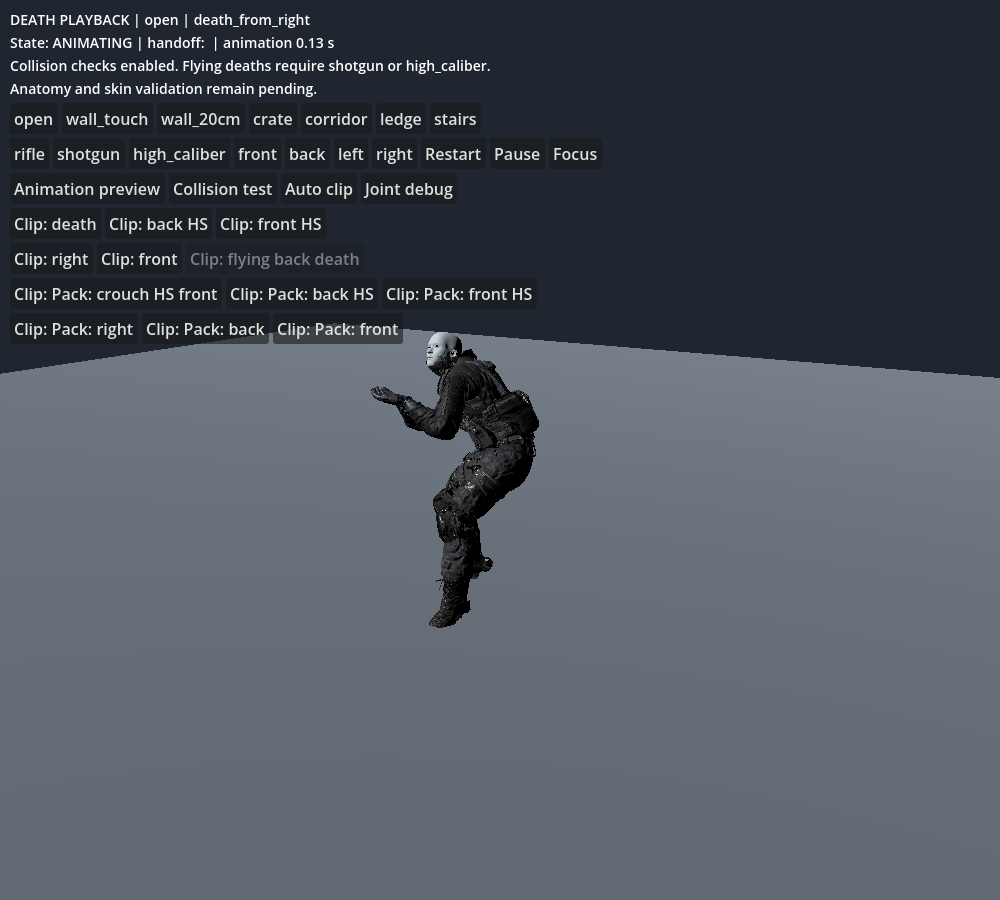
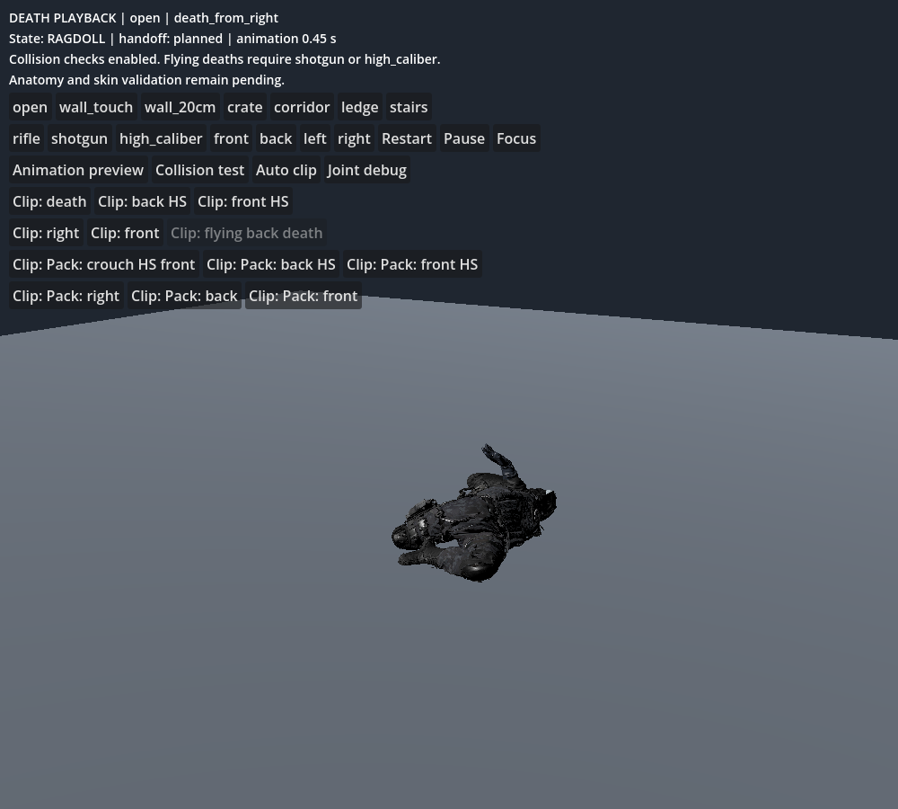
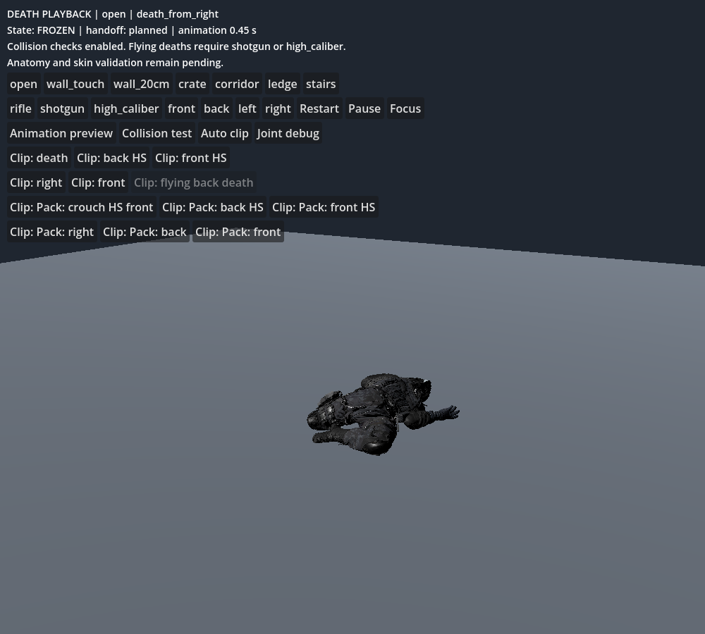

# Right-side death playback — 2026-10-25

Godot 4.6.3 / Jolt. This is a focused correction in the isolated animation review, not approval of the full character phase or live-game integration.

## Measurement and change

The clearance bake aligned only frame zero. In the two right-side clips, the planted left-foot probe then crossed the 2 mm floor-clearance margin at 33 and 50 ms. The bake correctly stopped before that crossing, but this left almost no visible animation.

`ground_alignment.clip_plant_windows` now selects a 0.2 s calibration window for those two clips only. The bake samples the authored feet at 60 Hz and uses one constant presentation offset for the entire clip. No animated root correction or collision exemption was added. The existing 25 mm lift ceiling remains enforced. Other clips retain their original offsets and handoff metadata. Settings are exported to the matching Resource by the bake itself.

| Clip | Old lift mm | New lift mm | Old playback s | New playback s | Old peak contact mm | New peak contact mm | New final contact mm |
|---|---:|---:|---:|---:|---:|---:|---:|
| death_from_right | 7.83 | 14.71 | 0.017 | 0.450 | 11.11 | 8.59 | 4.01 |
| pro_rifle_pack_death_from_right | 7.83 | 11.60 | 0.033 | 0.367 | 10.64 | 16.68 | 4.09 |

Both finish with a planned handoff and supported, settled corpse. The second clip trades longer authored playback for a higher transient collider penetration. These depths include a 2 mm query margin, sampled every five physics ticks, and do not measure garment/skin triangles. The untouched flying death still has the suite's 27.22 mm peak. Full contact quality remains unapproved.

## Verification

- 18/18 collision-playback cases pass, including all twelve clips and six obstacle scenarios. All settle supported, with one death event, one handoff, no guard freeze, and no runaway displacement. Maximum final collider depth: 6.99 mm.
- 12/12 explicit preview clips finish and change 71 bones.
- Existing lifecycle contracts pass: pause, Focus, airborne-freeze refusal, one death/handoff, and six-full-ragdoll budget. These are fixture tests, not proof of live reward integration.
- Regression now requires both right-side clips to play at least 0.2 s in the open scenario.
- Actual viewport images below were captured and inspected: animation, active ragdoll, settled corpse. Renderer is llvmpipe / Compatibility; hardware frame times are not valid.





Reproduce from the extracted review project:

```sh
godot --headless --path . --script tools/ragdoll/bake_clearance.gd
godot --headless --path . --fixed-fps 60 --script tools/ragdoll/test_playback_transition.gd
godot --headless --path . --fixed-fps 60 --script tools/ragdoll/test_preview.gd
godot --headless --path . --fixed-fps 60 --script tools/death/test_contracts.gd
godot --path . --fixed-fps 60 --script tools/ragdoll/capture_transition.gd -- death_from_right
```

## Acceptance checklist

- [x] Both right-side clips retain visible animation before physics.
- [x] Existing collision checks, lift ceiling, and weapon eligibility preserved.
- [x] Transition, preview and lifecycle regressions pass.
- [x] Native animation/ragdoll/settled captures inspected.
- [ ] Strict joint-angle, skin/gear clipping and all-role acceptance.
- [ ] Zero visible contact penetration and target-hardware performance.

## Five likely failure points and tests

1. Foot floating from the constant lift: inspect close-up boots on slopes and stairs, across the full plant interval; the current review camera is insufficient to approve sole contact.
2. Higher transient penetration in the pack clip: measure every physics tick and capture worst-contact frames, including skin triangles.
3. Initial joint projection and frequent velocity guards: run the strict anatomical matrix; functional settling does not approve these interventions.
4. Retargeted garment deformation: rerun body-versus-gear shell measurements for every role/body and extreme pose before approving clothing.
5. Query cost under crowd load: profile six active ragdolls in Forward+ on target hardware; software-rendered captures cannot establish the budget.
