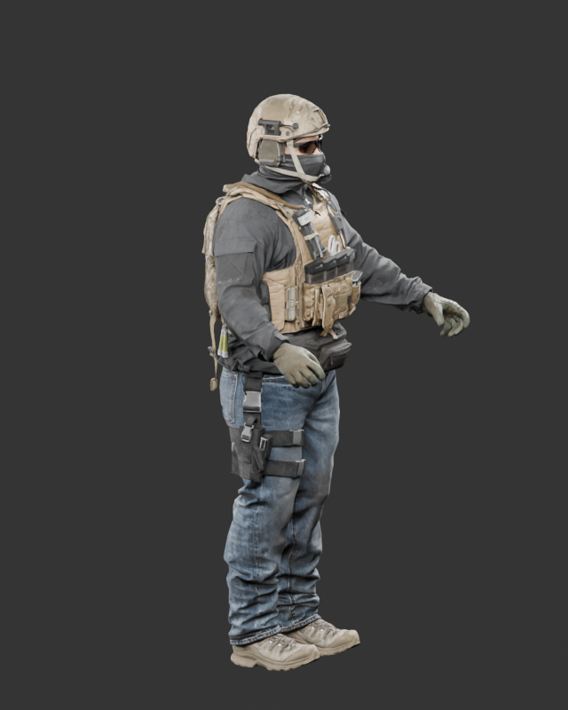
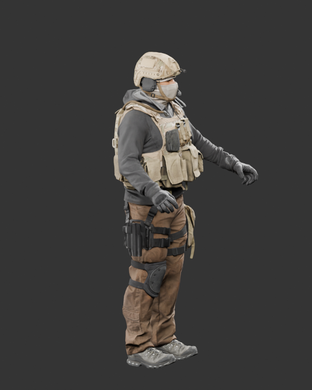
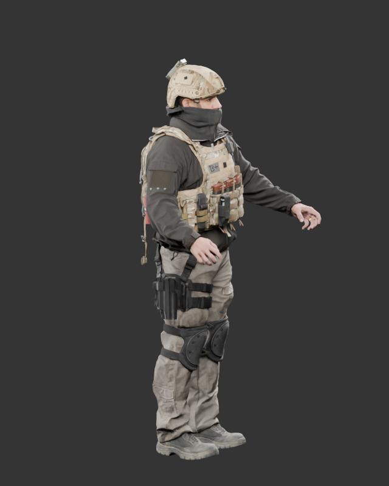

# Additional soldiers — intake, 2026-10-27

All supplied volumes are present: A has z01–z05 + ZIP, B has z01–z06 + ZIP, D has z01–z05 + ZIP (19 files total). Each archive contains one packed `.blend`. Direct split-ZIP copying with the installed `zip` produced invalid data; streaming the compressed member across the ordered volumes recovered all three with matching central-directory CRC and uncompressed size. SHA-256 receipts are in `ally_mex_archive_validation.json`.

The files use Blender 5.0's compressed format. Installed Blender 4.3.2 cannot open them. Audits and renders used the official `bpy==5.0.1` PyPI package under Python 3.11, with file script execution disabled. Source files were not resaved. Original archives/projects remain in workspace staging, outside the checkout; this report contains measurements and review renders.

| Model | Triangles | Bones | Mesh parts / material slots | Unique materials | Review height with cm→m conversion |
|---|---:|---:|---:|---:|---:|
| ally_mex_a | 65,656 | 311 | 40 / 40 | 40 | 1.864 m |
| ally_mex_b | 68,173 | 362 | 37 / 37 | 36 | 1.861 m |
| ally_mex_d | 72,213 | 368 | 43 / 43 | 42 | 1.886 m |

These are source-mesh counts, not measured Godot draw calls or optimized LODs. The source scene has scale_length=1 but approximately 186–189 scene-unit heights. The review interprets these as centimeter-sized imports and applies 0.01 unit conversion only. It does not establish a body-only 1.80 m measurement or validate the 0.24 m head target.

All three have UVs and armature weights. All three have zero unweighted vertices. A has zero vertices exceeding four effective deform weights; B has 5,823 and D has 5,251, which require influence reduction and deformation checks. All source faces are triangles; joint topology has not been approved for the earlier deformation/corrective requirements. No shape keys or animation actions are supplied. The rigs retain source names such as `j_mainroot`, `j_spinelower`, `j_spineupper`, `j_spine4`, `j_neck`, `j_head`, `j_shoulder_le/ri`, `j_elbow_le/ri`, `j_wrist_le/ri`, and `j_hip_le/ri`. They are not yet mapped to the game's humanoid skeleton.

The projects contain 302 / 284 / 332 image datablocks respectively; most are 1×1 shader constants, not unique production maps. Nonconstant textures range up to 2K and are packed TIFFs. The 0×0 Render Result datablock is not a missing character texture. Blender emits TIFF ExtraSamples warnings on some packed images; the rendered color/normal appearance still needs channel-by-channel Godot conversion checks. Detailed per-mesh UV areas, geometry areas, material/image references and complete bone lists are in the adjacent audit JSON files. A uniform character-wide texel density is not established: each material has its own texture dimensions and UV usage.

## Reusable and remaining work

The inspected renders show authored human silhouettes, folded clothing, carriers, pouches, helmets, footwear and readable material differences. These are useful source models, not blockout meshes. Preserve their UV-specific clothing/gear detail and skin maps; do not overwrite the entire character with a tiling concrete or fabric map.

Before gameplay integration: reduce LOD0 toward 35–50k triangles; consolidate to at most three materials through atlas baking; reduce/remap the 311–368 bone source rigs to the supported humanoid budget; add the missing build/corrective shapes; retarget the existing clips; measure clipping across poses; author wound boundaries and rebake model-specific gore geometry. The current cap cache is tied to the existing review body and must not be reused blindly. These files have no supplied animations or approved trauma meshes.

No gameplay model was replaced during intake. No animation, ragdoll, clipping, 20 m role-readability, anatomical layering or performance acceptance is claimed from these static renders.

## Native review renders

Cycles CPU, 12 samples with denoising, 640×800, neutral world and three area lights. Original supplied materials, centimeter conversion, no geometry repairs. All three images were captured and inspected. These are Blender source previews, not screenshots of integrated Godot enemies.

