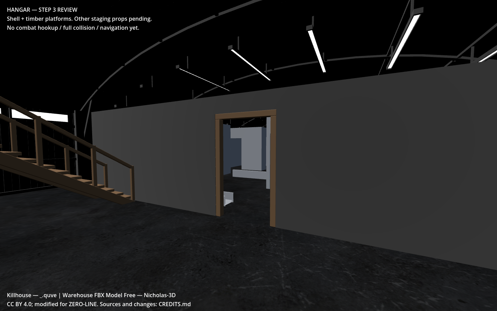
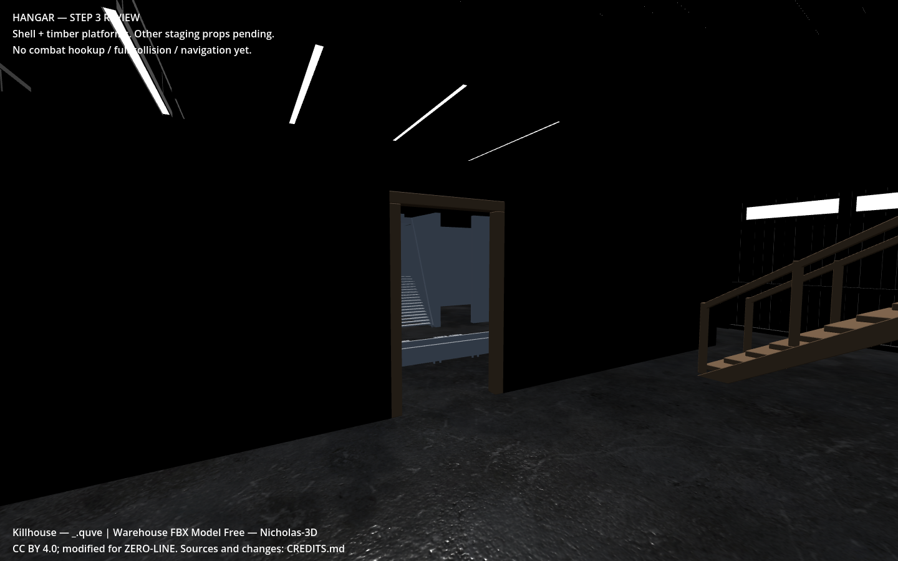
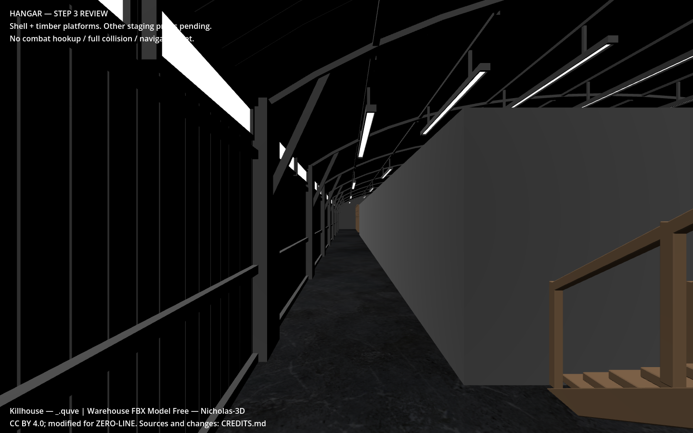
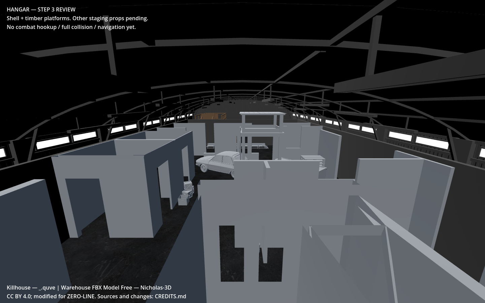

# Killhouse perimeter — requested revision

Enclosed **only the killhouse** with **2.716 m-high, 0.15 m-thick** perimeter walls. They share the warehouse’s existing **Metal material resource**, rather than an approximate replacement. Existing interior surfaces, warehouse geometry/materials and timber platforms retain their previous appearance. The roof stays open.

Both ends have **1.2 × 2.2 m clear doorways**, retaining the timber frames. These are open exits, not interactive swinging doors. Frame centers now align with the perimeter at **Z=-11.833933** and **Z=-34.425**, X=8. The outer perimeter spans X=2.247911–13.752089 and Z=-34.5–-11.758933. Its thickness extends inward, preserving the side alleys (about 2.048 m past warehouse ribs) and the north stair approach.

Actual Godot **4.6.3 / Compatibility** captures, inspected. The shared metal material looks very dark on unlit faces under the current review lighting; lighting polish remains pending. The warehouse’s ribbed appearance includes modeled geometry; this change shares its material, without claiming replicated corrugation geometry. Captures use software-rendered llvmpipe, so no target-hardware frame-time claim is made.

## Checks

- **80 triangles** added for the perimeter itself, using one existing material; eight matching box collision sections.
- Exported bounds: Y=0–2.716000 m. No below-floor killhouse geometry or duplicate coplanar floor triangles found.
- **2,415 exported-mesh rays, zero blocked**, covering both exits and the warehouse entrance.
- **26 Godot/Jolt physics rays passed:** eight wall-section collision hits and eighteen unobstructed doorway samples.
- Warehouse mesh attributes/indices match the previous commit byte-for-byte. Timber-platform position triangles match at 0.00001 m precision, independent of export ordering; its transform also matches. Existing material definitions match. See `scope_validation.json`.
- Whole review model: **748,022 triangles / 38 meshes**. Recutting source geometry around the aligned exits also changes triangle subdivision. Optimization remains pending.
- This updates `scenes/maps/zero_line_hangar.tscn`; the combat map is not switched. Full capsule sweeps, navigation and combat hookup remain pending.

## Acceptance checklist

- [x] Perimeter only around the killhouse at its current wall height.
- [x] Shared warehouse metal material; open exit at each end.
- [x] Matching perimeter and frame collision; geometry and physics ray checks pass.
- [x] Screenshots captured and inspected.
- [ ] Full movement/navigation tests and lighting polish remain later map work.

## Five follow-up risks

1. **Doorway capsule snag:** sweep the real player capsule through both exits after full collision generation; ray tests alone do not certify this.
2. **Navigation trapped inside:** rebake with the new perimeter and verify paths through both exits when integrating the map.
3. **Wallrun collider joins:** test continuous movement along both straight side walls and across each corner.
4. **Dark metal hides silhouettes:** evaluate the pending lighting pass in both directions, preserving the shared material.
5. **Future rebuild drops enclosure:** run `configure_killhouse_enclosure.py`, then pass the canonical `data/maps/hangar_staging_layout.json` to `build_hangar_step3.py`; old scratch layout files lack this revision.
