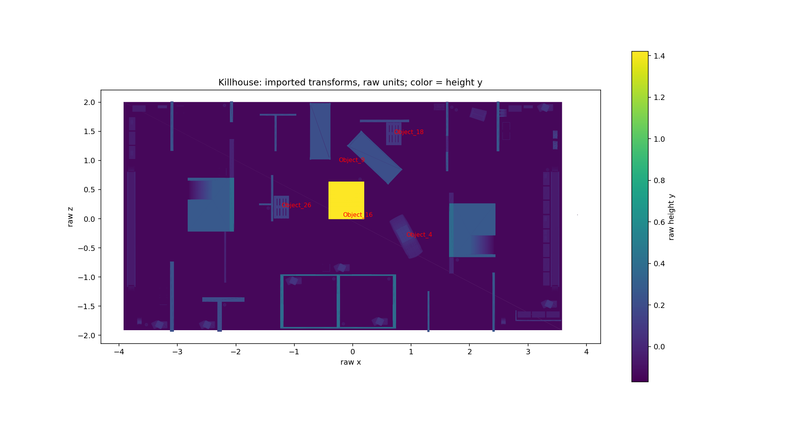
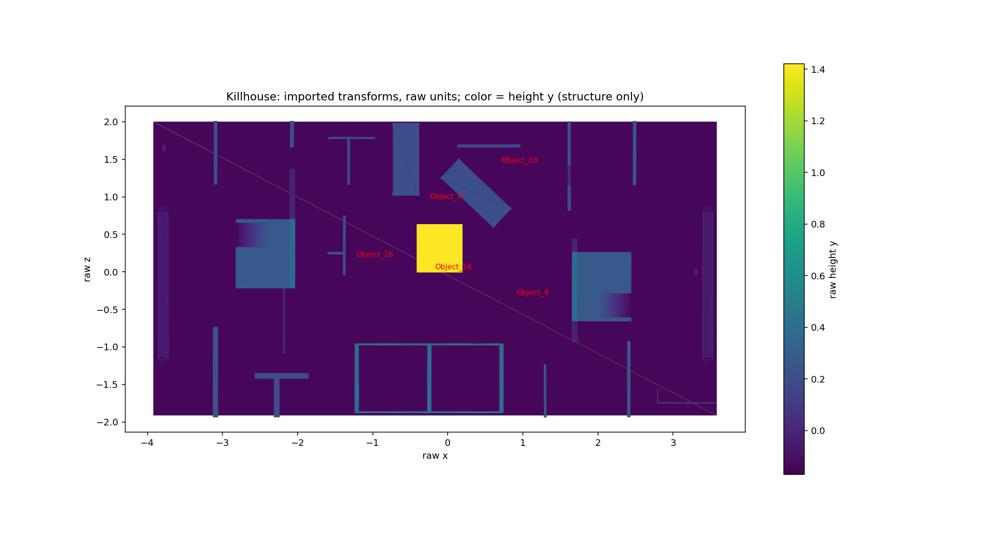

# Step 0 — supplied map geometry audit

Audit only. No playable scene, asset source, collision, navigation or gameplay file was modified. Dimensions below retain the imported glTF root transforms. Killhouse values are raw units; warehouse values are meters. Triangle counts include all supplied geometry, before any optimization. Role labels are geometric interpretations, not source metadata.

## Decision needed before Step 1

**The stated dimensions do not support the requested uniform-scale solution.** Most standalone partitions are only 0.334–0.407 units above the main floor; room walls reach about 0.521–0.537. Overall height 1.590 is dominated by the central tall structure, not representative partition height. At S=3 these partition/room heights become about 1.00–1.61 m.

To preserve 2 m alleys inside 16 m width, the rotated short dimension must be ≤12 m: S≤12/3.953326=3.0354. Even the 0.5374-unit room wall would then be only 1.631 m high. Reaching 2.7 m on that wall alone needs S≈5.024, making the short dimension about 19.86 m before alleys. A 0.373-unit partition needs S≈7.24 and roughly 28.6 m width. There is no single uniform scale meeting both requirements.

Recommended review choice: retain an S≈3 footprint and treat existing low partitions as cover, with explicit permission to remodel selected room walls/door openings using copies of the supplied meshes. Alternatively enlarge the warehouse footprint substantially. Neither change has been made.

## Source totals and structural findings

- Killhouse: 27 meshes, **735,094 triangles**, bounds x −3.924471..3.852899, y −0.169789..1.420277, z −1.940980..2.012346; footprint **7.777370 × 3.953326**. Two untextured materials.
- Main floor is y≈**−0.142391**, not the minimum pole/prop vertex y=−0.169789. The two-cell block has raised floor samples at y=−0.023482 (0.118909 above main floor; 0.357 m at S=3).
- **Three outer wall sheets exist** in Object_16: x=−3.92447, z=−1.91477 and z=2.00238, extending from y=−0.14239 to 1.29084. The opposite x end is open. These plus the floor are a connected eight-triangle component. The brief’s “no outer walls” observation is incorrect.
- No full-building ceiling: the large shell component is floor plus three walls. Local horizontal room/box roofs exist around y=0.250125; the two-cell block has stepped/sloped overhead surfaces around y=0.308128–0.394973. The central tall object has a cap at y≈1.3809–1.4203. Open space elsewhere remains uncapped.
- Car Object_4: 0.5736 × 0.2529 × 0.7634 raw bounding size; its long footprint dimension is approximately 0.7634. Its scale does not agree with the taller shell.
- Warehouse: 3 meshes, **11,106 triangles**. Metal reaches x≈0..16, y −0.023933..5, z −46.230..0.040. Floor quad x 0..16, y=0, z −46.150..0.
- Warehouse main door panel is **8.0890 m wide × 3.0000 m tall**, x 3.955493..12.044510, y −0.023933..2.976068, z approximately −0.074..−0.0765. Frame inset is approximately 7.9090 m wide and top y=2.886068. The panel is closed geometry: current passage clearance is zero until it is moved/removed in a later step.
- Original warehouse material JSON sets **doubleSided=true for Metal, Emissive and WetConcrete**. There is no material-level single-sided flag to repair in this supplied file. Thin sheets are present, but disappearance in a particular view must be investigated in the imported runtime; no inside-view acceptance is claimed here.

## Per-mesh inventory

|Mesh|Triangles|Minimum (x,y,z)|Maximum (x,y,z)|Interpreted role|
|---|---:|---|---|---|
|Object_2|110|3.4255, -0.0295, 1.3142|3.4287, -0.0137, 1.3369|small prop|
|Object_3|216|-3.3396, -0.1424, 1.8965|3.0875, -0.0155, 1.9427|edge strip/assembly|
|Object_4|36,996|0.6274, -0.1503, -0.6871|1.2010, 0.1026, 0.0763|car|
|Object_5|15,248|3.2816, -0.1442, 0.8075|3.3690, -0.0487, 0.9043|small prop|
|Object_6|7,884|-3.5619, -0.1436, -1.8463|2.6932, -0.0296, 1.9732|distributed low props|
|Object_7|7,896|-3.8057, -0.1437, -1.6953|3.8529, -0.0161, 1.9757|distributed low props|
|Object_8|9,828|3.2747, -0.0479, -0.3726|3.3248, -0.0161, 0.7744|edge assembly|
|Object_9|8,984|-3.8057, -0.1652, -0.0433|3.3248, 0.9655, 1.9876|vehicle/box assemblies and central details|
|Object_10|1,860|2.6670, -0.1437, -1.7372|3.3709, 0.0602, 1.9451|distributed low props|
|Object_11|6,468|-2.6355, -0.1465, -1.8948|3.4970, 0.0834, -0.9892|distributed low props|
|Object_12|6,704|-3.8310, -0.1465, -1.8948|3.4316, 0.0834, 1.9822|distributed low props|
|Object_13|4,292|2.5387, -0.1446, -1.8190|2.6209, 0.0372, -1.6876|small prop|
|Object_14|4,392|-3.6918, -0.1446, -1.8190|3.4300, 0.0372, 1.3152|distributed low props|
|Object_15|5,812|1.9981, -0.1436, 1.1896|3.5059, 0.1117, 1.9087|low box/assembly|
|Object_16|2,596|-3.9245, -0.1698, -1.9410|3.5841, 1.4203, 2.0123|floor, three exterior sheets, partitions, room blocks and central tall structure|
|Object_17|43,842|2.5356, -0.1098, 1.7490|2.6130, 0.0866, 1.8801|dense repeated prop|
|Object_18|43,842|0.5748, -0.1457, 1.2634|0.8316, -0.0984, 1.6503|dense repeated prop|
|Object_19|43,842|0.5748, -0.1009, 1.2634|0.8316, -0.0536, 1.6503|dense repeated prop|
|Object_20|43,842|0.5748, -0.0557, 1.2634|0.8316, -0.0084, 1.6503|dense repeated prop|
|Object_21|43,842|0.5748, -0.0112, 1.2634|0.8316, 0.0361, 1.6503|dense repeated prop|
|Object_22|43,842|0.5748, 0.0337, 1.2634|0.8316, 0.0810, 1.6503|dense repeated prop|
|Object_23|43,842|2.5113, -0.1098, 1.7490|2.5887, 0.0866, 1.8801|dense repeated prop|
|Object_24|43,842|2.5594, -0.1098, 1.7490|2.6368, 0.0866, 1.8801|dense repeated prop|
|Object_25|2,020|3.4333, -0.0065, 1.2078|3.4449, 0.0885, 1.3126|small upright prop|
|Object_26|95,950|-1.3433, -0.0966, 0.0165|-1.0960, 0.1399, 0.3816|dense central prop|
|Object_27|99,980|-1.3485, -0.1439, 0.0061|-1.0917, 0.0453, 0.3930|dense central prop|
|Object_28|67,122|-1.3485, -0.0020, 0.0061|-1.0917, 0.1399, 0.3930|dense central prop|
|NurbsPath.005_Metal_0|10,616|-0.0000, -0.0239, -46.2300|16.0000, 5.0000, 0.0400|warehouse shell, ribs and door|
|NurbsPath.005_Emissive_0|488|0.0778, 2.5105, -45.5895|15.9222, 4.3577, -0.4105|light strip geometry|
|NurbsPath.005_WetConcrete_0|2|0.0000, 0.0000, -46.1500|16.0000, 0.0000, -0.0000|floor|

## Partition heights

Measured Object_16 connected components; heights are from main floor y=−0.142391 to each top. Components include room blocks where walls are joined.

|Component|Horizontal bounds (x / z)|Top y|Height above main floor|
|---:|---|---:|---:|
|17|-3.1282..-3.0605 / -1.9410..-0.7338|0.2307|0.3731|
|18|-3.1188..-3.0699 / 1.1616..2.0119|0.2307|0.3731|
|19|-2.8247..-2.0329 / -0.2204..1.3688|0.3790|0.5214|
|20|-2.8241..-2.3885 / 0.3222..0.3332|0.2647|0.4071|
|21|-2.8241..-2.3885 / 0.6485..0.6595|0.2647|0.4071|
|32|-2.5743..-1.8524 / -1.4247..-1.3480|0.1984|0.3408|
|41|-2.3163..-2.2396 / -1.9370..-1.3583|0.1952|0.3376|
|43|-2.0990..-2.0488 / 1.6541..2.0124|0.2307|0.3731|
|44|-1.6025..-1.3927 / 0.2314..0.2653|0.1974|0.3398|
|45|-1.5912..-0.9646 / 1.7686..1.7993|0.1984|0.3408|
|46|-1.3973..-1.3597 / -0.0448..0.7518|0.1984|0.3408|
|47|-1.3384..-1.3015 / 1.1581..1.7846|0.1916|0.3340|
|48|-1.2407..0.7430 / -1.8835..-0.9540|0.3950|0.5374|
|65|-0.2736..-0.2174 / -1.8835..-0.9540|0.3950|0.5374|
|66|0.1232..0.9656 / 1.6543..1.6992|0.1711|0.3135|
|70|1.2791..1.3142 / -1.9410..-1.2387|0.2645|0.4069|
|71|1.5952..1.6383 / 0.8153..2.0069|0.2307|0.3731|
|72|1.6523..2.4441 / -0.9405..0.4475|0.3790|0.5214|
|74|2.0078..2.4435 / -0.6161..-0.6050|0.2647|0.4071|
|75|2.0078..2.4435 / -0.2898..-0.2788|0.2647|0.4071|
|93|2.3899..2.4338 / -1.9410..-0.9225|0.2645|0.4069|
|94|2.4651..2.5119 / 1.1550..2.0093|0.2645|0.4069|

## Opening measurements and limits

An axis-aligned structural slice at y=0.05 groups parallel wall faces within 0.08 raw units and reports gaps >0.1 and <2.5 units. Vertical triangle rays at each candidate center measure floor/overhead surfaces. This inventory deliberately includes passage breaks, narrow slots and gaps between separate aligned objects; it is **not an approved exhaustive doorway classification**. Widths are slice measurements and heights are center-ray measurements, not rectangular capsule-sweep clearance. “Open” means no overhead intersection at that center. False candidates with 0.0123 height are furniture slots. They must not be treated as doors.

Important framed openings: west/east outer room openings are about **0.22394 wide × 0.34298 high**; the two-cell front openings are **0.33325 × 0.34440**, above the raised floor. At S=3 these become 0.672×1.029 m and 1.000×1.033 m. Neither provides the requested 2.0 m standing height. Other narrow room slots appear in the table; their purpose is unverified.

|ID|Plane|Span along other horizontal axis|Slice width|Center clear height|
|---:|---|---|---:|---:|
|G00|x=-3.09433|-0.73376..1.16163|1.89539|Open|
|G01|x=-2.81830|-0.10782..0.11611|0.22394|0.34298|
|G02|x=-2.81830|0.32772..0.65454|0.32682|Open|
|G03|x=-2.60720|-1.34799..0.32222|1.67021|Open|
|G04|x=-2.60720|0.33325..0.64848|0.31523|0.01231|
|G05|x=-2.35589|-1.35826..0.29629|1.65455|Open|
|G06|x=-2.05536|-0.11439..0.04571|0.16010|0.39252|
|G07|x=-2.05536|0.14584..0.30594|0.16010|0.39252|
|G08|x=-2.05536|0.70300..1.65411|0.95111|Open|
|G09|x=-1.59685|0.26532..1.76863|1.50331|Open|
|G10|x=-1.37200|0.75178..1.15807|0.40630|Open|
|G11|x=-1.26097|-1.75776..-1.47479|0.28297|Open|
|G12|x=-1.26097|-0.95399..1.15807|2.11206|Open|
|G13|x=-1.18458|-1.75776..-1.47479|0.28297|0.45052|
|G14|x=-0.37356|0.07155..0.55576|0.48421|1.00281|
|G15|x=-0.24549|-1.57391..-1.29094|0.28297|0.45052|
|G16|x=0.15030|0.07155..0.55576|0.48421|1.00281|
|G17|x=0.15030|0.59944..1.65427|1.05482|Open|
|G18|x=0.71499|-1.75776..-1.47479|0.28297|0.45052|
|G19|x=1.63453|-0.26250..-0.10240|0.16010|Open|
|G20|x=1.63453|-0.00227..0.15783|0.16010|Open|
|G21|x=1.63453|0.26382..0.81529|0.55147|Open|
|G22|x=1.63453|1.14769..1.42029|0.27261|Open|
|G23|x=2.23482|-0.60504..-0.28981|0.31523|0.01231|
|G24|x=2.43526|-0.92254..-0.65955|0.26299|Open|
|G25|x=2.43526|-0.61109..-0.28428|0.32682|Open|
|G26|x=2.43526|-0.07267..0.15127|0.22394|0.34298|
|G27|x=2.43526|0.26382..1.15502|0.89120|Open|
|G28|z=-1.74591|-1.18458..0.68694|1.87152|0.53736|
|G29|z=-1.74591|0.74304..2.78680|2.04375|Open|
|G30|z=-1.45810|-1.85238..-1.24069|0.61169|Open|
|G31|z=-1.45810|-1.18458..0.68694|1.87152|0.45052|
|G32|z=-1.33240|-1.85238..-0.27355|1.57883|Open|
|G33|z=-0.96076|-0.96972..-0.63647|0.33325|0.34440|
|G34|z=-0.96076|-0.01401..0.31925|0.33325|0.34440|
|G35|z=-0.96076|0.74304..2.38992|1.64687|Open|
|G36|z=-0.07510|-2.80221..-1.39725|1.40496|0.39252|
|G37|z=0.04970|-0.35172..0.13691|0.48862|1.00281|
|G38|z=0.26406|-2.39548..-1.60251|0.79297|Open|
|G39|z=0.57760|-0.35172..0.13353|0.48525|1.00281|
|G40|z=1.15560|-3.06987..-1.33836|1.73151|Open|
|G41|z=1.15560|1.63832..2.46510|0.82678|Open|
|G42|z=1.66920|-2.04878..0.12324|2.17202|Open|

## Warehouse roof profile

Triangle-ray measurements at z=−23.075, from above downward. These sample the metal/rib envelope; they are not final underside clearance checks for placed partitions. Roof height also varies locally with rib position along z. Full sample data is in roof_profile.json.

|x (m)|Metal envelope height (m)|
|---:|---:|
|0.100|3.0338|
|2.075|4.0265|
|4.050|4.5999|
|6.025|4.8888|
|8.000|4.9770|
|9.975|4.8888|
|11.950|4.5999|
|13.925|4.0265|
|15.900|3.0338|

## Height-colored plan

Images are computed directly from imported triangles, sorted by mean height for plan visualization. Thin vertical wall faces can collapse to lines; the table and connected-component analysis identify the outer shell. No texture, collision or rendering acceptance is implied. Both plan images were inspected.

## Acceptance status / next review

- Verified source triangle counts, transformed bounds, material flags, floor, outer walls, local caps, car dimensions and door-panel geometry.
- Measured structural heights, roof envelope samples and all candidates from the documented opening extractor.
- **Outstanding:** manual classification of every candidate doorway/window, full clear-rectangle height checks, imported inside-view verification. The source has no named doorway markers; the automated table cannot honestly certify every opening.
- No scaling, placement, decimation, material replacement or playable-map changes performed. Step 1 is paused for review because the uniform-scale/height/width constraints conflict.

## Attribution

“Killhouse” by _.quve — https://sketchfab.com/3d-models/killhouse-a2ce333ba32548d5b454131f6016c961 — CC-BY 4.0 (confirmed by supplied license.txt).

“Warehouse FBX Model Free” by Nicholas-3D — https://sketchfab.com/3d-models/warehouse-fbx-model-free-daa7fd3ff88945298d00045ca40a4c03 — CC-BY 4.0 (source attribution supplied in the task brief).

These audit diagrams are derived from those supplied meshes. Original files remain unmodified in workspace staging.
