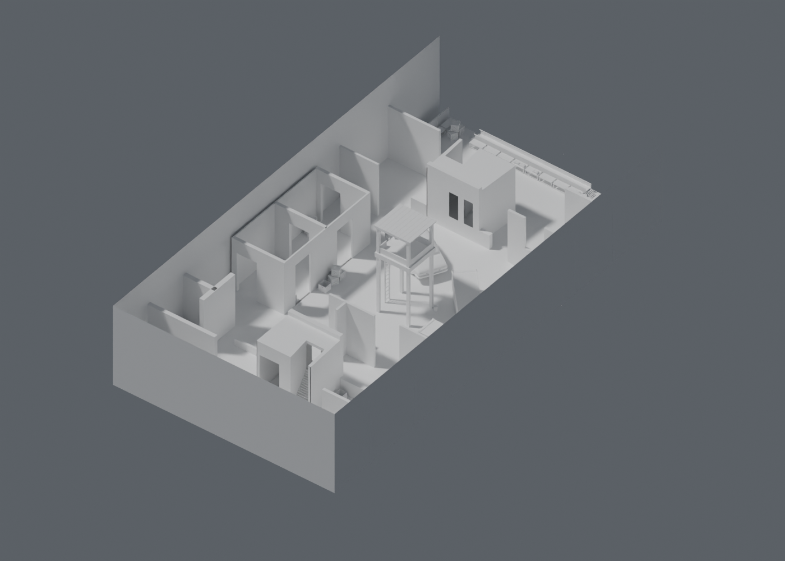
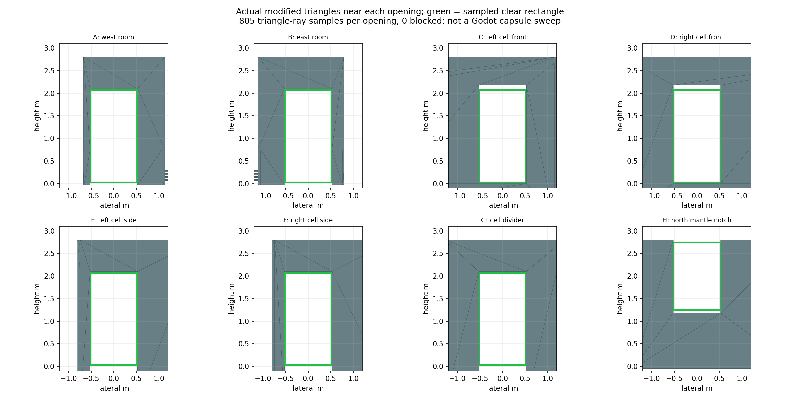
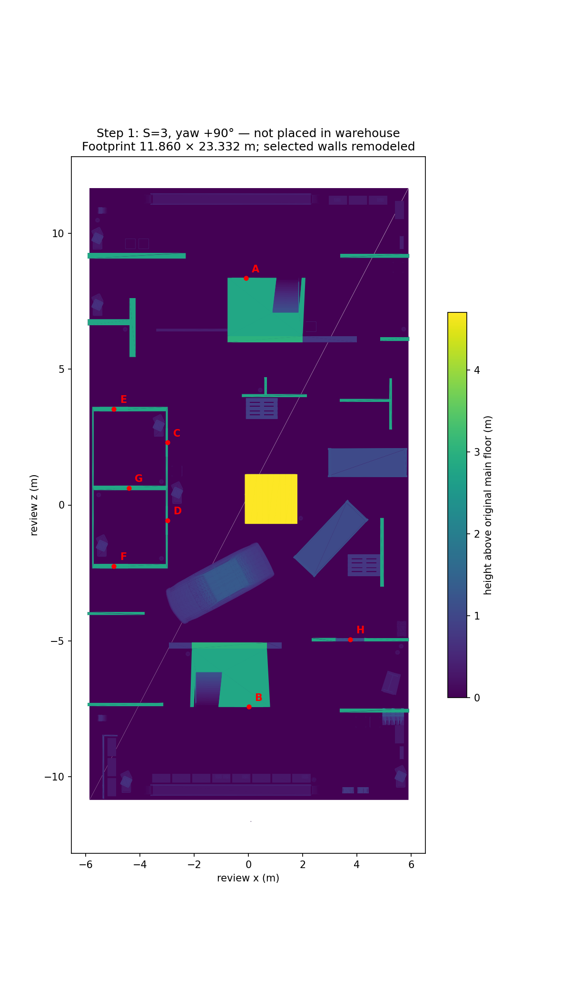

# Step 1 — scale, orientation and approved human-scale edits

The user's “continue” accepted the audit proposal: keep an approximately 23.3 × 11.9 m layout and modify **copies** of selected partition/door meshes. This explicitly relaxes the original uniform-scaling-only restriction for those local architecture edits. The layout transform itself remains a single uniform S=3 with +90° yaw. No source file, warehouse geometry or playable scene was changed.

## Delivered review asset

[Download the derived GLB](../../downloads/map-step1/killhouse_step1_review.glb). Import for inspection only. The file is excluded from runtime exports and contains the source attribution in its glTF asset metadata. It retains all 27 source meshes and **735,094 triangles**; optimization is Step 5.



This is an actual Blender 5.0.1 Cycles CPU render of the exported/reimported GLB, 16 samples, plain source materials. It was inspected. It is not a Godot gameplay screenshot or a lighting/performance acceptance test.

## Dimensions and edits

- Footprint after rotation: **11.859978 m across × 23.332110 m long**. Main floor y=0. At a later centered placement, this nominal footprint would leave 2.070011 m per side and 11.408945 m at each end of the 46.15 m warehouse floor. This arithmetic does not replace Step 2 roof/prop placement checks.
- Fourteen selected standalone partition components have 2.8 m tops. The two box-room assemblies have 2.8–3.0 m main wall tops; the two-cell block reaches 2.8 m. Local room geometry was remapped using source vertices, without replacing the structures with boxes.
- Seven walking openings were widened toward **1.05 m** and given at least **2.10 m** lintel height. The two-cell front lintels reach approximately 2.18 m because its lower side lintels needed separate handling. The two-cell raised entry floor was moved to the main-floor level.
- The north partition's apparent “gap” is a **mantle notch**. Its sill remains approximately 1.18 m high. It is not classified as a walk-through doorway.
- One additional open passage beside the east room was widened to the 1.05 m design width by shortening the adjacent partition end. Other narrow room slots remain windows/ports, not designated navigation routes.
- Car Object_4: **4.0 m oriented length**, scaled uniformly by 1.743523 after the layout scale. PCA determines the long horizontal axis so a rotated bounding box is not mistaken for vehicle width/length. Its bottom is aligned with y=0.
- Pallets Object_18–22: long side **1.2 m**, short side approximately **0.797 m**, uniform prop factor 1.033816. The five-pallet stack is rebuilt with 2 mm gaps, from y=0 to approximately **0.741425 m**.
- Upright pallet-like props Object_17/23/24: longest principal extent **1.2 m**, uniform prop factor approximately 2.0266. Their side-by-side spacing must be revised in Step 2 because larger props can overlap at their original positions.
- Dense central props Object_26–28 retain source proportions at the layout scale. They still need role/silhouette review and decimation; no fabricated 1 m crate dimensions are asserted.

All 31 component/prop operations and resulting per-mesh bounds are recorded in `step1_geometry.json`; tuning is in `data/maps/killhouse_step1.json`.

## Opening checks



Each of A–G was sampled with **805 finite triangle rays** through the actual modified architecture, covering a **1.03 m-wide rectangle from y=0.03 to 2.07 m**. Each returned **zero blocked samples**. H, the mantle notch, was tested separately from y=1.25 to 2.75 m, also with zero blocked samples. Total: **6,440 samples, zero blocked**. The 1 cm jamb margin and lower/upper margins are intentional; these checks do not certify an infinitely dense clearance rectangle.

| ID | Opening | Sampled width | Sampled vertical range | Blocked samples |
|---|---|---:|---:|---:|
| A | West room | 1.03 m | 0.03–2.07 m | 0/805 |
| B | East room | 1.03 m | 0.03–2.07 m | 0/805 |
| C | Left cell front | 1.03 m | 0.03–2.07 m | 0/805 |
| D | Right cell front | 1.03 m | 0.03–2.07 m | 0/805 |
| E | Left cell side | 1.03 m | 0.03–2.07 m | 0/805 |
| F | Right cell side | 1.03 m | 0.03–2.07 m | 0/805 |
| G | Cell divider | 1.03 m | 0.03–2.07 m | 0/805 |
| H | North mantle notch | 1.03 m | 1.25–2.75 m | 0/805 |

These are geometry tests against Object_16, not Jolt capsule sweeps or checks against every nearby prop. Actual player collision remains radius 0.34 m / standing height 1.72 m in the current game. Step 6 must generate matching colliders and test movement through the completed map.

## Oriented plan



The plan is computed from the modified triangles and was inspected. It is centered at the review origin only; it is not the requested warehouse placement diagram. Step 2 will supply that separate diagram and its approval gate.

## Remaining work and acceptance

- [x] Original ZIP and warehouse GLB SHA-256 values unchanged.
- [x] Uniform layout scale and 90° rotation; bounded 11.86 × 23.33 m footprint.
- [x] Selected walls and seven primary walking openings remodeled in derivative geometry.
- [x] Car and pallet sizing; review GLB exported/reimported as 27 meshes / 735,094 triangles.
- [x] Geometry opening logs, top-down plan, elevation drawings and exported-model render inspected.
- [ ] Warehouse placement, roof underside clearance, side-alleys and prop spacing — Step 2.
- [ ] Exterior-sheet removal, duplicate/local floors, subfloor wall/support geometry and ceiling choice — Step 3.
- [ ] Materials/lighting, decimation, collisions, navigation and game hookup — later steps.

The untrimmed edited cell support geometry extends to **y≈−0.794 m** below the main floor. It is explicitly pending shell/floor reconciliation, not approved final geometry. The unchanged central tower still reaches **4.688 m**; it may need lowering after actual roof-clearance rays. No all-bounds-inside-hangar, no-z-fighting, prop-collision, full doorway or performance acceptance is claimed at this stage. Do not use this raw review asset as collision for the live map.

## Five next failure checks

1. **Roof contact:** cast upward from all partition/tower tops after Step 2 placement and require ≥0.3 m to the underside.
2. **Expanded props overlap:** test the car, upright pallets and neighboring walls after their per-prop scaling; adjust position before collider generation.
3. **Doorway snags:** generate final colliders and run the real standing/crouched capsule through A–G, including the floor thresholds.
4. **Duplicate/subfloor surfaces:** remove the killhouse shell floor/exterior sheets as appropriate and trim supports to the final warehouse floor; verify no overlap/z-fighting.
5. **Lost topology at optimization:** repeat the opening tests and silhouette comparison after Step 5 decimation, not just on this full-resolution review.

## Reproduction and attribution

With the Step-0 measured arrays in `/workspace/map-intake`:

```
python tools/maps/prepare_killhouse_step1.py /workspace/map-intake /workspace/map-step1
python tools/maps/check_killhouse_step1.py /workspace/map-step1
python tools/maps/plot_killhouse_step1.py /workspace/map-step1 docs/map-step1
```

Use the Blender 5 `bpy` environment to run `export_killhouse_step1.py` with source glTF, prepared NPZ and output GLB paths; `render_killhouse_step1.py` takes the exported GLB, output PNG and validation JSON paths.

Derived from **Killhouse** by **_.quve**, https://sketchfab.com/3d-models/killhouse-a2ce333ba32548d5b454131f6016c961 , **CC-BY 4.0**. Changes are documented above. Warehouse source attribution remains in the Step-0 report; the warehouse is not part of this derivative GLB.
