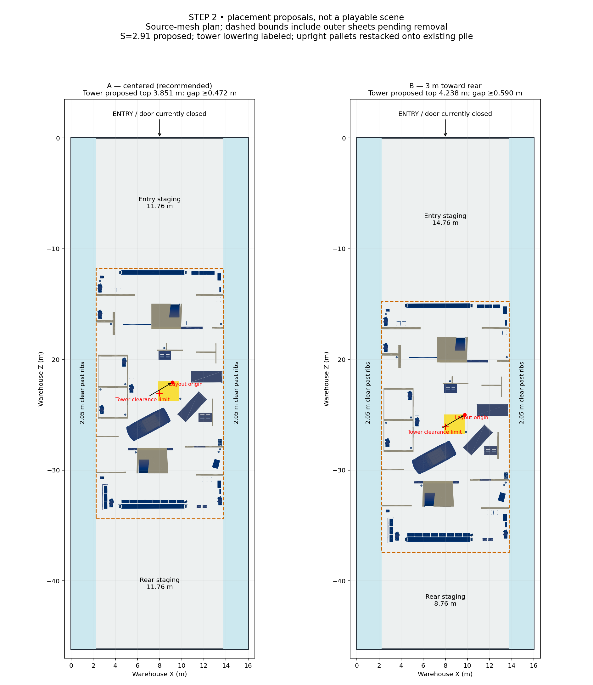
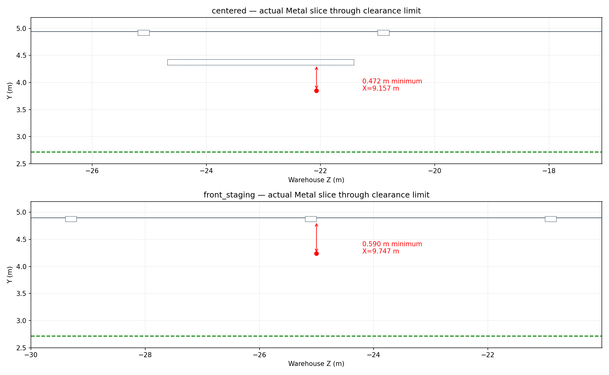

# Step 2 — warehouse placement proposal (approval required)

**Recommend A: centered**, with equal front/rear staging. This is a measured proposal, not an integrated map. Neither original asset nor the Step 1 review GLB or playable scene is changed.



## Important correction: measure past the warehouse ribs

The warehouse is 16 m wide, but its Metal ribs extend **0.200 m inward** at standing-player height along both candidate placements. Step 1’s S=3 footprint gives only **1.870 m clear**, despite its nominal 2.070 m side margins. It fails the requested 2 m free alley.

Propose **uniform S=2.91**, a further 0.97 uniform scale on the Step 1 layout, still with +90° yaw. Preserve the independently sized 4 m car and 1.2 m pallets by moving their centers with the layout while retaining their dimensions. Revised layout bounds are **11.504178 × 22.632147 m**. Nominal side margins are 2.247911 m; conservative clearance beyond 0.200001 m ribs is **2.047910 m**. This is geometric width, not a tested wallrun or capsule sweep. Only 47.9 mm beyond the 2 m requirement remains; collider inflation must be checked.

Selected partition tops become **2.716 m**, room peaks **2.910 m**. The seven walking openings become approximately **1.0185 m wide × at least 2.037 m high**, still above the 0.9 × 2.0 m requirement. The prior clear sampled rectangle transforms to 0.9991 m wide, y=0.0291–2.0079 m; uniform transformation preserves those source-architecture results. Props and generated colliders are not certified by that affine result. Main floor remains y=0; subfloor supports remain a Step 3 issue.

## Candidate transforms

Coordinates below apply to the Step 1 review geometry after the additional uniform 0.97 scale and independent prop-size preservation. Do not apply +90° yaw again to that already-oriented derivative.

| Property | A: centered (recommended) | B: rearward alternative |
|---|---:|---:|
| Translation X, Y, Z (m) | 8, 0, -23.075006 | 8, 0, -26.075006 |
| Layout Z range (m) | -34.391080 to -11.758933 | -37.391080 to -14.758933 |
| Entry staging length | 11.758933 m | 14.758933 m |
| Rear staging length | 11.758933 m | 8.758933 m |
| Clear side alleys past ribs | 2.047910 m each | 2.047910 m each |
| Proposed tower top | 3.850651 m | 4.237892 m |
| Minimum retained-structure overhead gap | 0.471899 m | 0.590027 m |

A keeps balanced flanking loops and staging at both ends. B gives a larger entry combat/staging area and preserves more tower height, at the cost of a smaller rear area. Both leave the existing warehouse door panel closed until Step 3 opens/removes the derivative panel; an entry arrow is not a claim that the doorway is presently traversable.

## Roof checks and required changes



Tested actual source Metal triangles, including ribs and the lower hanging metal housing: **4,782 triangles** with nonzero horizontal projection and minimum Y above 2.5 m. For each elevated Object_16/Object_9 triangle, intersect its XZ projection with overhead triangles and evaluate vertical-ray height differences at the overlap vertices. Since each triangle height is linear, extrema occur at those vertices. Explicit edge tests cover vertical partitions with zero projected face area. Taking the lowest hit avoids mistaking the top of the roof for its underside or ignoring a collision when geometry already penetrates the roof.

This is offline mesh geometry validation, not Godot/Jolt physics. It does not certify light fixtures from the separate Emissive mesh, future colliders, player headroom on elevated walkable surfaces, or movement/navigation. The diagrams are inspected geometry plots, not game screenshots or performance measurements.

Required derivative changes:

1. **Tower upper portion only:** Object_16 components 49–69. For A, map Y above 3 m to `3 + (Y - 3) * 0.55`; for B use 0.80. Vertices at/below 3 m remain fixed. A lowers the uniformly rescaled top from 4.547365 m to 3.850651 m; B lowers it to 4.237892 m. This is a local tower redesign, not a global height change. Attached high detail in Object_9 remains clear in the tested mesh. Review tower access/headroom before treating any upper deck as playable.
2. **Remove duplicate outer sheets/floor in Step 3:** Object_16 component 0 still fails. Its clearance is -0.146908 m for A and -0.438518 m for B. It is explicitly excluded from the *retained* structure pass and is not silently accepted. Until removal, the full review model fails clearance.
3. **Restack overlapping upright pallets:** Objects 17/23/24 rotate rigidly onto the existing Object_18–22 pile, retaining 1.2 m long sides. PCA-derived orthonormal rotations and translations are recorded in JSON. Eight pallets total, 2 mm gaps, final top **1.187532 m**. This removes their mutual overlap without putting props into side alleys/staging areas. These are proposed transforms; neighboring collider clearance still needs Step 6.
4. All other partitions and box rooms need no additional roof-driven lowering or shift beyond the revised uniform scale.

## Per-component evidence

Numbers below are after proposed tower lowering, at the revised S=2.91. Component IDs use welded source topology (same IDs as Step 1). Shell component 0 is pending removal. Detailed pre/post critical points and counts are in [placement_validation.json](placement_validation.json).

| Mesh / component | A min gap (m) | B min gap (m) | Status |
|---|---:|---:|---|
| Object_16 / 0 | -0.146931 | -0.438468 | FAIL — remove shell in Step 3 |
| Object_16 / 17 | 1.016235 | 1.374018 | ≥0.3 m |
| Object_16 / 18 | 1.016234 | 1.374464 | ≥0.3 m |
| Object_16 / 19 | 1.604952 | 1.975898 | ≥0.3 m |
| Object_16 / 20 | 2.236359 | 2.236359 | ≥0.3 m |
| Object_16 / 21 | 2.179219 | 2.179219 | ≥0.3 m |
| Object_16 / 32 | 1.735811 | 1.809988 | ≥0.3 m |
| Object_16 / 41 | 1.302148 | 1.377772 | ≥0.3 m |
| Object_16 / 43 | 1.374018 | 1.374018 | ≥0.3 m |
| Object_16 / 44 | 2.240818 | 2.240819 | ≥0.3 m |
| Object_16 / 45 | 1.574603 | 1.574603 | ≥0.3 m |
| Object_16 / 46 | 2.160008 | 1.606950 | ≥0.3 m |
| Object_16 / 47 | 1.579181 | 1.016235 | ≥0.3 m |
| Object_16 / 48 | 1.352475 | 1.016234 | ≥0.3 m |
| Object_16 / 49 | 1.246317 | 1.719887 | ≥0.3 m |
| Object_16 / 50 | 0.489021 | 0.618366 | ≥0.3 m |
| Object_16 / 51 | 1.118127 | 0.659289 | ≥0.3 m |
| Object_16 / 52 | 1.114440 | 0.655602 | ≥0.3 m |
| Object_16 / 53 | 1.109699 | 0.650862 | ≥0.3 m |
| Object_16 / 54 | 1.104958 | 0.646121 | ≥0.3 m |
| Object_16 / 55 | 1.100218 | 0.641381 | ≥0.3 m |
| Object_16 / 56 | 0.471899 | 0.634724 | ≥0.3 m |
| Object_16 / 57 | 0.471899 | 0.619825 | ≥0.3 m |
| Object_16 / 58 | 1.063926 | 0.604926 | ≥0.3 m |
| Object_16 / 59 | 1.049026 | 0.590027 | ≥0.3 m |
| Object_16 / 60 | 1.162741 | 0.723974 | ≥0.3 m |
| Object_16 / 61 | 1.100778 | 0.661850 | ≥0.3 m |
| Object_16 / 62 | 1.735946 | 1.557409 | ≥0.3 m |
| Object_16 / 63 | 1.674082 | 1.495385 | ≥0.3 m |
| Object_16 / 64 | 1.088564 | 1.499447 | ≥0.3 m |
| Object_16 / 65 | 1.016234 | 1.428100 | ≥0.3 m |
| Object_16 / 66 | 1.588041 | 1.662213 | ≥0.3 m |
| Object_16 / 67 | 1.100778 | 0.734009 | ≥0.3 m |
| Object_16 / 68 | 1.162741 | 0.795972 | ≥0.3 m |
| Object_16 / 69 | 1.088564 | 1.544972 | ≥0.3 m |
| Object_16 / 70 | 1.374018 | 1.016236 | ≥0.3 m |
| Object_16 / 71 | 1.379178 | 1.016236 | ≥0.3 m |
| Object_16 / 72 | 1.604954 | 1.412953 | ≥0.3 m |
| Object_16 / 74 | 2.173418 | 2.173418 | ≥0.3 m |
| Object_16 / 75 | 2.234514 | 2.234515 | ≥0.3 m |
| Object_16 / 93 | 1.016236 | 1.374020 | ≥0.3 m |
| Object_16 / 94 | 1.016236 | 1.301270 | ≥0.3 m |
| Object_9 / -1 | 1.745461 | 1.745462 | ≥0.3 m |

A evaluated 51,882 ray extrema; B evaluated 49,257. No queried face/edge entity lacked an overhead intersection. Ordinary remodeled walls/rooms have minimum gaps of 1.016234 m. Other props stay below 2 m and are not asserted to pass a comprehensive overhead fixture/collision audit.

## Acceptance checklist

- [x] Top-down PNG with both placements, entry, staging, side alleys and critical tower location.
- [x] Actual warehouse rib intrusion accounted for; revised scale proposal retains human-size walls/doors.
- [x] All elevated architecture components reported; failing shell is explicit.
- [x] Proposed tower changes produce ≥0.3 m clearance for retained architecture in the tested Metal geometry.
- [x] Alternative placement and prop-spacing proposal supplied.
- [x] Both final diagrams inspected.
- [ ] User approves A or B and the S=2.91 / tower / pallet changes.
- [ ] Apply changes, remove duplicate shell, open warehouse entry, reconcile floor and ceilings — Step 3.
- [ ] Emissive fixtures, elevated player headroom, wallrun lanes, actual colliders and navigation verified in engine — later steps.

## Five likely failures and checks

1. **Rib collider intrusion:** sweep the real 0.34 m-radius / 1.72 m-tall player along both alleys; measure final generated collider-to-layout gap ≥2 m.
2. **Tower hits overhead housing:** repeat the mesh clearance script after export, then engine ray checks against final colliders and Emissive geometry. Require ≥0.3 m.
3. **Shell left in export:** assert removed component-0 sheets no longer exist; inspect front/rear and side alleys from player eye height.
4. **Lowered tower becomes unusable:** test access and standing/crouched capsule headroom on every intended elevated surface; keep inaccessible upper ornament non-walkable if it cannot pass.
5. **Restacked props obstruct routes or lose transforms:** compare exported bounds/orthonormal rotations with JSON; sweep around the 1.188 m pile and retest nearby doors after final collision generation.

## Reproduction and credits

```
python tools/maps/plan_hangar_step2.py /workspace/map-intake /workspace/map-step1 docs/map-step2
python tools/maps/draw_hangar_step2.py /workspace/map-intake /workspace/map-step1 docs/map-step2
```

Dependencies: numpy, scipy, shapely >=2, matplotlib. Inputs are the measured Step 0 arrays and Step 1 derivative arrays. Scratch proposed coordinates are written beside the intake directory under `map-step2`, not into the game. No Godot API or runtime code is introduced.

"Killhouse" by _.quve, [source](https://sketchfab.com/3d-models/killhouse-a2ce333ba32548d5b454131f6016c961), CC-BY-4.0. "Warehouse FBX Model Free" by Nicholas-3D, [source](https://sketchfab.com/3d-models/warehouse-fbx-model-free-daa7fd3ff88945298d00045ca40a4c03), CC-BY-4.0. Proposed transformations and derivative changes are documented above; originals are unmodified.

**Review gate:** the supplied brief explicitly says “STEP 2: PLACEMENT (show a top-down diagram PNG; wait for my OK before building)”. Approval of A or B is required before constructing the integrated scene.
