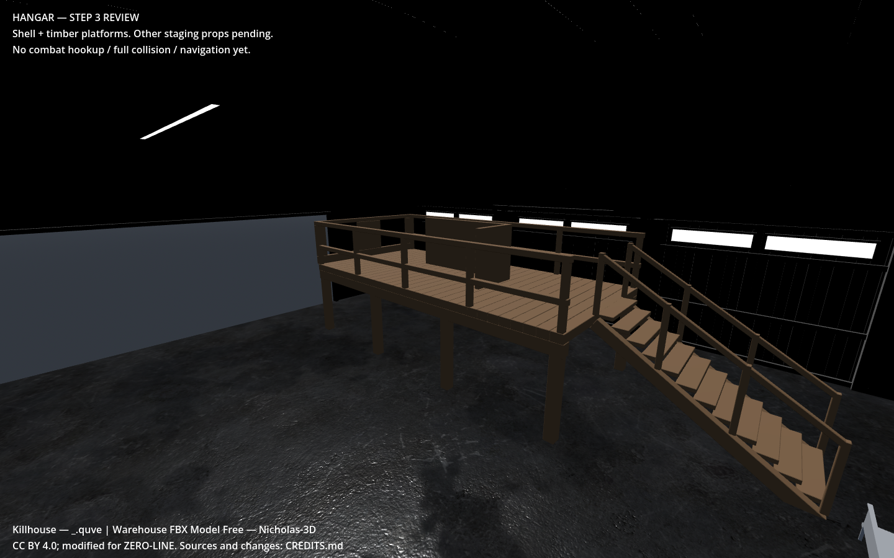
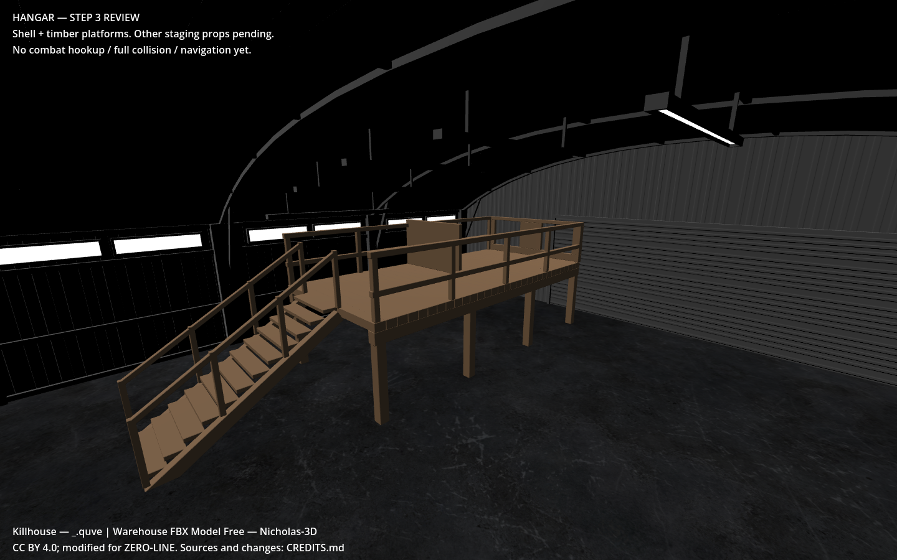
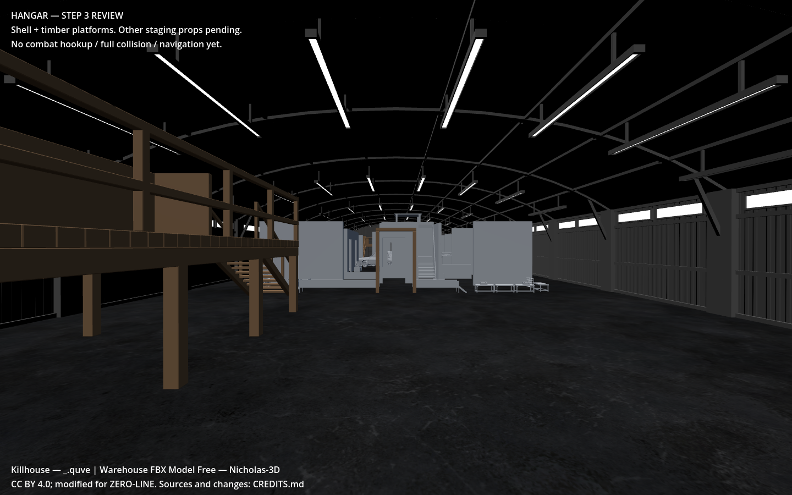
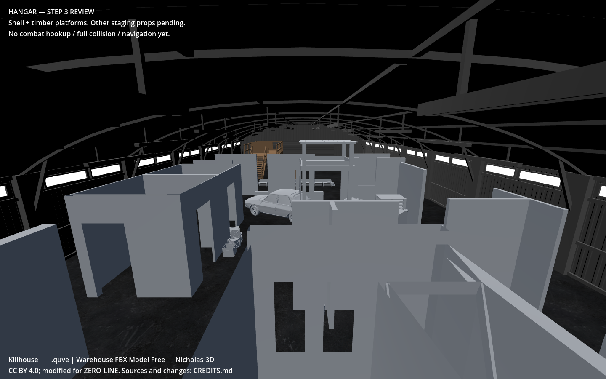
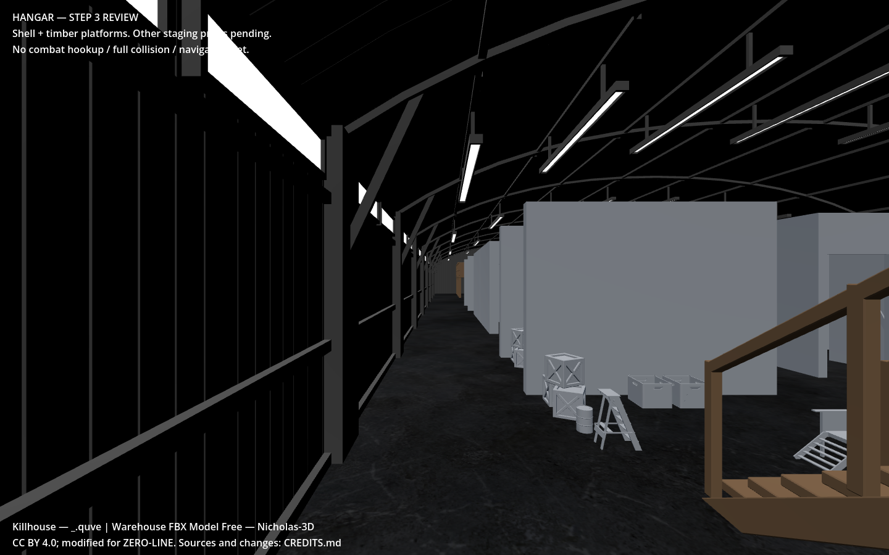
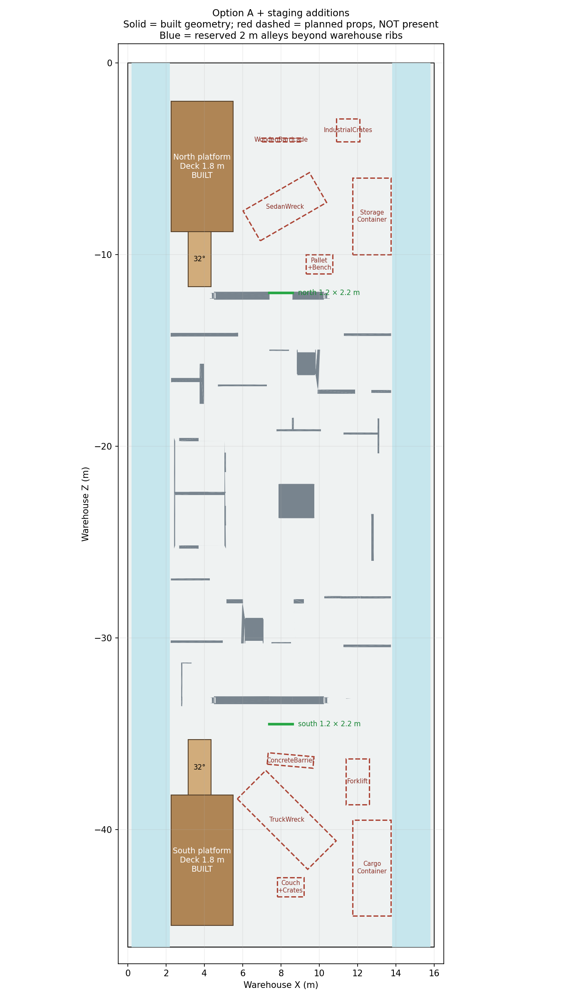

# Step 3 — Option A shell and staging platforms

The user approved Option A and supplied a staging schematic. The new scene is **`scenes/maps/zero_line_hangar.tscn`**. Open it in Godot 4.6.3 and press F6 for the fixed-camera review. The current combat map is unchanged. This scene does not yet have full collision, navigation, spawn relocation or combat hookup.

## Built

- Approved centered S=2.91 layout at (8, 0, -23.075006), including proposed tower lowering and pallet restacking. Original files remain untouched.
- Imported warehouse with its original textures/UVs and double-sided materials. Removed its closed entrance panel (4 source polygons); kept the surrounding frame, walls and roof. No replacement exterior was built from primitives.
- Removed the killhouse’s duplicate floor and three exterior sheets. Trimmed subfloor mesh geometry to Y=0 and removed coplanar/degenerate remnants found by the exported-mesh check.
- Opened box-room ceilings to the warehouse roof. Retained their walls and partitions, plus the central tower platforms. This preserves vertical sightlines and avoids enclosed rooms with a second roof. An initial preview revealed remaining ceiling undersides; these were removed before final capture.
- Two **1.2 × 2.2 m** egress openings at (8,0,-12) and (8,0,-34.5). Source geometry within each opening’s 1.6 m-deep clearance prism was cut. Timber frames have matching StaticBody3D/BoxShape3D colliders; no new enclosing walls were introduced.
- Two timber platforms with plank decks, eight support posts each, longitudinal beams, 12 stair treads, stringers, stair handrails, 1.1 m guardrails, two window slits each, and the requested L-shaped/straight deck cover. These are new authored structural meshes with plain timber-colored material, not finished textured assets.
- Source credits in CREDITS.md, GLB metadata, asset provenance and the review scene overlay.







These are actual Godot 4.6.3 Compatibility viewport captures, inspected after export/import. The host uses **Mesa llvmpipe software rendering**: frame times would not represent target PC performance. Dark warehouse metal, plain killhouse surfaces and plain timber are explicitly pending the materials/light step. Screenshots do not certify physics or navigation.

## Changes needed to fit the schematic

The new sketch is retained verbatim in `user_staging_brief.txt`. Exact built/planned coordinates and status are in [hangar_staging_layout.json](../../data/maps/hangar_staging_layout.json).

| Item | Requested | Implemented / planned correction | Reason |
|---|---|---|---|
| Warehouse rear | Z=-47 | Keep original floor end -46.150013 | Supplied shell measurement |
| Core anchor/bounds | Anchor -23.50; approximate 11.2 × 22.5 m | Approved A anchor -23.075006, 11.504178 × 22.632147 m | Preserve approved measured plan |
| Platform width | X=2–5.5 | X=2.25–5.5 | Keep ≥2 m past 0.2 m warehouse ribs |
| Deck height | 2.5 m | **1.8 m** | Lowest sampled Metal/Emissive overhead is 3.732232 m; 2.5 m deck gives only 1.232232 m standing clearance |
| North deck | Z=-9 to -2 | Z=-8.8 to -2 | Keep stair foot outside core |
| South deck | Z=-45 to -38 | Z=-45 to -38.2 | Stair fit and landing |
| North stairs | 2.5 m rise over 1.5 m at 32° | 1.8 m rise over **2.880602 m**, foot Z=-11.680602 | Original endpoints imply **59.04°**, not 32° |
| South stairs | 2.5 m rise over 2 m at 32° | 1.8 m rise over **2.880602 m**, foot Z=-35.319398 | Original endpoints imply **51.34°** |
| Observation slits | On stair landing end | Two 1 × 0.8 m slits on the opposite short end | Keep 1.2 m stair entrance open; revised width cannot fit both slits plus piers beside it |
| North container | X=12.5–14.5 | Planned X=11.75–13.75 | Reserve side alley |
| South container | X=13–15 | Planned X=11.75–13.75 | Reserve side alley |
| North sedan | (5.5,0,-7.5), 4.5 m | Planned (8.2,0,-7.5), supplied 4 m car | Avoid platform supports and preserve source prop sizing |
| South truck | (6,0,-39.5) | Planned (8.3,0,-39.5) | Avoid platform footprint |
| Concrete barrier | Z=-37 | Planned Z=-36.4 | Separate it from rotated truck envelope |
| Pallet/bench | (8,0,-8.5) | Planned (10,0,-10.5) | Separate from sedan footprint |
| Couch/crates | Z=-42.5 | Planned Z=-43 | Leave space beyond truck |

Both decks were probed at **9,042 points each**, approximately 5 cm spacing, against source Metal **and Emissive** triangles. The 1.72 m player capsule has **0.212232 m minimum sampled head gap** on the north deck and **0.212237 m** on the south. This is a geometric sample, not a swept capsule or a guarantee between samples. Full stair/crouch/mantle tests remain Step 6.

## Staging additions still pending



Solid geometry is built; **red dashed items are planned and absent**, not completed art. Existing killhouse props remain in the core. The new staging barricade, crates, containers and vehicle duplicate have not been populated in this step. The supplied car and pallets can be reused; barriers/containers need authored geometry/materials. A suitable **forklift, truck, couch and bench** model is not present in the supplied map assets. The van-like source box has not been verified as a usable truck model and is not mislabeled as one. These require asset acquisition or separate modeling work.

The requested additional nav bake follows final collision/layout in Step 6. No decorative prop will alter weapon, movement, scoring, enemy or pickup rules.

## Geometry verification

Export/reimport: **747,354 triangles across 37 meshes**, including **728,520 killhouse triangles**. This exceeds the ≤120k killhouse target; Step 5 decimation is still required. No draw-call or target-hardware frame-time pass is claimed. See `geometry_validation.json`, `metrics.json` and `build_report.json` for evidence.

| Check | Result |
|---|---|
| North egress: sampled width 1.18 m, Y=0.03–2.17 m | 0 / 805 blocked rays |
| South egress: sampled width 1.18 m, Y=0.03–2.17 m | 0 / 805 blocked rays |
| Warehouse entry: sampled width 7.68 m, Y=0.03–2.77 m | 0 / 805 blocked rays |
| Killhouse vertices below Y=-0.00001 m | None |
| Killhouse triangles entirely within 1 mm of floor | None |
| Full navigation / capsule sweeps | Not performed |

The opening rays test **all exported meshes**, including the new frames and platforms. They do not substitute for tests against generated colliders. Deliberate 2.048 m side alleys and open ends remain open; no extra gap-closing walls were added. Every interior wall is not yet visually certified from both sides: the five review views cover entry, platforms, core and one alley; the room-by-room walkthrough belongs to Step 7.

## Acceptance checklist

- [x] Approved supplied meshes combined in a new Godot review scene.
- [x] Duplicate shell/floor removed; below-floor and coplanar remnants checked after reimport.
- [x] Main warehouse entry opened; both egress routes cleared and frames have colliders.
- [x] Box rooms open to warehouse roof; no additional closing walls.
- [x] Two platforms built with corrected headroom, stair slope, rail/slit placement.
- [x] Godot import and real viewport captures; API checks logged against 4.6.3.
- [x] Addition statuses and coordinate deviations documented.
- [ ] Every interior face inspected, final textures/light, other staging assets, triangle optimization.
- [ ] Full collision/nav/movement validation, enemy scale shots and playable hookup.

## Five likely failure points and tests

1. **Stairs snag the player:** generate a ramp collider behind the visual treads, preserve 1.2 m clear width, then test standing/crouched ascent and descent with the real capsule.
2. **Platform overhead fixture contact:** sweep the standing capsule across both decks and landings, including jump/mantle destinations; the sampled 0.212 m head gap is not jump clearance.
3. **Cuts leave visible wall-edge holes:** inspect the egress cut edges at eye height after materials. Frames cover the intended arch edge; no global watertight-mesh claim is made for these originally open surface assets.
4. **Staging props encroach on routes:** validate each final rotated mesh and collider against platform supports, egress prisms and the two reserved alleys before spawning it.
5. **Optimization breaks doors or platforms:** repeat exported geometry checks and silhouette/camera captures after decimation; no performance target is claimed at this stage.

## Reproduce

Use `prepare_hangar_step3.py` with Step 0 intake, Step 2 report/coordinates and a scratch output directory. Use Blender 5 Python to run `build_hangar_step3.py` with the original glTF, warehouse GLB, prepared arrays, staging layout, output GLB and report path. `audit_hangar_export.py` takes exported GLB, output NPZ and JSON; `check_hangar_step3.py` takes those arrays/rows and a validation output path. `draw_hangar_staging.py` draws the built/planned layout.

```
godot --headless --editor --path . --import
godot --path . res://scenes/maps/zero_line_hangar.tscn
godot --path . --script tools/maps/capture_hangar_step3.gd
```

The capture script needs a graphics display. Original asset hashes and derivative hash are in `assets/maps/hangar/provenance.json`. No frozen ragdoll or gameplay files were edited.
